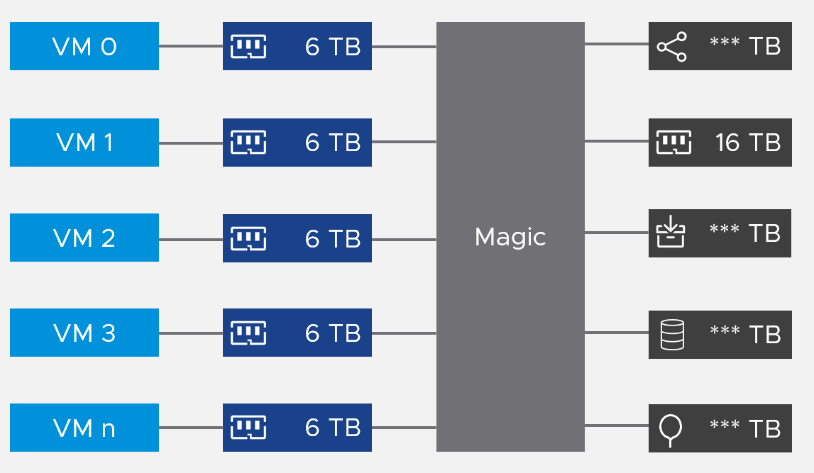
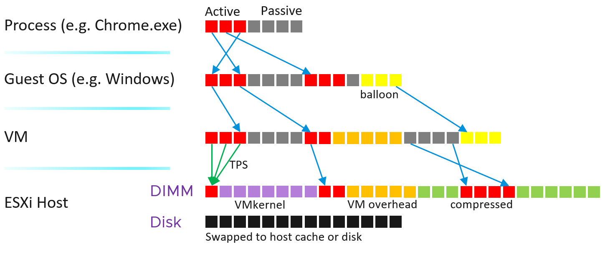
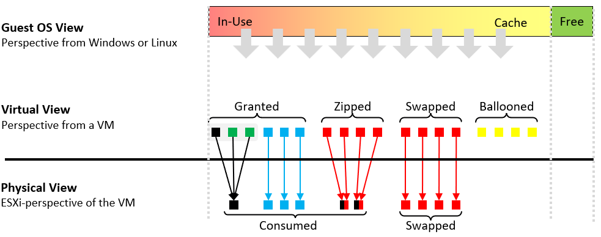

# Memory layers and page mapping

## Four layers
- Process → Guest OS → VM → ESXi. Virtualization adds the VM and ESXi layers. CPU has 3 layers; memory has 4.
- A container has no memory management of its own. It shares the host OS kernel, which allocates, tracks and limits its memory.
- Only the last layer (ESXi) manages physical memory. So the term "Guest physical memory" is illogical. Use VM pages and ESXi pages.
- Each layer has its own address space and its own vantage point.
- Metrics from different layers are not comparable. Example: Granted (VM view) vs Consumed (ESXi view).

## Virtual memory inside the guest
- Windows and Linux give each process a contiguous virtual address space.
- Benefits: simpler memory management; isolation between processes (some security).
- Isolation strength: process < container < VM.
- Virtual memory allows overcommit: a guest with 16 GB of RAM can give processes more through the page file.
- A process cannot see what backs a page: RAM or page file. It experiences slowness without a counter that explains it.
- Some applications manage their own memory and hide it from the OS. Examples: databases, Java VM. SQL Server uses SQLOS for memory and buffer management.

## Virtual memory at the VM layer
- Each VM sees a contiguous address space, isolated from other VMs.
- The ESXi pages behind it need not be contiguous.
- A VM cannot see what backs its pages: DIMM, swap file, copy-on-write (shared), compressed, or ballooned. This makes overcommit possible.


## Two sets of metrics
| Set | Tracks | Instances | Examples |
|---|---|---|---|
| VM memory | VM pages | Per VM, and summed over running VMs at ESXi level | Granted, Shared |
| ESXi memory | ESXi pages | Per VM, and at ESXi level including the kernel's own memory and VM overhead | Consumed, Shared Common |

- Do not confuse the sum of VM metrics at ESXi level with ESXi memory metrics.

## ESXi memory management
| Mechanism | Facts |
|---|---|
| Transparent Page Sharing (TPS) | Runs even when ESXi has plenty of RAM. Not a sign of unmet demand. Scope (intra-VM vs inter-VM): see `vsphere/memory/concepts/page-sharing`. |
| Memory tiering | Transparent to the VM. ESXi moves inactive pages to NVMe. |
| Balloon | The first sign of memory pressure, not of unmet demand. Proactive: starts before ESXi fails to meet demand. Reduces guest cache. |
| Compress / swap | Proactive. Means ESXi Consumed is very high, not that VMs contend for RAM. Consumed can hold a lot of cache. Host cache is used first if present. |

- ESXi uses 4 levels: TPS, memory tiering, balloon, compress/swap.
- Memory management is a gradient across the 4 levels. Pressure and unmet demand are not a clean switch.
- Demand is unmet only when Contention occurs.
- The kernel large page setting contributes more to ESXi capacity and VM performance than these mechanisms.

## Page mapping across layers

- The VM monitor of each VM maps VM pages to ESXi pages.
- Not 1:1:
  - several VM pages can point to one ESXi page (TPS).
  - a VM page can have no ESXi page (ballooned, swapped).
- So VM pages and ESXi pages for the same VM differ. Hence two sets of metrics.
- Ballooned pages do not map to the physical layer.
- Physical memory is shared by VMs and the hypervisor's own processes (VMkernel, VM overhead). Manage them as one: sum them for total consumption.
- The physical layer can include host cache and tiered memory, not only DIMM.
- With memory tiering: be on guard when the active memory metric crosses 50%. NVMe latency should be low.
- A page may map to a non-local DIMM: NUMA effect.

## VM view vs ESXi view of one VM

- The VM view counts the input. The ESXi view counts the output.
- Example: 3 VM pages shared into 1 ESXi page. VM metrics report 3 shared pages; ESXi metrics report 1.
- Ballooned pages exist only in the VM view. They point to no ESXi page.

## Traps
- "Compare Granted with Consumed" → different layers and contexts.
- "TPS means memory pressure" → TPS runs regardless of pressure.
- "Balloon or swap means VMs are contending" → both are proactive. Check Contention.
- "Sum of VM metrics at host level = ESXi metric" → ESXi metrics include the kernel and VM overhead.

## Metadata
```yaml
id: vsphere/memory/concepts/memory-layers
retriever_guide: how-it-works
scope: vsphere
technology:
- memory
pillar:
- performance
- capacity
product:
- vsphere
object:
- VirtualMachine
- HostSystem
internal_derive:
- vsphere/foundations/provider-consumer
related:
- vsphere/memory/concepts/page-sharing
- vsphere/memory/concepts/overcommit-techniques
- vsphere/memory/concepts/memory-tiering
- vsphere/memory/concepts/large-memory-pages
- vsphere/memory/concepts/guest-os-vs-vm-memory
- vsphere/memory/metrics/virtual-motherboard/ballooned
- vsphere/memory/metrics/virtual-motherboard/consumed
- vsphere/memory/metrics/host/consumed
images:
  - path: ../images/vm-memory-address-space-vs-esxi-backing-pages.png
    product: [vsphere]
    object: [VirtualMachine, HostSystem]
    topic: 'Memory page mapping'
    image_type: diagram
  - path: ../images/memory-page-mapping-process-guest-os-vm-esxi.png
    product: [vsphere]
    object: [VirtualMachine, HostSystem]
    topic: 'Memory page mapping'
    image_type: diagram
  - path: ../images/vm-memory-vm-view-vs-esxi-view-of-pages.png
    product: [vsphere]
    object: [VirtualMachine, HostSystem]
    metric: ['VM Memory Granted', 'ESXi Memory Consumed']
    topic: 'Memory page mapping'
    image_type: diagram
source:
  document: PART 3 - Counters.docx
  path: Memory > Architecture > The 4 Layers; Virtual Memory; Relationship
corrections: []
review_notes:
- "Section 'ESXi memory management': author (2026-11-03), Q012: 4 levels. Book corrected."
- "Section 'ESXi memory management': author (2026-11-03), Q013: balloon is the first sign of memory pressure, not unmet demand; a grey area because of the 4-level gradient."
- 'Section ''Page mapping across layers'': diagram modified by the author from a Valentin Bondzio diagram.'
- 'Section ''ESXi memory management'': the book cites VMware vSphere 6.5 Host Resources Deep Dive (Denneman, Hagoort), chapter 11, p. 243, for the overcommit backing types. Third-party excerpt not copied.'
- 'Section ''ESXi memory management'': TPS KB from the book: https://knowledge.broadcom.com/external/article/323624/additional-transparent-page-sharing-mana.html (not read).'
- 'Section ''Virtual memory inside the guest'': SQLOS source from the book: https://blogs.vmware.com/apps/2020/11/monitoring-and-rightsizing-memory-resource-for-virtualized-sql-server-workloads.html'
status: draft
```
