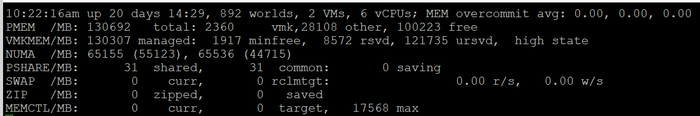

# esxtop memory counters

## Summary lines (host)

| Line | Meaning |
|---|---|
| MEM overcommit avg | 1, 5, 15-minute exponentially weighted averages. Ratio of total requested memory to managed memory, minus 1. Requested = VM configured memory (or limit) + user world memory + reserved overhead. Above 0 (ratio above 1): requested exceeds physical; fine with ballooning and sharing. The book prefers configured VM memory alone for capacity. |
| PMEM | Physical memory. Total (from BIOS) = vmk + other + free. vmk: kernel code, data, heap, management. Other: VMs and non-VM user worlds. |
| VMKMEM | Managed (slightly below total; allocatable to VMs, user worlds, kernel), minfree (kept free for critical use; inside Free), reserved (group reservations + overhead reservations + minfree), unreserved (available for reservation), state (keep High). |
| NUMA | Per node: total and free. Sum is slightly below total. Cluster-on-Die doubles the nodes. |
| PSHARE | shared (VM memory shared), common (machine memory common across worlds), saving (machine memory saved). |
| SWAP | Sum of VM swapped. rclmtgt: target MB to swap. |
| ZIP | Sum of VM zipped. |
| MEMCTL | Sum of VM ballooned. |

## Balloon
| Counter | Meaning |
|---|---|
| MCTL? | Y: a VM (kernel processes are not ballooned). |
| MCTLSZ (MB) | Current balloon size. Above 0: the host is reclaiming memory. |
| MCTLTGT (MB) | Balloon target. Not 0: the VM can be ballooned. |
| MCTLMAX (MB) | Maximum reclaimable by ballooning. Depends on the Guest OS. |
- First warning level. Not contention. Starts only at about 99% host use, which is high when HA is enabled.

## Compression and swap
| Counter | Meaning |
|---|---|
| CACHESZ, CACHEUSD (MB) | Compression cache size and used. |
| ZIP/s (MB/s) | Compression rate. A capacity problem: the host is short of RAM. Unused pages zipped cause no contention. Keep at 0. |
| UNZIP/s (MB/s) | Decompression rate. A performance problem: the VM is waiting; VM memory contention is above 0. |
| SWCUR (MB) | Current swapped; usually inactive pages. |
| SWTGT (MB) | Expected swap size (estimate). |
| SWR/s, SWW/s (MB) | Swap read (back to memory) and swap write (to disk). |
| LLSWR/s, LLSWW/s (MB) | Same for host cache (LL = low latency). Attributed to the VMM group only, not shown per VM. LLSWW/s includes writes from DIMM and from disk. |

## NUMA
| Counter | Meaning |
|---|---|
| NHN | NUMA home node(s). Expect a single node. 0/1 or 2 means split across nodes. With CPU Hot Add, NUMA is off: multiple home nodes, memory interleaved. |
| NMIG | NUMA migrations, cumulative until power cycle. Costly: pages are remapped and local memory restarts at 0%. |
| NRMEM (MB) | Remote memory. Ideally 0 or tiny. Larger than one socket's RAM raises the chance. |
| N%L | Local memory %. Below 100% is not ideal. |
| GST_NDx (MB) | Guest memory on node x. |
| OVD_NDx (MB) | VMM overhead memory on node x. |

## Consumption
| Counter | Meaning |
|---|---|
| MEMSZ (MB) | Memory allocated to the VM. MEMSZ = GRANT + MCTLSZ + SWCUR + never touched. Where compressed pages go is unclear. |
| GRANT (MB) | Granted. Not Consumed. |
| CNSM | Consumed. |
| SZTGT (MB) | Machine memory the kernel aims to allocate. |
| TCHD (MB) | Touched: working set estimate. |
| TCHD_W | Touched by writes. Far below TCHD: mostly reads. |
| OVHD, OVHDMAX, OVHDUW (MB) | Current, maximum and user-world overhead. Negligible on modern hosts. |
| ZERO, SHRD, SHRDSVD, COWH (MB) | Zero pages, shared, saved by sharing (not in vSphere Client), copy-on-write hint. |
| %ACTV, %ACTVS, %ACTVF, %ACTVN | Active; slow average (longer, more accurate); fast average; predicted next fast value (internal). |
| MCMTTGT, CMTTGT, CMTCHRG, CMTPPS | Commit counters. Internal; not in vSphere Client or VCF Operations. |

## Allocation
| Counter | Meaning |
|---|---|
| AMIN | Reservation. 0 for most VMs. Leave kernel modules as they are. |
| AMAX | Limit. -1 = unlimited. |
| AMLMT | Limit; expect -1. Difference from AMAX unclear. |
| ASHRS | Shares. |
| AUNITS | Units. |

## Checkpoint
| Counter | Meaning |
|---|---|
| CPTRD (MB) | Data read from the checkpoint file (snapshot, suspend). Large values can slow the VM. |
| CPTTGT (MB) | Checkpoint target size. |

## Traps
- "ZIP/s means VMs wait" → UNZIP/s does.
- "NMIG is current" → cumulative since power-on.

## Metadata
```yaml
id: vsphere/memory/metrics/comparisons/esxtop-memory
retriever_guide: metric-meaning
scope: vsphere
technology:
- memory
pillar:
- performance
- capacity
product:
- vsphere
object:
- HostSystem
- VirtualMachine
metric_class: contention
internal_derive:
- vsphere/memory/concepts/memory-layers
- vsphere/memory/concepts/swap-and-compression
same_name: []
same_meaning: []
related:
- vsphere/system/concepts/esxtop
- vsphere/memory/concepts/host-memory-states
- vsphere/cpu/concepts/numa
source:
  document: PART 3 - Counters.docx
  path: Provider Objects > esxtop > Memory
corrections: []
review_notes:
- 'Section ''Summary lines'': overcommit formula source cited by the book: https://communities.vmware.com/t5/Storage-Performance/Interpreting-esxtop-4-1-Statistics/ta-p/2786881 (esxtop 4.1 era).'
status: draft
```
