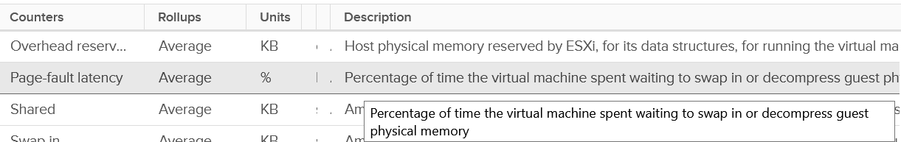
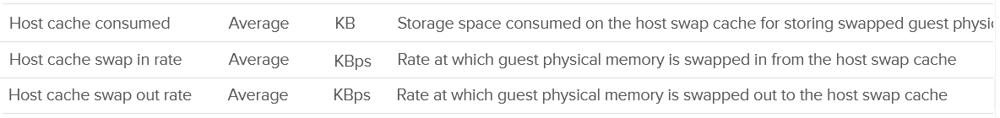
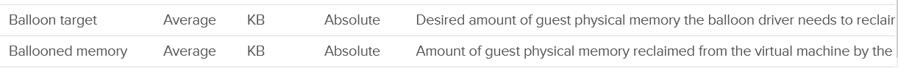
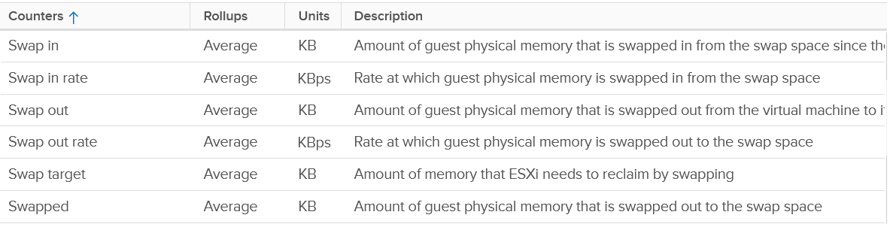
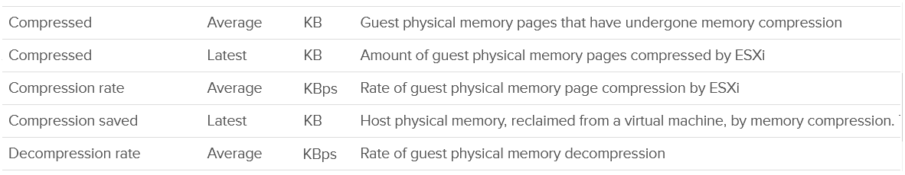
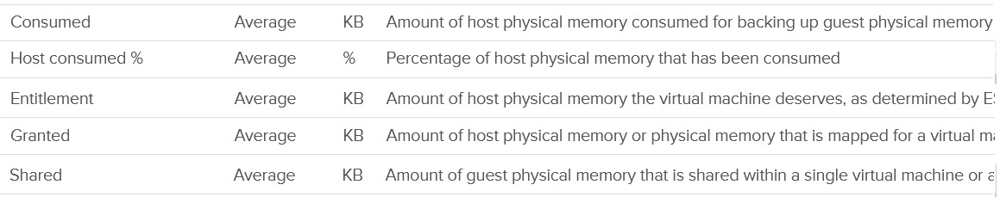
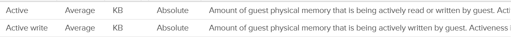
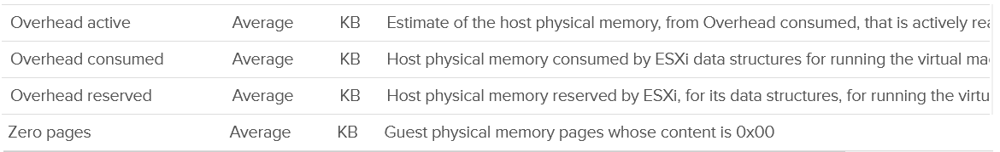
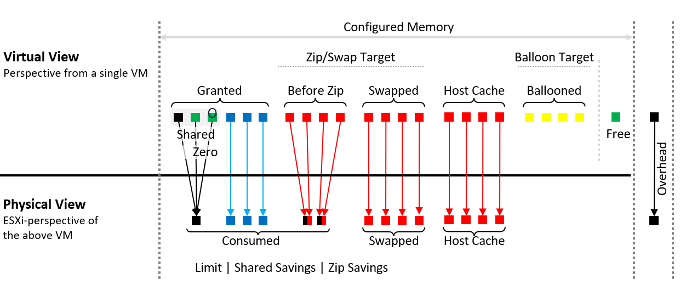

# VM memory metrics compared

## Use cases
- At VM level, performance is essentially the only use case.
- Capacity: use Guest OS metrics. VM capacity metrics feed host capacity and the VM's memory footprint (for example, for migration).
- Some metrics exist for kernel memory management, not for operations.

## Performance checks, in order
1. Page-fault latency (Latency): the only counter that tracks actual performance.

2. Swap: 6 metrics (Swap in, Swap in rate, Swap out, Swap out rate, Swap target, Swapped). Slower than compression.
3. Compression: Compressed, Compression rate, Compression saved, Decompression rate.
4. Host cache: Host cache consumed, swap in rate, swap out rate. Faster than disk if built on fast SSD.

5. Balloon: Balloon target, Ballooned memory.

- Intel Optane memory has no metric: it is meant to be transparent to ESXi.



## Contention
- Only Latency is true contention. VCF Operations VM Memory Contention is the vCenter Latency counter.

## Consumption set
- Consumed (main), Granted, Entitlement, Shared, Host consumed %. Plus Active, Active write, Overhead, Zero pages.
- Reservation and allocation are properties.




## Virtual view vs physical view

| Item | View | Meaning |
|---|---|---|
| Configured | VM | What the Guest OS sees. The guest cannot see overhead. |
| Granted | VM | Mapped pages, minus ballooned, swapped, compressed, host cache. |
| Shared | VM | Pages pointing to the same ESXi page. Many are zero pages. |
| Compressed | VM and ESXi | Output of compression. Mutually exclusive with Swapped. |
| Swapped | VM and ESXi | Pages in the swap file. |
| Ballooned | VM | Reclaimed by the balloon driver and not requested back. The bigger it is, the higher the chance a page is needed later. |
| Free | VM | Never touched since power-on. Drops toward 0 as the guest pages in and out. |
| Overhead | ESXi | Virtualization data structures. Negligible. |
| Entitlement | ESXi | Granted + Overhead. |
| Consumed | ESXi | Granted - sharing savings, capped by limit. |
- Targets: Zip/Swap Target covers pages before zip and swapped. Balloon Target covers ballooned pages.

## Demand
- vCenter has no memory Demand counter. CPU has one.
- Demand = met demand (used) + unmet demand.
- Broad view: VM-level unmet demand = Ballooned + Swapped + Compressed.
- Strict view: only contention is unmet demand. Ballooned, swapped and compressed memory is not; swap-in and decompression are.
- Problem with the strict view: host metrics cannot separate contention caused by limits. VM-level metrics must exclude it.

## Traps
- "Use VM metrics to size the Guest OS" → use Guest OS metrics.
- "Ballooned, Swapped, Compressed are performance counters" → they measure space. Latency measures the wait.

## Metadata
```yaml
id: vsphere/memory/metrics/comparisons/vm-memory-metrics
retriever_guide: metric-meaning
scope: vsphere
technology:
- memory
pillar:
- performance
- capacity
product:
- vsphere
- vcf-operations
object:
- VirtualMachine
metric_class: consumption
internal_derive:
- vsphere/memory/concepts/memory-layers
same_name: []
same_meaning: []
related:
- vsphere/memory/metrics/virtual-motherboard/latency
- vsphere/memory/metrics/virtual-motherboard/consumed
- vsphere/memory/metrics/virtual-motherboard/granted
- vsphere/memory/metrics/virtual-motherboard/shared
- vsphere/memory/metrics/virtual-motherboard/active
- vsphere/memory/metrics/virtual-motherboard/ballooned
- vsphere/memory/metrics/virtual-motherboard/swapped
- vsphere/memory/metrics/virtual-motherboard/compressed
- vsphere/memory/metrics/virtual-motherboard/entitlement
- vsphere/memory/metrics/virtual-motherboard/overhead
- vsphere/memory/metrics/virtual-motherboard/usage
images:
  - path: ../../images/vcenter-vm-memory-page-fault-latency-counter-table.png
    product: [vsphere]
    object: [VirtualMachine]
    metric: ['VM Memory Latency']
    image_type: table
  - path: ../../images/vcenter-vm-memory-host-cache-counters-table.png
    product: [vsphere]
    object: [VirtualMachine]
    metric: ['VM Memory Host Cache Consumed', 'VM Memory Host Cache Swap In Rate', 'VM Memory Host Cache Swap Out Rate']
    image_type: table
  - path: ../../images/vcenter-vm-memory-balloon-counters-table.png
    product: [vsphere]
    object: [VirtualMachine]
    metric: ['VM Memory Balloon Target', 'VM Memory Ballooned']
    image_type: table
  - path: ../../images/vcenter-vm-memory-swap-counters-table.png
    product: [vsphere]
    object: [VirtualMachine]
    metric: ['VM Memory Swap In', 'VM Memory Swap Out', 'VM Memory Swap Target', 'VM Memory Swapped']
    image_type: table
  - path: ../../images/vcenter-vm-memory-compression-counters-table.png
    product: [vsphere]
    object: [VirtualMachine]
    metric: ['VM Memory Compressed', 'VM Memory Compression Rate', 'VM Memory Decompression Rate']
    image_type: table
  - path: ../../images/vcenter-vm-memory-consumption-counters-table.png
    product: [vsphere]
    object: [VirtualMachine]
    metric: ['VM Memory Consumed', 'VM Memory Granted', 'VM Memory Entitlement', 'VM Memory Shared']
    image_type: table
  - path: ../../images/vcenter-vm-memory-active-counters-table.png
    product: [vsphere]
    object: [VirtualMachine]
    metric: ['VM Memory Active', 'VM Memory Active Write']
    image_type: table
  - path: ../../images/vcenter-vm-memory-overhead-and-zero-counters-table.png
    product: [vsphere]
    object: [VirtualMachine]
    metric: ['VM Memory Overhead', 'VM Memory Zero Pages']
    image_type: table
  - path: ../../images/vm-memory-virtual-view-vs-physical-view.png
    product: [vsphere]
    object: [VirtualMachine]
    topic: 'VM memory views'
    image_type: diagram
source:
  document: PART 3 - Counters.docx
  path: Memory > VM > Overview; Contention Metrics; Consumption Metrics; Demand
corrections: []
review_notes: []
status: draft
```
