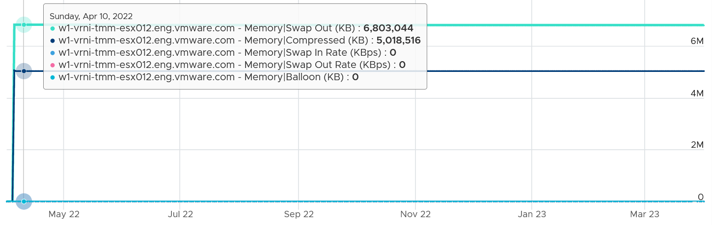

# ESXi Memory Compressed

## Meaning
- Two host counters: the amount subjected to compression, and the resulting compressed amount.
- The book takes Compressed to be the result.
- Pages can stay compressed for a long time when nothing requests them. Example: about 5 GB compressed for about 1 year, with balloon at 0 (no current pressure).


## Traps
- "Compressed > 0 means current pressure" → it can be years old. Check balloon and swap-in.

## Metadata
```yaml
id: vsphere/memory/metrics/host/compressed
retriever_guide: metric-meaning
scope: vsphere
technology:
- memory
pillar:
- capacity
product:
- vsphere
object:
- HostSystem
metric_class: context
internal_derive: []
same_name: []
same_meaning: []
related:
- vsphere/memory/metrics/host/swap-used
- vsphere/memory/metrics/virtual-machine/compressed
- vsphere/memory/concepts/swap-and-compression
source:
  document: PART 3 - Counters.docx
  path: Memory > ESXi > Overview; Swap + Compress
corrections: []
review_notes:
- 'Section ''Meaning'': the book is unsure whether Compressed is the input or the result.'
status: draft
```
