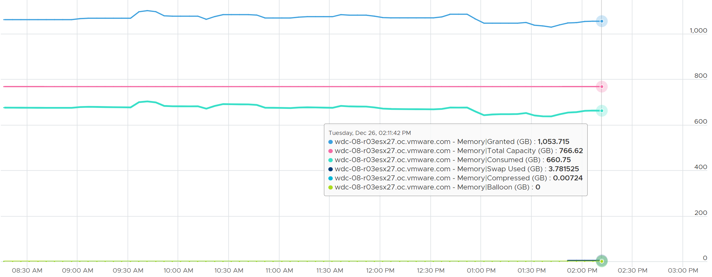

# ESXi Memory Granted

## Meaning
- Consumer-level counter: sum of granted memory of the running VMs, plus non-VM user worlds.
- Excludes kernel space: privileged processes get memory without the granting process.
- Consumed includes both user and kernel space.

## Behaviour
- Can exceed total capacity. Example: 1,053 GB granted on a 755 GB host.
- Consumed + Swapped + Compressed stays below total capacity.
- Not 0 on a host with no running VMs. The book's guess: non-VM user worlds.


## Traps
- "Granted above capacity is impossible" → it is the VMs' view.

## Metadata
```yaml
id: vsphere/memory/metrics/host/granted
retriever_guide: metric-meaning
scope: vsphere
technology:
- memory
pillar:
- capacity
product:
- vsphere
object:
- HostSystem
metric_class: consumption
internal_derive: []
same_name:
- vsphere/memory/metrics/virtual-machine/granted
same_meaning: []
related:
- vsphere/memory/metrics/host/consumed
- vsphere/memory/metrics/virtual-machine/granted
source:
  document: PART 3 - Counters.docx
  path: Memory > ESXi > Consumption Metrics > Granted
corrections: []
review_notes: []
status: draft
```
