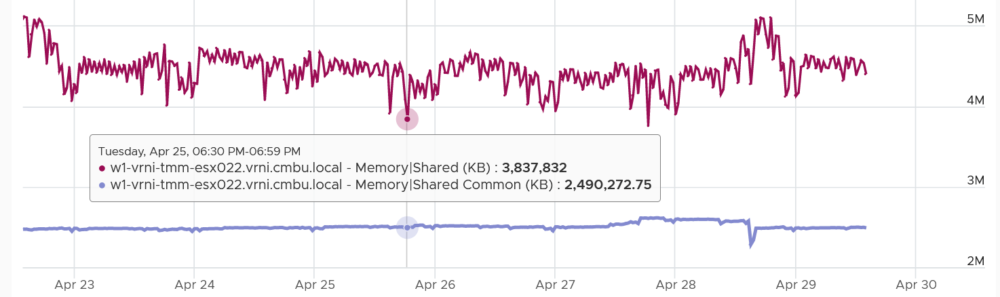

# ESXi Memory Shared and Shared Common

## Meaning
| Counter | Meaning |
|---|---|
| Shared | Sum of VM and kernel pages pointing to a shared page. 3 VMs with 2 MB identical memory each: 6 MB. |
| Shared Common | Sum of the shared pages themselves. |

## Formula
```text
Host memory savings from sharing = Shared - Shared Common
```
- Shared Common should be at most half of Shared: sharing means at least 2 pages point to one page.
- Far below half: large savings.

## Behaviour
- Shared Common exceeded half of Shared many times in one example. Unexplained. The book's guess: large pages broken into 4 KB pages.
- With hardware-assisted memory virtualization, ESXi backs VM memory with large pages, which rarely share. Under high consumption, large pages are broken into 4 KB pages, which can share.
- Use Shared Common over time as a leading indicator of large pages being broken up. Compare with the host's own history.
- With TPS limited to within a VM by default, shared values should be much smaller. Salting allows sharing only when salt and content match.


## Traps
- "Shared = savings" → savings = Shared - Shared Common.

## Metadata
```yaml
id: vsphere/memory/metrics/host/shared
retriever_guide: metric-meaning
scope: vsphere
technology:
- memory
pillar:
- capacity
product:
- vsphere
object:
- HostSystem
metric_class: consumption
internal_derive:
- vsphere/memory/concepts/page-sharing
same_name: []
same_meaning: []
related:
- vsphere/memory/metrics/virtual-machine/shared
- vsphere/memory/concepts/large-memory-pages
images:
  - path: ../../images/esxi-memory-shared-common-above-half-of-shared.png
    product: [vsphere]
    object: [HostSystem]
    metric: ['ESXi Memory Shared', 'ESXi Memory Shared Common']
    image_type: timeline
source:
  document: PART 3 - Counters.docx
  path: Memory > ESXi > Consumption Metrics > Shared
corrections: []
review_notes:
- 'Section ''Behaviour'': the reason Shared Common exceeds half of Shared is the book''s guess (large pages). Author to confirm.'
status: draft
```
