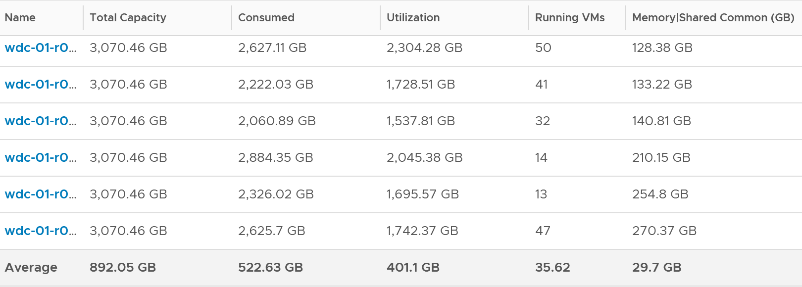

# ESXi Memory Utilization (VCF Operations)

## Formula
```text
Utilization = sum of running VM Utilization + kernel reservation
```
- Analysis section form: Utilization = Machine Demand + ESX System Usage. Machine Demand = sum of VM Utilization.
- Equals ESX System Usage on a host with no running VMs.

## Why
- Consumed is too conservative: mostly cache.
- Active is too aggressive: not designed for sizing.
- Utilization sits between them.
- Uses the kernel reservation, not actual kernel use: not exact, but gives a buffer.

## Observed values
- 192 hosts, 6,840 VMs: Utilization was 122 GB lower than Consumed on average. Including Shared Common, the gap is 152 GB.


## Traps
- "Utilization = Consumed" → it removes cache and inactive pages via guest metrics.

## Metadata
```yaml
id: vsphere/memory/metrics/host/utilization
retriever_guide: metric-meaning
scope: vsphere
technology:
- memory
pillar:
- capacity
product:
- vcf-operations
object:
- HostSystem
metric_class: consumption
internal_derive: []
same_name: []
same_meaning: []
related:
- vsphere/memory/metrics/host/consumed
- vsphere/memory/metrics/virtual-motherboard/utilization
- vsphere/memory/metrics/comparisons/host-memory-metrics
images:
  - path: ../../images/esxi-memory-utilization-vs-consumed-across-hosts.png
    product: [vcf-operations]
    object: [HostSystem]
    metric: ['ESXi Memory Utilization', 'ESXi Memory Consumed']
    image_type: table
    sample: '192 hosts'
source:
  document: PART 3 - Counters.docx
  path: Memory > ESXi > Consumption Metrics > Utilization; Analysis
corrections: []
review_notes:
- 'Section ''Formula'': the Utilization section uses kernel reservation; the Analysis section uses ESX System Usage. Open question in project/author-questions.md.'
status: draft
```
