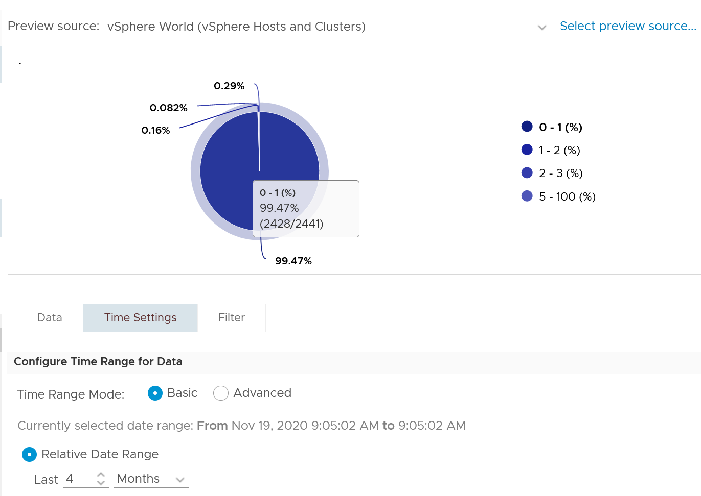

# VM Memory Latency

## Meaning
- Indicates a performance problem. A primary counter for how well the VM is served.
- Contrast: CPU Latency does not always indicate a performance problem. See `vsphere/cpu/metrics/virtual-machine/latency`.

## Unit
- Memory Architecture section: percentage of memory space that takes longer than expected to read.
- Memory VM section and vCenter description: percentage of time the VM waits to swap in or decompress pages.
- Not latency in nanoseconds.
- The only ESXi counter for memory speed.
- Disk is the opposite: disk latency is time, not share of space.

## Mechanism
- Also called page-fault latency. esxtop: %LAT_M.
- Time a vCPU waits for a page fault to complete. Mostly swap wait, plus some decompression and copy-on-write break.
- The only memory performance counter. Other memory metrics measure space held, which is capacity, not speed.
- Highly correlated with swap-in rate.
- Superset of CPU Swap Wait: CPU Swap Wait covers swap-in only; Latency also covers decompression.
- VCF Operations VM Memory Contention maps to this counter.
- Excludes balloon: a different context, and the hypervisor cannot see guest activity.
- A page outside DIMM (host cache, swapped, compressed) takes longer to deliver.
- DIMM access takes about 200 ns. Memory latency is more than 1,000x lower than disk latency.
- Windows and Linux do not track memory latency. The closest guest counter is page fault.
- When it rises, Compressed and Swapped fall and Consumed and Granted rise: pages come back.

## Observed values
- Without memory overcommit and limits, memory contention is basically 0.
- 2,441 VMs, worst value per VM over 4 months: only 13 VMs above 1%.


## Traps
- "Memory Latency 5% means 5 ns" → it is a percentage, not a time.

## Metadata
```yaml
id: vsphere/memory/metrics/virtual-machine/latency
retriever_guide: metric-meaning
scope: vsphere
technology:
- memory
pillar:
- performance
product:
- vsphere
object:
- VirtualMachine
metric_class: contention
internal_derive:
- vsphere/foundations/visibility-layers
same_name:
- vsphere/cpu/metrics/virtual-machine/latency
- vsphere/storage/metrics/virtual-machine/disk-latency
same_meaning: []
related:
- vsphere/memory/concepts/memory-as-storage
- vsphere/memory/concepts/swap-and-compression
- vsphere/memory/metrics/virtual-machine/swap-in-rate
- vsphere/memory/diagnosis/vm-memory-latency-high
- vsphere/cpu/metrics/virtual-machine/swap-wait
images:
  - path: ../../images/vm-memory-contention-worst-value-distribution-across-vms.png
    product: [vcf-operations]
    object: [VirtualMachine]
    metric: ['VM Memory Contention']
    image_type: distribution
    sample: '2,441 VMs'
source:
  document: PART 3 - Counters.docx
  path: The World of Metrics > Metrics Nuances > Complexity > Naming Complexity; Memory > Architecture; Memory > VM > Contention Metrics > Latency; Best Practice
corrections: []
review_notes:
- 'Section ''Unit'': from Memory > Architecture.'
- 'Sections Mechanism, Observed values: from Memory > VM.'
- 'Section ''Unit'': the Architecture section defines the counter as a share of memory space; the VM section and vCenter define it as a share of time. Open question in docs/author-questions.md.'
status: draft
```
