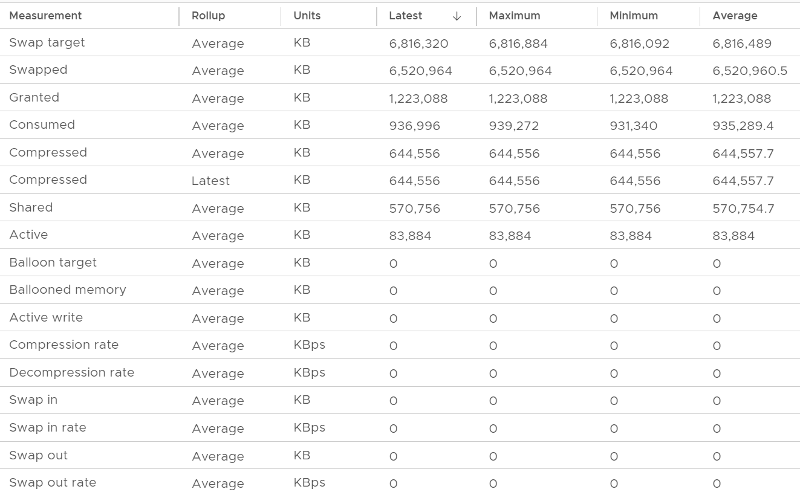

# VM Memory Swap Target

## Meaning
- Amount of memory ESXi aims to reclaim from the VM by compression and swapping.
- Input, not result. ESXi need not reach it if it does not have to.
- Read it as compress-swap target.

## Example
- Swap Target about 6.8 million KB, changing every 20 seconds.
- Swapped constant for the hour (max = min). No limit, no resource pool: likely historical.
- Granted constant: the VM did not request more.
- Consumed fluctuated slightly. Consumed and Swap Target mirror each other: when Consumed rises, Swap Target falls.


## Traps
- "Swap Target = Swapped" → the target is an input; Swapped is the result.

## Metadata
```yaml
id: vsphere/memory/metrics/virtual-machine/swap-target
retriever_guide: metric-meaning
scope: vsphere
technology:
- memory
pillar:
- performance
- capacity
product:
- vsphere
object:
- VirtualMachine
metric_class: context
internal_derive:
- vsphere/memory/concepts/swap-and-compression
same_name: []
same_meaning: []
related:
- vsphere/memory/metrics/virtual-machine/swapped
- vsphere/memory/metrics/virtual-machine/compressed
- vsphere/memory/metrics/virtual-machine/consumed
source:
  document: PART 3 - Counters.docx
  path: Memory > VM > Swap + Compress > Transition; Quiz!
corrections: []
review_notes: []
status: draft
```
