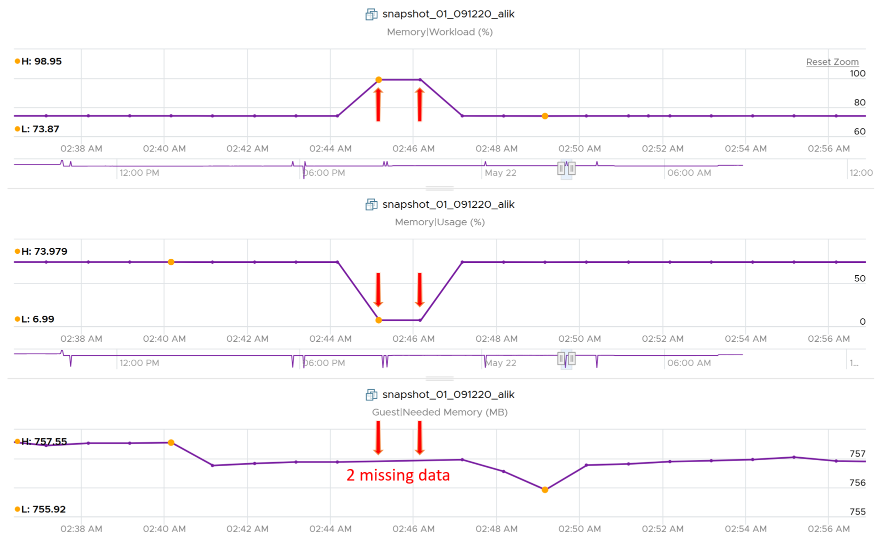

# VM Memory Usage

## Meaning
- Maps to Active: what the VM is physically using. Related to performance.
- VCF Operations uses Guest OS data for VM memory Usage. It falls back to Active when Guest OS data is not available.

## Why it differs from ESXi and cluster Usage
- Two-level memory hierarchy in virtualization.
- ESXi and cluster Usage map to Consumed, which is related to capacity.

## By tool
- vCenter UI Usage (%) = Active.
- VCF Operations Usage (%) = Guest OS Needed Memory (KB) / VM Memory Total Capacity (KB) × 100.
- Example: 1 GB VM, Guest OS Needed Memory 757 MB: 757 / 1,024 = 74%.
- Guest OS metrics missing: VCF Operations Usage (%) falls back to Active (example: dropped to 6.99%). Workload (%) falls back to Consumed (example: jumped to 98.95%).


## Traps
- Comparing VM Usage with ESXi Usage as if they measure the same thing. This confusion has led customers to buy more RAM than required.

## Metadata
```yaml
id: vsphere/memory/metrics/virtual-machine/usage
retriever_guide: metric-meaning
scope: vsphere
technology:
- memory
pillar:
- performance
- capacity
product:
- vsphere
object:
- VirtualMachine
metric_class: consumption
internal_derive:
- foundations/resource-nature
same_name:
- vsphere/memory/metrics/host/usage
- vsphere/memory/metrics/cluster/usage
same_meaning: []
related:
- vsphere/memory/metrics/virtual-machine/consumed
- vsphere/memory/metrics/virtual-machine/utilization
- vsphere/memory/metrics/virtual-machine/active
source:
  document: PART 3 - Counters.docx
  path: The World of Metrics > Metrics Nuances > Complexity > Naming Complexity; Memory > VM > Consumption Metrics > Usage (%)
corrections: []
review_notes:
- 'Sections By tool: from Memory > VM.'
status: draft
```
