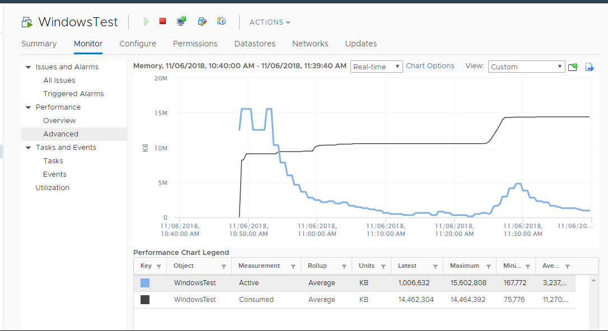

# VM Memory Active

## Meaning
- Estimate of VM memory read or written recently. ESXi calls it Touch; vCenter calls it Active.
- An internal counter of kernel memory management. The book sees no operational use case.
- VCF Operations name: Memory | Non Zero Active (KB). Active Write counts writes only.

## Mechanism
- Active is really a rate (pages touched per time), reported as space (KB).
- A page can be read and written many times. 100 reads + 100 writes can touch far fewer than 200 pages.
- Recent must be defined. The book proposes 1 second, like IOPS.
- Sampling: if ESXi samples every 2 seconds, vCenter has 10 samples per 20-second period. Samples can hit the same or different pages. Example: 100 MB then 150 MB active gives 150-250 MB for 4 seconds.
- Each sample is independent and averaged with earlier samples. Active becomes more accurate over time. esxtop has a longer-term Active; vSphere Client does not.
- Ballooned memory is excluded (inactive). Active is unaware of locked pages and large pages.
- VCF Operations averages 15 vCenter samples into 300 seconds. The same page is counted many times, so Active over-reports.
- Differs from the Guest OS working set estimate: different algorithms, plus ballooning and host swapping.

## Active vs Consumed
- Different calculation, different purpose. Not just aggressive vs conservative versions of the same thing.
- Neither suits Guest OS sizing. Little correlation with Guest OS memory use.
- Active is lower than Consumed and Guest OS Used: those two measure space held, including inactive pages.
- Active can fall while Consumed rises.
- Active is sampled. It can stay constant when it should not, and can stay at 100% for hours (see `vsphere/memory/concepts/guest-os-vs-vm-memory`).


## Traps
- "Active = VM memory utilization" → it is a sampled estimate for the kernel.
- "Active over-reports, so it is always higher than Consumed" → it is usually far lower.

## Metadata
```yaml
id: vsphere/memory/metrics/virtual-motherboard/active
retriever_guide: metric-meaning
scope: vsphere
technology:
- memory
pillar:
- performance
- capacity
product:
- vsphere
- vcf-operations
object:
- VirtualMachine
layer:
- virtual-motherboard
metric_class: consumption
internal_derive:
- vsphere/memory/concepts/guest-os-vs-vm-memory
same_name: []
same_meaning: []
related:
- vsphere/memory/metrics/virtual-motherboard/consumed
- vsphere/memory/metrics/virtual-motherboard/usage
images:
  - path: ../../images/vm-memory-active-falls-while-consumed-rises.png
    product: [vsphere]
    object: [VirtualMachine]
    metric: ['VM Memory Active', 'VM Memory Consumed']
    image_type: timeline
source:
  document: PART 3 - Counters.docx
  path: Memory > VM > Consumption Metrics > Active; Consumed vs Active
corrections: []
review_notes:
- 'Section ''Mechanism'': the 2-second sampling is the book''s assumption.'
- 'Reference from the book: https://blogs.vmware.com/vsphere/2013/10/understanding-vsphere-active-memory.html (not read).'
status: draft
```
