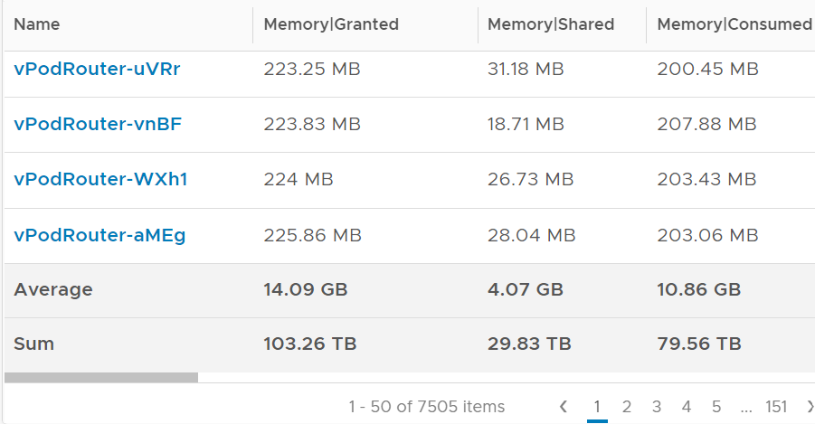

# VM Memory Shared

## Meaning
- Amount of VM memory subjected to sharing. Not the savings.
- VM view: counts the input. 3 VM pages shared into 1 ESXi page count as 3.

## Two types
| Type | Facts |
|---|---|
| Intra-VM | Within one VM. Pages are 4 KB, or 2 MB with guest large pages. 4 KB pages are far more likely to share. |
| Inter-VM | Between VMs. Disabled by default for security. |

- Accounting: a page shared between VMs counts in full for each VM. Summing VMs inflates the ESXi-level value.
- Example: VM 001 has 100 MB shared within itself and 10 MB shared with other VMs. Shared = 110 MB.

## Savings
- Per group of pages pointing to the same ESXi page: 10 pages → 9 pages saved.
- Compression is not counted as savings: it costs performance.
- Observation across 7,505 VMs: Granted 103.26 TB, Shared 29.83 TB, Consumed 79.56 TB. The book computes Granted - Consumed = 23.7 TB, then savings = 29.83 - 23.7 = 6.13 TB, about 6%.


## Traps
- "Shared = memory saved" → it is the amount subjected to sharing.
- "Sum VM Shared for host savings" → inter-VM shared pages count once per VM.

## Metadata
```yaml
id: vsphere/memory/metrics/virtual-motherboard/shared
retriever_guide: metric-meaning
scope: vsphere
technology:
- memory
pillar:
- performance
- capacity
product:
- vsphere
object:
- VirtualMachine
layer:
- virtual-motherboard
metric_class: consumption
internal_derive:
- vsphere/memory/concepts/page-sharing
same_name: []
same_meaning: []
related:
- vsphere/memory/metrics/virtual-motherboard/zero-pages
- vsphere/memory/metrics/virtual-motherboard/granted
- vsphere/memory/metrics/virtual-motherboard/consumed
images:
  - path: ../../images/vm-memory-granted-shared-consumed-across-vms.png
    product: [vsphere]
    object: [VirtualMachine]
    metric: ['VM Memory Granted', 'VM Memory Shared', 'VM Memory Consumed']
    image_type: table
    sample: '7,505 VMs'
source:
  document: PART 3 - Counters.docx
  path: Memory > VM > Consumption Metrics > Shared; Savings
corrections: []
review_notes:
- 'Section ''Savings'': the book''s calculation (savings = Shared - (Granted - Consumed)) conflicts with its formula Consumed = Granted - Savings, which gives savings = 23.7 TB. Open question in docs/author-questions.md.'
status: draft
```
