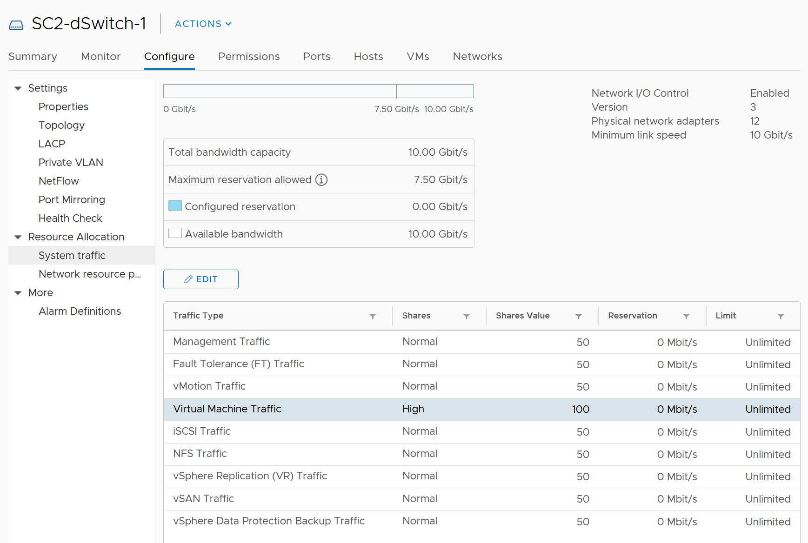

# Network vs compute and storage

## Differences
| Attribute | Compute or storage | Network |
|---|---|---|
| Nature | A node | An interconnect |
| Hardware | Single purpose | Multi-purpose |
| Location | Few places | Many places |
| Upper limit | Yes | No fixed limit per workload |
| Net resource available to VMs | Relatively high | Low |
| Resource allocation per VM | Granular | Coarse |
| Monitoring | Simpler | Harder |
| Workload types | 1 | Many (unicast, multicast, broadcast) |
| Primary unit | Byte | Bit |

## Interconnect
- A CPU, RAM or array problem usually stays local. A local network problem can become data-center-wide.
- Network connects users and servers to the Internet: multiple entry points, HA, preferably 2 ISPs.
- Many paths and routes: test connectivity from specific points.

## Hardware
- Besides switch, router and gateway, there are services such as firewall and load balancer, in hardware or software. Monitor all.
- Duplex: full duplex is 100% in each direction. A 25 Gb port handles 25 Gb transmit + 25 Gb receive.
- Blade and HCI form factors blur server and network.
- Network devices (switches, wireless access points, SD-WAN edges) sit in many locations, even employee homes.

## No fixed upper limit
- Physical capacity is shared, so each workload has a dynamic limit.
- The VM Network port group gets more bandwidth when no vMotion runs. Each VM shares the port group with other VMs.
- The limit differs per host and changes over time.
- The ESXi uplink is often not the smallest pipe: firewalls, load balancers, routers, WAN and Internet sit on the path. Each VM has its own practical limit.

## Net available resource
- What the IaaS platform uses is overhead. More ESXi kernel, NSX, vSAN and vSphere Replication traffic leaves less for business VMs.
- Compute overhead is low: around 10% even with vSAN.
- Network overhead is high: mass vMotion, Storage vMotion and cloning on IP storage, vSAN. Non-VM traffic can take most of the bandwidth.
- Example: VM traffic has 100 of 500 NIOC shares: overhead can reach 80%.


## Coarse allocation
- vNIC speed cannot be set. It takes the speed of the vmnic behind the port group: 1, 10 or 25 GbE (with the right vNIC driver).
- 500 Mbps or 250 Mbps cannot be allocated in the guest.
- Physical bandwidth is shared and typically oversubscribed.
- A network-intensive VM can exceed 1 Gbps each way. Example: a Hadoop worker receiving more than 5 Gbps several times.
- NIOC and traffic shaping exist, but are not VM configuration properties.

## Contention metrics
| Metric | In vSphere |
|---|---|
| Latency | No |
| Dropped packets | Yes |
| Retransmitted packets (TCP retransmits drops) | No |
| Jitter (variation of latency) | No |
- Applications can tolerate poor latency better than variable latency.
- NIOC has no metric that shows it capped bandwidth (unlike Storage I/O Control). Check logs.
- Consumption: throughput and packets per second (PPS). PPS is less used, but high PPS at low latency costs a lot of CPU, as in NSX Edge VMs.

## Workload types
- Most traffic should be unicast. Broadcast and multicast have purposes; monitor whether they happen at the wrong time on the wrong network.
- Basic services (DNS, NTP) need availability monitoring.
- Partner with network experts.

## Traps
- "Each VM can use the full uplink speed" → the uplink is shared, dynamic and often oversubscribed.
- "No NIOC metric, so NIOC never capped" → no such metric exists.

## Metadata
```yaml
id: vsphere/network/concepts/network-characteristics
retriever_guide: how-it-works
scope: vsphere
technology:
- network
pillar:
- performance
- capacity
- availability
product:
- vsphere
object:
- VirtualMachine
- HostSystem
- VmwareDistributedVirtualSwitch
internal_derive: []
related:
- vsphere/network/concepts/netioc
- vsphere/network/concepts/network-observability
source:
  document: PART 3 - Counters.docx
  path: Network > Architecture > Unique Characteristics
corrections: []
review_notes:
- 'Section ''Contention metrics'': the book states there is no NIOC cap counter in vCenter 7. Not checked for vCenter 9.1.'
- 'Section ''Interconnect'': example outage read from the book: https://blog.ipspace.net/2019/05/real-life-data-center-meltdown.html (third-party).'
status: draft
```
