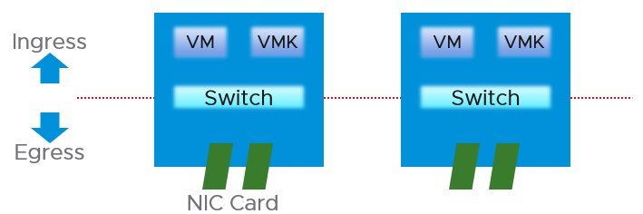
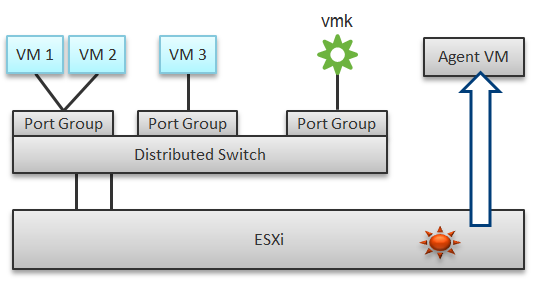
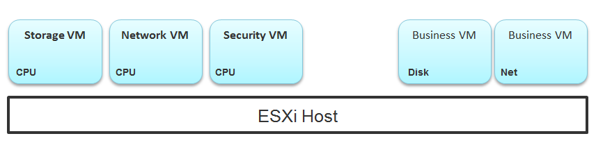
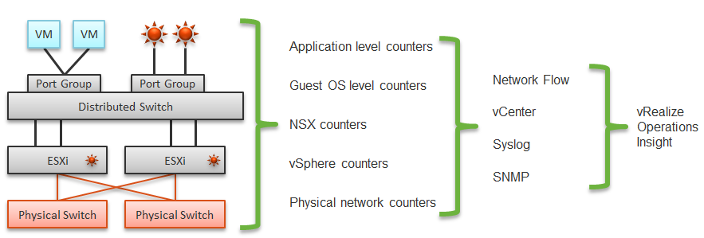
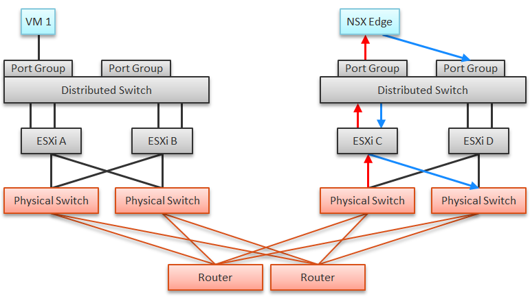
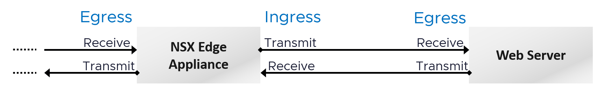

# Network layers and observability

## Two layers

| Layer | Facts |
|---|---|
| Virtual | vNICs and software switches. The top-of-rack switch now lives inside each ESXi host. |
| Virtual | Port groups are VM or kernel (vMotion, vSAN). They do not mix, for security. |
| Virtual | VM-to-VM traffic on the same host never reaches the physical network. vmnic metrics do not see it. |
| Virtual | No fixed limit while traffic stays in the host. Watch packets per second, not only throughput. |
| Physical | Physical NICs are vmnics. No per-VM or per-kernel-interface breakdown. |

## Four areas to monitor in one host

1. VM network.
2. Kernel network.
3. ESXi kernel modules: NSX Distributed Logical Router and Distributed Firewall route and filter traffic inside the host.
4. Agent VMs.

- Port group monitoring complements VM and host monitoring.
- A distributed switch carries VM and kernel traffic over shared uplinks.
- A distributed port group's data is the aggregate of all hosts using it.
- Tools unaware of in-host traffic miss VM-to-VM flows.

## Agent VMs
- One per host. No HA: usually on local datastore.
- Examples: storage service (for example Nutanix CVM), network service, security (for example Trend Micro Deep Security).
- A slow security agent VM in the data path looks like a network or storage problem to business VMs. The interception happens in the hypervisor, not on the network.


## Five data sources
- Application, Guest OS, NSX, NetFlow/sFlow/IPFIX from vDS and physical devices, and vSphere.
- VDI: application-level data is required. Example: Horizon Blast saw packet loss while Windows saw no drops; packets arrived out of order and were unusable to the protocol.
- Packet analysis: header analysis (light, broad visibility) or full packet analysis (deep, heavy).


## NSX Edge
- A VM's network problem can come from another VM on another host. Example: VM 1 reaches the outside through an NSX Edge VM on another cluster. An Edge CPU problem or its host's RAM problem slows VM 1's network.


## Guest OS vs VM
| Type | Guest OS metric | VM equivalent |
|---|---|---|
| Contention | Dropped packets | None. VM dropped packets are a different level. |
| Contention | Latency | None. vSphere has no network latency metric. |
| Utilization | Throughput, packets per second | Should match VM metrics. If not, packets are dropped. Report by traffic type (unicast, multicast, broadcast). |

## Direction terms
- Ingress and egress: relative to an environment. Moving further inside is ingress.
- Receive (RX) and transmit (TX): relative to one port. A port has both.
- On a distributed switch, the ESXi physical NIC is the uplink. The ESXi host is not a hop.


## Traffic type metrics
- VCF Operations has unicast, multicast and broadcast metrics at VM, ESXi, distributed port group and distributed switch level (also vSphere Pods, which are VMs).
- No aggregation at higher levels: use super metrics.
- To see which objects have a metric: open a VCF Operations policy and search the metric name.

## Packet size
- Typically 1,600 bytes with NSX, or 9,000 bytes with jumbo frames.
- Special packets (for example ping) are smaller and should be a small share.
- Track packet sizes against expectation.

## Traps
- "vmnic traffic = sum of VM traffic" → in-host VM-to-VM traffic and kernel traffic break that.
- "Distributed port group metrics are per host" → aggregated over all hosts.
- "Guest OS sees no drops, so the network is fine" → application protocols can still lose packets.

## Metadata
```yaml
id: vsphere/network/concepts/network-observability
retriever_guide: how-it-works
scope: vsphere
technology:
- network
pillar:
- performance
- capacity
product:
- vsphere
- nsx
- vcf-operations
object:
- VirtualMachine
- HostSystem
- VmwareDistributedVirtualSwitch
- DistributedVirtualPortgroup
internal_derive: []
related:
- vsphere/network/concepts/network-characteristics
- vsphere/network/concepts/netioc
- vsphere/network/concepts/passthrough-and-offload
source:
  document: PART 3 - Counters.docx
  path: Network > Architecture > Architecture intro; Network Observability
corrections: []
review_notes:
- 'Section ''Direction terms'': the book says a VM has no ingress traffic. Open question in docs/author-questions.md.'
status: draft
```
