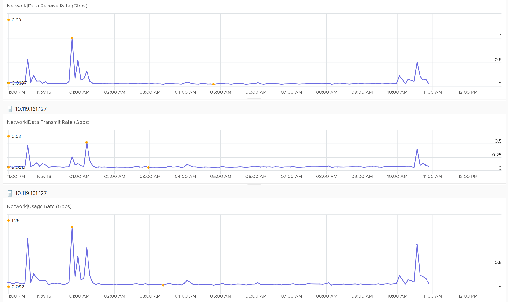

# ESXi Network Throughput and Packets

## Scope
- vSphere Client shows physical NICs only, not virtual network traffic.
- Metrics exist per vmnic and per host. Host ≈ sum of vmnics; small variance.
- vCenter and VCF Operations have no metrics for standard switches and their port groups. Look at each parent host; a dashboard can cycle through hosts.

## Counters
- Bits per second: receive, transmit, usage rate. Duplicate metrics exist; the reason is unclear.
- Usage rate = receive + transmit. With full duplex it can exceed the physical link speed.
- Packets per second: receive, transmit.
- List all vmnics in a table to find which one to plot.


## Packet size
```text
Average packet size = bits per second / packets per second
```
- A large change across the environment is worth investigating.

## Unusual packets
- Broadcast and multicast counters exist. Hosts and VMs should have minimal broadcast and multicast.

## Traps
- "Usage rate above link speed is impossible" → it adds both directions.

## Metadata
```yaml
id: vsphere/network/metrics/host/throughput
retriever_guide: metric-meaning
scope: vsphere
technology:
- network
pillar:
- performance
- capacity
product:
- vsphere
object:
- HostSystem
metric_class: consumption
internal_derive: []
same_name:
- vsphere/network/metrics/virtual-machine/throughput
same_meaning: []
related:
- vsphere/network/metrics/virtual-machine/throughput
- vsphere/network/metrics/host/packets-dropped
source:
  document: PART 3 - Counters.docx
  path: Network > ESXi > ESXi intro; Consumption Metrics; Unusual Packets
corrections: []
review_notes:
- 'Section ''Packet size'': the book says to divide packets per second by bits per second. Written as bits per second / packets per second, which gives size.'
status: draft
```
