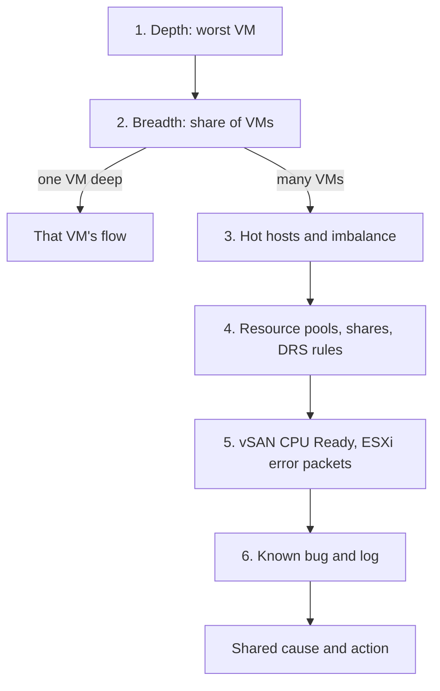

# VMs in a cluster face contention

## Symptom
- Cluster Performance (%) is yellow or worse, or several VMs of one cluster are slow in the same window ([`vsphere/object-types/vm/troubleshooting/vm-slow`](../vm/troubleshooting/vm-slow.md), step 3).
- The cluster KPI quantifies the problem; this flow finds which VMs and which shared cause.

## Flow


## Checks, in order
1. Depth (VirtualMachine). The depth rows of Cluster Performance (%): worst VM peak vCPU Ready, Co-stop, memory wait and disk latency, each against its `kpi` row in `catalog/thresholds-performance` (group Depth, cluster-performance as `kb`) ([`vsphere/object-types/cluster/cluster-performance`](cluster-performance.md)). Note which rows are not green and which VM is the worst. → step 2.
2. Breadth (ClusterComputeResource). The 90th percentile rows of Cluster Performance (%) against their `kpi` rows (group Breadth). A depth row not green with the breadth rows green: under 10% of the VMs → that VM's flow ([`vsphere/object-types/vm/troubleshooting/vm-slow`](../vm/troubleshooting/vm-slow.md), step 4); if they share one host → step 3. A breadth row not green: many VMs wait, a host or cluster cause → step 3.
3. Consumption (HostSystem). Imbalance among hosts ([`vsphere/technology/cpu/metrics/cluster/inter-host-imbalance`](../../technology/cpu/metrics/cluster/inter-host-imbalance.md)). Cluster utilization is rarely high (HA and buffer), so look for hot hosts: the hottest host and monster VMs are in Cluster Risk (%) ([`vsphere/object-types/cluster/models/cluster-risk`](models/cluster-risk.md)). → step 4.
4. Configuration (ClusterComputeResource, ResourcePool). VMs that are siblings of a resource pool; unbalanced shares; DRS settings, VM-host or VM-VM affinity; inconsistent host configuration, such as storage or network not on all hosts ([`vsphere/object-types/cluster/configuration/cluster-configuration-review`](configuration/cluster-configuration-review.md)). → step 5.
5. Kernel and network (HostSystem). vSAN CPU Ready; ESXi error packets ([`vsphere/technology/network/metrics/host/errors`](../../technology/network/metrics/host/errors.md)). → step 6.
6. Known bug and log (HostSystem): driver and firmware versions; events in the window ([`vsphere/object-types/vm/troubleshooting/vm-slow`](../vm/troubleshooting/vm-slow.md), its known bug and log checks).

## Order rationale
- Depth and breadth first: they tell a cluster problem from one VM's problem.
- Hot hosts before configuration: cluster totals stay low while one host is full.
- Configuration before kernel and network: resource pools, shares and rules cause contention that load does not explain.

## Interpretation
| Finding | Possible cause | Action |
|---|---|---|
| Many VMs affected | VMs that are siblings of a resource pool make pool VMs suffer | Fix the resource pool hierarchy. |
| Many VMs affected | Unbalanced shares: some VMs with large shares | Review shares. |
| Many VMs affected | High ESXi utilization on some hosts | Check imbalance causes: DRS settings, VM-host or VM-VM affinity, resource pools, inconsistent configuration (storage or network not on all hosts). |
| vSAN CPU Ready | Kernel scheduling | Only changeable through ESXi advanced settings. |
| ESXi error packets | NIC | Check vmnic driver and firmware. |

## Misconceptions
- "Few VMs affected means the cluster is fine" → depth matters: one VM can be badly hit.
- "Cluster utilization is low, so contention cannot come from load" → one hot host is full while the cluster total is low.

## Metadata
```yaml
id: vsphere/object-types/cluster/cluster-vm-contention
retriever_guide: troubleshooting
scope: vsphere
technology:
- cpu
- memory
- storage
- network
- system
pillar:
- performance
product:
- vsphere
- vcf-operations
object:
- ClusterComputeResource
internal_derive:
- vsphere/object-types/cluster/concepts/cluster-utilization-vs-contention
- vsphere/object-types/cluster/cluster-performance
- vsphere/object-types/vm/troubleshooting/vm-slow
- vsphere/technology/cpu/metrics/cluster/inter-host-imbalance
- vsphere/object-types/cluster/models/cluster-risk
- vsphere/object-types/cluster/configuration/cluster-configuration-review
- vsphere/technology/network/metrics/host/errors
related:
- sp5-framework/performance/performance-management
source:
  document: Knowledge base
  path: Provider Objects > Performance > Cluster Performance (%) > Troubleshooting
corrections: []
review_notes: []
status: draft
```
