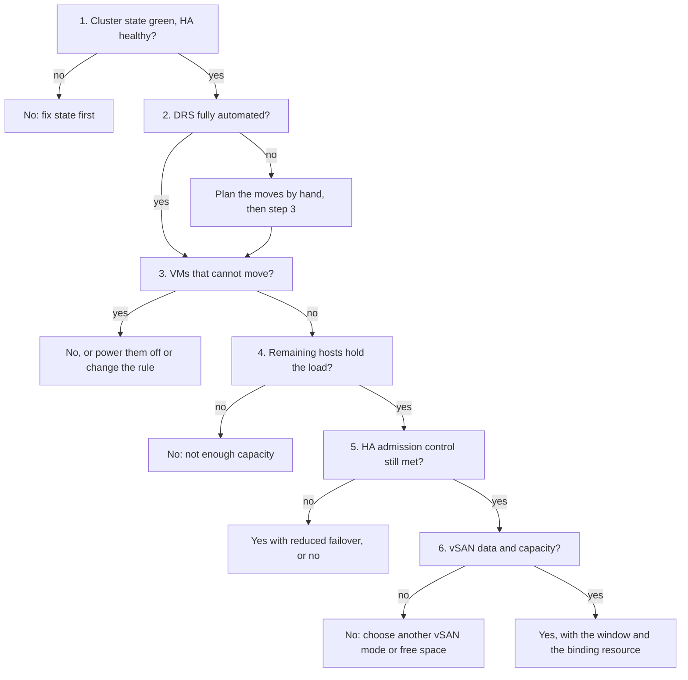

# Can this cluster take a host out?

## Question
- Can one ESXi host leave this vSphere cluster for maintenance, a patch or an upgrade, without its VMs waiting and without losing the failover the cluster is designed for?
- The answer is yes, yes with a stated risk for the window, or no, with the resource or rule that blocks it.
- An operational question, answered by a decision tree; not a health check. Short-term capacity: a host taken out lowers usable capacity, not total capacity ([`sp5-framework/capacity/supply`](../../../../sp5-framework/capacity/supply.md), section Total vs usable after host loss).

## Flow


## Checks, in order
1. Cluster state and HA (ClusterComputeResource). Yellow or red, or HA errors → no: fix the state first ([`vsphere/object-types/cluster/concepts/admission-control-and-cluster-state`](../concepts/admission-control-and-cluster-state.md)). Green → step 2.
2. DRS automation level (ClusterComputeResource). Fully automated: DRS runs the evacuation itself. Partially automated or manual: DRS only shows recommendations, so the moves are applied by hand → step 3 either way.
3. VMs that cannot move (VirtualMachine). Any of:
   - a required VM-Host rule ("must run on"): DRS never violates a required rule, so it does not evacuate those VMs, and the host does not enter maintenance mode;
   - a VM without shared storage or with a device bound to the host (PCI passthrough, a local datastore);
   - a VM larger than the free threads or memory of every remaining host: the cluster has room in total, but in no single host.
   Found → no, or power those VMs off for the window, or change the rule to a preferential "should run on" rule. None → step 4.
4. Remaining capacity (ClusterComputeResource). Spread the load of the cluster over the hosts that remain:
   - CPU: threads in use on all hosts ÷ threads of the remaining hosts. Keep it below the red band of Cluster Consumption (%) CPU thread utilization (`catalog/thresholds-capacity`).
   - Memory: consumed memory of all hosts ÷ DRAM of the remaining hosts. Ballooning starts only near 99% of a host, so a high value is a risk, not slowness; keep the hosts out of the low memory state ([`vsphere/technology/memory/concepts/host-memory-states`](../../../technology/memory/concepts/host-memory-states.md)).
   - Cluster Performance (%) already orange or red → no: one host fewer adds contention ([`vsphere/object-types/cluster/cluster-performance`](../cluster-performance.md)).
   - Fits → step 5. Does not fit → no; move or power off workload first, or wait for a quieter window.
5. HA admission control (ClusterComputeResource). vSphere HA counts only hosts that are connected, not in maintenance mode, and without HA errors. Admission control refuses actions that break its failover constraint, migrations included, so the evacuation can stall. With the cluster resources percentage policy, at least two HA hosts must remain besides the one entering maintenance mode.
   - Still met with one host fewer (a cluster sized N+2, or one with spare capacity) → step 6.
   - Not met → yes with reduced failover for the window: a host failure during it may leave VMs unable to restart. The docs give one way through: deactivate admission control temporarily so vMotion can proceed, and turn it back on after. Or no, if the workload cannot accept that risk.
6. vSAN (ClusterComputeResource, Datastore). Only for a vSAN cluster; otherwise → yes.
   - Ensure accessibility (the default): moves only what keeps every object accessible. The data is not reprotected during the window: objects run below their failures to tolerate. The only option on a three-host or three-fault-domain cluster.
   - Full data migration: moves every component off the host and keeps the policy compliant. The remaining hosts need free capacity for that data and enough hosts for the policy; not possible on a three-host cluster.
   - No data migration: moves nothing; objects with data only on that host become inaccessible if it is powered off.
   - A VM object with data on the host that is not accessible and not fully evacuated blocks maintenance mode.
   - Keep vSAN storage consumption below 80%: above it vSAN rebalances, and it needs room to rebuild components after a host failure or maintenance. The operations reserve and host rebuild reserve manage that room.
   - The Confirm Maintenance Mode dialog shows whether capacity is enough, how much data moves, and how many objects become non-compliant or inaccessible.
   - Enough capacity for the chosen mode → yes. Not enough → no, or another mode with its stated risk.

## Order rationale
- State first: in yellow or red, reservations are not met; any capacity number is built on a broken base.
- Rules and pinned VMs before capacity: a must rule or a passthrough device blocks the evacuation whatever the free capacity.
- Capacity before HA: if the remaining hosts cannot carry the load, failover does not matter.
- HA before vSAN: HA decides whether the window runs with reduced failover; vSAN decides whether the data stays protected.
- vSAN last: it applies only to vSAN clusters, and its capacity check is shown by the dialog itself.

## Interpretation
- No at step 1 → about the current state, not the maintenance.
- No at step 3 → name the VMs and the rule or device that pins them.
- No at step 4 → name the resource (CPU threads, memory) and how far over it would go.
- Yes with reduced failover at step 5 → state the window and the risk; the decision is the owner's.
- Yes → the binding resource, the window, and for vSAN the mode and its risk.
- A cluster that can never take a host out without reduced failover is sized without a maintenance host: plan N+1 for maintenance on top of HA ([`sp5-framework/capacity/supply`](../../../../sp5-framework/capacity/supply.md), section Usable capacity).

## Misconceptions
- "The cluster is at 50%, so any host can go into maintenance" → the remaining hosts carry the whole load: a 4-host cluster at 50% runs its 3 remaining hosts at 67%; and HA, rules and pinned VMs decide too.
- "DRS will move everything" → it never violates a required VM-Host rule, and it cannot move passthrough or local-storage VMs.
- "Maintenance mode lowers total capacity" → it lowers usable capacity; the host stays in total capacity.
- "HA still protects the cluster during maintenance" → HA counts only hosts not in maintenance mode; with one host fewer, failover can fall below the design.
- "Ensure accessibility keeps vSAN data protected" → it keeps objects accessible; they run below their failures to tolerate until the host returns.
- "Full data migration is always the safe choice" → it needs free capacity on the remaining hosts for all the host's data, and is not possible on a three-host cluster.

## Metadata
```yaml
id: vsphere/object-types/cluster/decision-tree/can-cluster-take-a-host-out
retriever_guide: decision-tree
scope: vsphere
technology:
- cpu
- memory
- storage
- system
pillar:
- capacity
- availability
product:
- vsphere
- vsan
- vcf-operations
object:
- ClusterComputeResource
- HostSystem
- VirtualMachine
- Datastore
internal_derive:
- vsphere/object-types/cluster/concepts/admission-control-and-cluster-state
- vsphere/object-types/cluster/models/cluster-consumption
- vsphere/object-types/cluster/cluster-performance
- vsphere/technology/memory/concepts/host-memory-states
- sp5-framework/capacity/supply
related:
- vsphere/object-types/cluster/decision-tree/can-cluster-take-more-vms
- vsphere/object-types/cluster/concepts/drs-overview
- sp5-framework/capacity/capacity-management
source:
  document: vSphere 9.1 documentation (TechDocs, updated 2026-11-09), vSphere HA Admission Control; Cluster Resources Percentage Admission Control; Edit Cluster Settings; Using VM-Host Affinity Rules. VCF 9.1.x documentation (TechDocs), Working with Members of the vSAN Cluster in Maintenance Mode; Place a Member of vSAN Cluster in Maintenance Mode (updated 2026-11-09); Planning Capacity in vSAN (updated 2026-11-05)
  path: https://techdocs.broadcom.com/us/en/vmware-cis/vsphere/vsphere/9-1/vsphere-availability/creating-and-using-vsphere-ha-clusters/vsphere-ha-admission-control.html; .../vsphere-ha-admission-control/cluster-resources-percentage-admission-control.html; .../9-1/vsphere-resource-management/using-drs-clusters-to-manage-resources/using-vm-host-affinity-rules.html; https://techdocs.broadcom.com/us/en/vmware-cis/vcf/vcf-9-0-and-later/9-1/vsan-deployment-administration-and-monitoring/administering-vmware-vsan/expanding-and-managing-a-vsan-cluster/working-with-members-of-vsan-cluster-in-maintenance-mode.html; .../vsan-planning-and-deployment/designing-and-sizing-a-virtual-san-cluster/sizing-a-virtual-san-datastore/planning-capacity-in-virtual-san.html
corrections: []
review_notes:
- 'To check: Step 3: passthrough and local-storage VMs during maintenance mode; no 9.1 page read states it (vSphere 9.1 Virtual Machine Migration pages).'
- 'To check: Step 3: a VM larger than the free capacity of every remaining host is reasoning from placement, not a doc statement.'
- 'To check: Step 4: the projection spreads the measured load over the remaining hosts; the threshold reuses the Cluster Consumption bands (knowledge base), not a vendor number.'
- 'To check: vSAN operations reserve and host rebuild reserve sizes; the 9.1 planning page gives no percentage (VMware vSAN Design Guide, vSAN Sizer).'
status: draft
```
