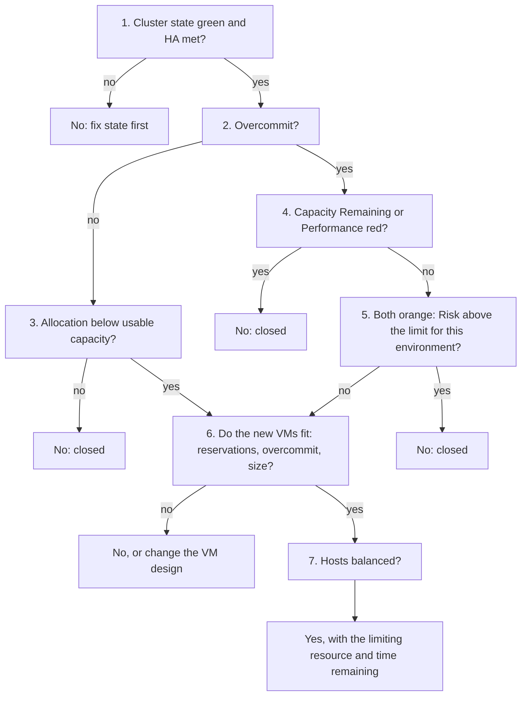

# Can this cluster take more VMs?

## Question
- Can this vSphere cluster take N more VMs, a project, or a VM upsize?
- The answer is yes or no, with the resource that limits it and the reason.
- An operational question, answered by a decision tree; not a health check. The cluster health check reads the result of this tree in its capacity step (`vsphere/object-types/cluster/health-check/cluster-health-check`, step 4).
- A closed cluster accepts no new VM and no VM upsize. Once capacity, performance and risk metrics exist, the decision can be automated: self-driving capacity management.

## Flow



## Checks, in order
1. Cluster state and HA (ClusterComputeResource). Yellow or red, or HA no longer meets its failover capacity → no; fix the state first. Admission control counts reservations, not usage. See `vsphere/object-types/cluster/concepts/admission-control-and-cluster-state`. Green → step 2.
2. Overcommit (ClusterComputeResource). Cluster planned without overcommit (1:1) → step 3. Overcommitted → step 4.
3. Allocation (ClusterComputeResource). Allocation of powered-on VMs, plus the new VMs, against usable capacity (total − HA − hypervisor − buffer; `sp5-framework/capacity/capacity-model`). Allocation reaches usable capacity → no: closed. Below → step 6.
4. Consumption and performance (ClusterComputeResource). Both read at the 95th percentile of the last 24 hours, with the same thresholds for production and non-production. Either one red → no: closed.
   - Cluster Consumption (%) (`vsphere/object-types/cluster/models/cluster-consumption`): red above 80%, orange above 60%.
   - Cluster Performance (%) (`vsphere/object-types/cluster/kpis/cluster-performance`): red below 20%, orange below 40%. This is the cluster KPI; it is not the class-of-service minimum VM Performance (%).
   - The vCommunity management pack automates this step and step 5 with one band set for every cluster: `vsphere/object-types/cluster/models/close-for-business`.
   - Neither red → step 5.
5. Risk (ClusterComputeResource). Only when consumption and performance are both orange. Cluster Risk (%), 95th percentile of the last 24 hours (`vsphere/object-types/cluster/models/cluster-risk`):
   - production: above 60% (orange) → no: closed;
   - non-production: above 80% (red) → no: closed.
   - Read the sub-metrics, not only the score: a worse sub-metric can lower the score.
   - Below the limit, or consumption and performance not both orange → open → step 6.
6. Fit of the new VMs (ClusterComputeResource, VirtualMachine).
   - Reservations: they must fit unreserved capacity; leave at least 10% unreserved (`vsphere/object-types/cluster/concepts/admission-control-and-cluster-state`).
   - Overcommit: the CPU and memory overcommit rows of Cluster Risk after the new VMs (`vsphere/object-types/cluster/models/cluster-risk`).
   - Size: a monster VM (more than 50% of a host's physical cores, or more than 40% of its DRAM or 256 GB, whichever is smaller) raises contention risk even at low utilization (`vsphere/object-types/cluster/models/cluster-risk`, section Monster VM).
   - Memory: ballooning starts only near 99% host use, so set the normal ceiling from the HA case; with 12 hosts sized for 11, 99% × 11 / 12 = 90.75% (`vsphere/technology/memory/concepts/host-memory-states`).
   - Any no → no, or change the VM design. All fit → step 7.
7. Balance (ClusterComputeResource). Inter-host imbalance red or pink → rebalance first: a hot host suffers while the cluster has room (`vsphere/technology/cpu/metrics/cluster/inter-host-imbalance`). Then answer yes, with the resource that fills first and the time remaining from the projection (`sp5-framework/capacity/capacity-model`, section Capacity Remaining and Time Remaining).


## Why this order
- State first: in yellow or red, reservations are not met; any capacity number is built on a broken base.
- Overcommit next: without overcommit, utilization, reservation and contention do not decide; allocation against usable capacity is the only input (`sp5-framework/capacity/capacity-dimensions`).
- Capacity and performance before risk: either one red is enough to close. Risk is a leading indicator that buys time; it decides only the grey case where both are orange.
- Production closes on a lower risk than non-production: a critical cluster has a lower risk threshold.
- Contention overrides utilization: a cluster that cannot serve its current VMs has no remaining capacity, whatever utilization says.
- Fit before balance: balance is fixed by DRS or by moving VMs; a VM that cannot fit is a design question.

## How to read the result
- No at step 1 → the answer is about the current state, not about the new VMs.
- No at steps 3 to 5 → the cluster is closed: name the dimension (allocation, capacity remaining, performance, risk) and the resource (CPU, memory, storage).
- Yes → give the limiting resource and how long the room lasts.

## Misconceptions
- "Cluster Performance below the Gold minimum of 99.5% closes the cluster" → the closure reads the cluster KPI (red below 20%); the class minimum is for each VM. Different metrics.
- "Our SLA says 99%" → an SLA is a business contract on the consumer's VMs and pods; the closure reads the KPI and the models.
- "Cluster CPU at 40%, so there is room" → check contention, risk and HA headroom; one hot host can be full.
- "Memory consumed at 85% means the cluster is full" → consumed is utilization; check saturation rows and contention, and the HA ceiling.
- "Memory fills first: the hosts show ballooned, compressed and swapped memory" → memory is a cache; these can be non-zero with 0% memory contention. A resource is full when its contention rises: read the contention sub-metrics of Cluster Performance (%).
- "Capacity Remaining is orange, so the cluster is closed" → orange alone does not close it; both capacity and performance orange sends the decision to risk.
- "Risk is red, so close the cluster" → risk decides only when capacity and performance are both orange; risk alone is a warning.
- "A cluster without overcommit closes on utilization" → without overcommit, only allocation against usable capacity closes it.
- "Cluster Risk fell after the last VMs, so the risk is lower" → read the sub-metrics; a worse sub-metric can lower the score.
- "The VMs have no reservation, so admission control passes them" → their overhead memory is still checked.

## Metadata
```yaml
id: vsphere/object-types/cluster/decision-tree/can-cluster-take-more-vms
retriever_guide: decision-tree
scope: vsphere
technology:
- cpu
- memory
- storage
- system
pillar:
- capacity
- performance
product:
- vsphere
- vcf-operations
object:
- ClusterComputeResource
internal_derive:
- vsphere/object-types/cluster/models/close-for-business
- vsphere/object-types/cluster/concepts/admission-control-and-cluster-state
- sp5-framework/capacity/capacity-dimensions
- vsphere/object-types/cluster/kpis/cluster-performance
- vsphere/object-types/cluster/models/cluster-risk
- sp5-framework/capacity/capacity-model
- vsphere/object-types/cluster/models/cluster-consumption
- vsphere/technology/memory/concepts/host-memory-states
- vsphere/technology/cpu/metrics/cluster/inter-host-imbalance
related:
- vsphere/object-types/cluster/health-check/cluster-health-check
- sp5-framework/concepts/health-check
- sp5-framework/capacity/class-of-service-planning
images:
  - path: ../images/cluster-closure-decision-flow-diagram.png
    product: [vsphere, vcf-operations]
    object: [ClusterComputeResource]
    topic: 'Cluster closure'
    image_type: diagram
  - path: ../images/cluster-closure-thresholds-prod-vs-non-prod-table.png
    product: [vcf-operations]
    object: [ClusterComputeResource]
    metric: ['Capacity Remaining', 'Cluster Performance', 'Cluster Risk']
    image_type: table
source:
  document: PART 1 - Concepts of Operations Management.docx; knowledge base synthesis of the files in internal_derive
  path: 'Capacity Management > Capacity Model > Cluster Closure; Logic. Pages 109-110.'
corrections: []
review_notes:
- 'To check: Steps 1, 6 and 7 and the full order of steps: steps 1, 6 and 7 come from the files in internal_derive (architecture review 2026-11-06, section 3.3); steps 2 to 5 and the closure thresholds follow the book (Cluster Closure, Logic) (Q061).'
- 'Step 5: the book text says the risk check runs when capacity and performance are both orange. One orange and one green is not stated; read as open.'
status: draft
```
