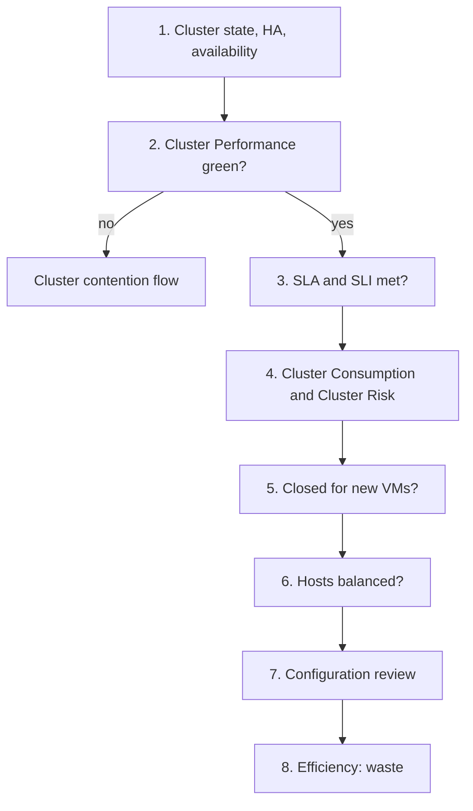

# vSphere cluster: health check

## Answers
- Is this vSphere cluster healthy? Which metrics matter most on a cluster, in what order: availability, performance, capacity, configuration, efficiency.
- Can it take more VMs: step 5.

## Symptom
- None. A scheduled or on-demand check of one cluster: the what. A failed step opens a troubleshooting flow: the why.

## Flow


## Principle
- The cluster is the sweet spot for monitoring and troubleshooting. Manage at cluster level; drill to hosts and VMs when troubleshooting.
- Cluster metrics are averages, even totals. One suffering VM is hidden. Low cluster utilization does not rule out contention. See `vsphere/object-types/cluster/concepts/cluster-utilization-vs-contention`.
- Two dimensions of performance: depth (the worst VM) and breadth (how many VMs).
- One KPI and two models: Cluster Performance (KPI), Cluster Consumption (capacity model), Cluster Risk (risk model). Read them separately.

## Checks, in order
Order of `operations-management/sp5-framework/health-risk-efficiency`: present health (availability, performance, security), then risk (capacity, configuration, compliance), then efficiency.
1. Availability (ClusterComputeResource). Cluster state green or yellow or red, and HA failover capacity met (`vsphere/object-types/cluster/concepts/admission-control-and-cluster-state`). Cluster and ESXi availability: `vsphere/object-types/cluster/metrics/comparisons/availability`. Flows for an availability failure (host down, HA did not restart VMs) are future, after 1.0: state what failed and stop. Otherwise → step 2.
2. Performance: Cluster Performance (%) (ClusterComputeResource). Depth from the worst VM, breadth from the 90th percentile, aggregated directly from VMs (`vsphere/object-types/cluster/kpis/cluster-performance`). Green → step 3. Yellow or worse → `vsphere/object-types/cluster/troubleshooting/cluster-vm-contention`; VMs short of CPU or memory in a DRS cluster → `vsphere/object-types/cluster/troubleshooting/vm-insufficient-resources-in-drs-cluster`. Then → step 3.
3. Service level (ClusterComputeResource). SLA and SLI, 30-day and lagging (`vsphere/object-types/cluster/kpis/cluster-sla-sli`). A breach is history: it confirms step 2, it does not replace it. → step 4.
4. Capacity: Cluster Consumption (%) and Cluster Risk (%) (ClusterComputeResource).
   - Cluster Consumption: utilization and saturation (`vsphere/object-types/cluster/models/cluster-consumption`).
   - Cluster Risk: highest host, reservation, overcommit, monster VMs; higher is worse (`vsphere/object-types/cluster/models/cluster-risk`).
   - HA and admission control reserve capacity that utilization does not show (`vsphere/object-types/cluster/concepts/admission-control-and-cluster-state`). Memory: `vsphere/technology/memory/metrics/cluster/consumed`.
   - Capacity model across products: `operations-management/capacity/capacity-model`. → step 5.
5. Closed for new VMs (ClusterComputeResource). The decision from the KPI and the two models: `operations-management/capacity/health-check/can-cluster-take-more-vms`. The vCommunity management pack publishes it every period as Close for Business (`vsphere/object-types/cluster/models/close-for-business`). → step 6.
6. Balance (ClusterComputeResource). Imbalance between hosts: a hot host causes contention while cluster totals stay low (`vsphere/technology/cpu/metrics/cluster/inter-host-imbalance`). DRS Score is about demand met, not contention (`vsphere/object-types/cluster/configuration/drs-migration-levels`). → step 7.
7. Configuration (ClusterComputeResource). `vsphere/object-types/cluster/configuration/cluster-configuration-review`. Also the drill-down when an earlier step failed: a configuration issue can cause an availability, performance or security problem, and known bugs are mostly configuration (older version, incompatible settings). Features that raise operational complexity (HA, DRS, vSAN, resource pools): `vsphere/object-types/cluster/concepts/cluster-operations`. VM operations counts (vMotion, power, reconfigure): `vsphere/object-types/cluster/metrics/vm-operations`. → step 8.
8. Efficiency (ClusterComputeResource, VirtualMachine). Waste that can be returned: idle, oversized and unused VMs, snapshots, unmapped space (`operations-management/capacity/reclamation`, `vsphere/technology/cpu/metrics/virtual-motherboard/idle-vm`, `vsphere/technology/cpu/health-check/oversized-vm-downsizing`).
- Not checked in 1.0: security and compliance (future phase).

## Why this order
- Availability first: a cluster in red state has broken reservations; every later number stands on a broken base.
- Performance before capacity: contention overrides utilization. A cluster that cannot serve its VMs has no capacity left.
- Capacity before configuration: capacity decides whether the cluster takes more VMs today; configuration is risk over a longer time.
- Efficiency last: work done when there is no problem and no risk.

## How to read the result
- Present health, risk and efficiency are read separately, never as one score.
- Cluster Performance red with low Cluster Consumption → contention from imbalance, limits, resource pools or storage; not from load. Step 6, then the cluster flow.
- Cluster Risk red alone does not close the cluster: it is a leading indicator.

## Traps
- "Cluster CPU at 40%, so no VM waits" → check worst VM Ready and the share of VMs with Ready.
- "Few VMs affected, so the cluster is fine" → depth matters: one VM can be badly hit.
- "Average the VM KPIs to get the cluster KPI" → aggregate from VMs by worst and 90th percentile.
- "DRS Score 80%+ means no contention" → DRS Score is about demand, not contention.
- "Cluster Risk is a KPI" → it is a risk model; the only cluster KPI is Cluster Performance.

## Metadata
```yaml
id: vsphere/object-types/cluster/health-check/cluster-health-check
retriever_guide: health-check
scope: vsphere
technology:
- cpu
- memory
- storage
- network
pillar:
- availability
- performance
- capacity
- value
product:
- vsphere
- vcf-operations
object:
- ClusterComputeResource
internal_derive:
- operations-management/sp5-framework/health-risk-efficiency
- vsphere/object-types/cluster/concepts/cluster-utilization-vs-contention
- vsphere/object-types/cluster/kpis/cluster-performance
- vsphere/object-types/cluster/models/cluster-consumption
- vsphere/object-types/cluster/models/cluster-risk
- vsphere/object-types/cluster/models/close-for-business
- operations-management/capacity/health-check/can-cluster-take-more-vms
- vsphere/object-types/cluster/troubleshooting/cluster-vm-contention
- vsphere/object-types/cluster/configuration/cluster-configuration-review
related:
- vsphere/object-types/vm/health-check/vm-health-check
- vsphere/object-types/esxi/health-check/esxi-health-check
- operations-management/capacity/capacity-model
- operations-management/capacity/reclamation
source:
  document: Knowledge base synthesis of the linked files (author's book; vSphere 9.1 documentation; VCF-vCommunity-Adapter documentation)
  path: Linked files in each step
corrections:
- 'Whole file: author decisions 2026-11-08: "what to monitor" is a health check; troubleshooting is part of the health check and comes after it; KPI is performance only (Cluster Consumption and Cluster Risk are models); availability flows, security and compliance are future, after 1.0.'
review_notes:
- 'Section ''Checks, in order'': the order of the pillars follows health-risk-efficiency (book). Steps 3, 6 and 8 placed by Claude. Author to confirm (Q062).'
- 'Sections ''Why this order'' and ''How to read the result'': Claude''s, from the linked files.'
- 'Moved 2026-11-08 from vsphere/object-types/cluster/overview-what-to-monitor.'
status: draft
```
