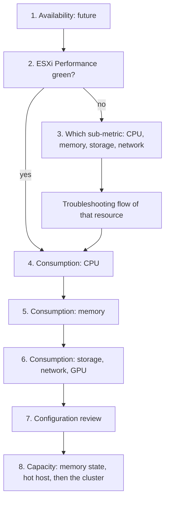

# ESXi: health check

## Answers
- Is this ESXi (ESX) host healthy? Which metrics matter most on a host, in what order?
- Which host metrics show performance, and which show capacity.

## Purpose
- A scheduled or on-demand check of one host across every pillar: the what. What a health check is: [`sp5-framework/concepts/health-check`](../../../../sp5-framework/concepts/health-check.md). A failed step opens a troubleshooting flow: the why.

## Flow


## Principle
- ESXi is a provider. It has no contention of its own: its Ready and Co-stop are sums of its VMs. See [`vsphere/architecture/provider-consumer`](../../../architecture/provider-consumer.md).
- Host performance is read from the contention of its VMs, at the worst VM and the 90th percentile: ESXi Performance (%).
- By default, Host-level contention counters average all VMs. Average is a lagging indicator as it hides the VM that suffers. See [`vsphere/technology/cpu/metrics/comparisons/host-contention-metrics`](../../../technology/cpu/metrics/comparisons/host-contention-metrics.md).
- Host utilization is capacity, not performance. A host can run at high utilization with no VM waiting, and VMs can wait on a lightly utilized host.

## Checks, in order
Order: availability, performance, security, capacity; within each pillar the what before the why ([`sp5-framework/concepts/health-check`](../../../../sp5-framework/concepts/health-check.md)).
1. Availability (HostSystem). Future, after 1.0: host not responding, disconnected, PSOD and soft errors come mostly from logs and events. State what was not checked. → step 2.
2. Performance: ESXi Performance (%) (HostSystem). One score from the 8 VM contention sub-metrics (worst VM and 90th percentile of Ready, Co-stop, memory latency, disk latency) and the host's bad network packets. See [`vsphere/object-types/esxi/kpis/esxi-performance`](../kpis/esxi-performance.md). Green → step 4. Yellow or worse → step 3.
3. Which sub-metric fails (HostSystem, VirtualMachine). Open the sub-metric that drives the score down:
   - CPU Ready or Co-stop → [`vsphere/technology/cpu/troubleshooting/vm-cpu-contention-high`](../../../technology/cpu/troubleshooting/vm-cpu-contention-high.md).
   - Memory latency → [`vsphere/technology/memory/troubleshooting/vm-memory-latency-high`](../../../technology/memory/troubleshooting/vm-memory-latency-high.md). Host memory Latency is an average of VMs: use the worst VM ([`vsphere/technology/memory/metrics/host/latency`](../../../technology/memory/metrics/host/latency.md)).
   - Disk latency → [`vsphere/technology/storage/troubleshooting/host-storage-latency`](../../../technology/storage/troubleshooting/host-storage-latency.md): split KAVG (kernel), DAVG (device), QAVG (queue) ([`vsphere/technology/storage/concepts/esxi-storage-latency-stack`](../../../technology/storage/concepts/esxi-storage-latency-stack.md)).
   - Bad network packets → [`vsphere/technology/network/metrics/host/packets-dropped`](../../../technology/network/metrics/host/packets-dropped.md) and [`vsphere/technology/network/metrics/host/errors`](../../../technology/network/metrics/host/errors.md).
   - → step 4.
4. Performance, consumption: CPU (HostSystem). Core Utilization and Thread Utilization are primary; complement with Usage (MHz) ([`vsphere/technology/cpu/metrics/host/core-utilization`](../../../technology/cpu/metrics/host/core-utilization.md), [`vsphere/technology/cpu/metrics/host/utilization`](../../../technology/cpu/metrics/host/utilization.md)). Usage and Demand can exceed 100% (Turbo; Demand sums VM demand): not an overload signal on their own ([`vsphere/technology/cpu/metrics/comparisons/host-consumption-metrics`](../../../technology/cpu/metrics/comparisons/host-consumption-metrics.md)). Hot cores and NUMA nodes: Peak Core Usage and Imbalance ([`vsphere/technology/cpu/metrics/host/peak-core-usage`](../../../technology/cpu/metrics/host/peak-core-usage.md)). → step 5.
5. Performance, consumption: memory (HostSystem). Consumed is the main capacity counter; it holds guest cache, so high Consumed alone is not a problem ([`vsphere/technology/memory/metrics/host/consumed`](../../../technology/memory/metrics/host/consumed.md)). Leading warnings: Balloon and State. Past contention: Swap and Compressed ([`vsphere/technology/memory/metrics/comparisons/host-memory-metrics`](../../../technology/memory/metrics/comparisons/host-memory-metrics.md)). Memory tiering hosts: active memory against DRAM, NVMe latency ([`vsphere/technology/memory/concepts/memory-tiering`](../../../technology/memory/concepts/memory-tiering.md)). → step 6.
6. Performance, consumption: storage, network and GPU (HostSystem). Device, adapter and path throughput and IOPS ([`vsphere/technology/storage/metrics/host/disk`](../../../technology/storage/metrics/host/disk.md), [`vsphere/technology/storage/metrics/host/adapter-and-path`](../../../technology/storage/metrics/host/adapter-and-path.md)). Network throughput per vmnic ([`vsphere/technology/network/metrics/host/throughput`](../../../technology/network/metrics/host/throughput.md)). GPU utilization, memory and temperature are statistics level 4 counters: no history at the default level ([`vsphere/technology/gpu/concepts/gpu-monitoring`](../../../technology/gpu/concepts/gpu-monitoring.md)). → step 7.
7. Configuration (HostSystem). [`vsphere/object-types/esxi/configuration/esxi-configuration-review`](../configuration/esxi-configuration-review.md). Also the drill-down when an earlier step failed: a configuration issue can cause an availability, performance or security problem, and known bugs are mostly configuration (older version, incompatible settings). Power management and BIOS settings change what utilization means ([`vsphere/technology/cpu/configuration/host-power-management`](../../../technology/cpu/configuration/host-power-management.md), [`vsphere/object-types/esxi/configuration/bios-settings`](../configuration/bios-settings.md)). Hypervisor overhead (vSAN, NSX, kernel): [`vsphere/architecture/overhead`](../../../architecture/overhead.md). → step 8.
8. Capacity (HostSystem). Two host-level signals only: the memory state as the leading warning ([`vsphere/technology/memory/metrics/host/state`](../../../technology/memory/metrics/host/state.md)) and a hot host against its cluster ([`vsphere/technology/cpu/metrics/cluster/inter-host-imbalance`](../../../technology/cpu/metrics/cluster/inter-host-imbalance.md)). CPU headroom of this host: [`vsphere/technology/cpu/decision-tree/host-cpu-capacity-headroom`](../../../technology/cpu/decision-tree/host-cpu-capacity-headroom.md). Then hand over to the cluster: a host is sized as part of its cluster ([`vsphere/object-types/cluster/health-check/cluster-health-check`](../../cluster/health-check/cluster-health-check.md), step 5).

- Efficiency (wastage, reclamation) is not part of the ESXi health check: VMs move between hosts by DRS and HA, so waste is read on the cluster and its VMs ([`vsphere/object-types/cluster/health-check/cluster-health-check`](../../cluster/health-check/cluster-health-check.md)).
- Not checked in 1.0: security and compliance (future phase).

## Why this order
- Availability first: a host that is down has no performance problem. Then performance, then capacity; efficiency belongs to the cluster.
- Performance from the KPI before raw counters: one score covers depth and breadth; the sub-metric points to the flow.
- Consumption inside performance: it explains the contention found in steps 2-3; utilization alone does not show whether a VM waits.
- Capacity last and short: a host is sized as part of its cluster, so only the memory state and a hot host are read here.

## How to read the result
- Present health, risk and efficiency are read separately, never as one score.
- ESXi Performance red with low utilization → contention from something other than load: limits, NUMA placement, a noisy VM, storage below the host.
- ESXi Performance green with high utilization → the host works hard and serves its VMs; a capacity question, not a performance one.

## Documentation guidance (esxtop)
- Performance Best Practices for vSphere 9.1 gives these esxtop readings:
  - esxtop CPU panel, first line (load average): a value equal to or greater than 1 means the system is overloaded.
  - esxtop PCPU line (usage of physical CPUs): 80% is a reasonable ceiling.
  - esxtop PCPU line: 90% should be a warning.
  - The source notes that organizations set their own standards for the target load percentage.
- Knowledge base reading: these are utilization levels, so they are capacity signals. Confirm a performance problem with the contention of the host's VMs (step 2). Load average 1.00 means all PCPUs fully used. See [`vsphere/tools/esxtop/cpu`](../../../tools/esxtop/cpu.md).

## Misconceptions
- "Host CPU at 90%, so VMs are slow" → check ESXi Performance: worst VM Ready and Co-stop.
- "Host Ready is low, so every VM is fine" → it is an average. Check the worst VM.
- "Demand 130%, so the host is overloaded" → check Core Utilization, Thread Utilization and VM contention.
- "Host memory Consumed at 95%, so add memory" → check balloon, swap-in and worst VM memory Latency.
- "The host is up and ESXi Performance is green, so it is healthy" → present health only; capacity and configuration are risk.

## Metadata
```yaml
id: vsphere/object-types/esxi/health-check/esxi-health-check
retriever_guide: health-check
scope: vsphere
technology:
- cpu
- gpu
- memory
- storage
- network
pillar:
- performance
- capacity
product:
- vsphere
- vcf-operations
object:
- HostSystem
internal_derive:
- vsphere/object-types/esxi/kpis/esxi-performance
- sp5-framework/concepts/health-risk-efficiency
- vsphere/technology/cpu/metrics/comparisons/host-contention-metrics
- vsphere/technology/cpu/metrics/comparisons/host-consumption-metrics
- vsphere/technology/cpu/decision-tree/host-cpu-capacity-headroom
- vsphere/technology/memory/metrics/comparisons/host-memory-metrics
- vsphere/technology/storage/concepts/esxi-storage-latency-stack
- vsphere/technology/cpu/troubleshooting/vm-cpu-contention-high
- vsphere/technology/memory/troubleshooting/vm-memory-latency-high
- vsphere/technology/storage/troubleshooting/host-storage-latency
- vsphere/object-types/esxi/configuration/esxi-configuration-review
related:
- sp5-framework/concepts/health-check
- vsphere/object-types/vm/health-check/vm-health-check
- vsphere/object-types/cluster/health-check/cluster-health-check
- vsphere/architecture/provider-consumer
- vsphere/tools/vsphere-client/performance-guidance
- vsphere/tools/esxtop/cpu
source:
  document: Knowledge base synthesis of the linked files (book; vSphere 9.1 documentation; VCF-vCommunity-Adapter documentation) + Performance Best Practices for VMware vSphere 9.1 (revision 20260624)
  path: Linked files in each step; section 'Documentation guidance (esxtop)' from ESX CPU Considerations (pp. 27-28)
corrections:
- 'Whole file: "what to monitor" is a health check; troubleshooting is part of the health check and comes after it; ESXi has a KPI (ESXi Performance); availability, security and compliance are future, after 1.0. VCF always includes VCF Operations: no vCenter-only fallback.'
review_notes:
- 'To check: Section ''How to read the result'': derived from the Principle section.'
status: draft
```
