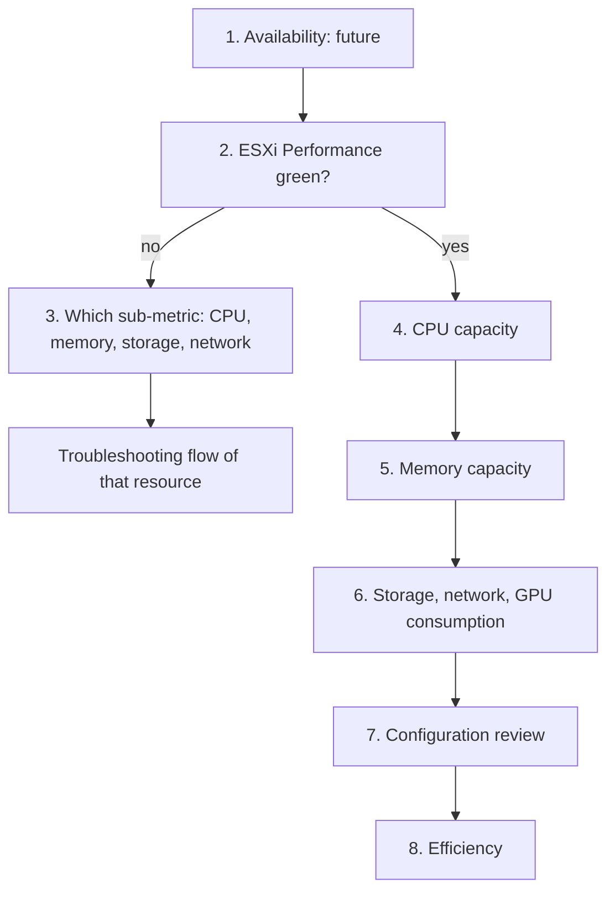

# ESXi: health check

## Answers
- Is this ESXi (ESX) host healthy? Which metrics matter most on a host, in what order?
- Which host metrics show performance, and which show capacity.

## Symptom
- None. A scheduled or on-demand check of one host: the what. A failed step opens a troubleshooting flow: the why.

## Flow


## Principle
- ESXi is a provider. It has no contention of its own: its Ready and Co-stop are sums of its VMs. See `vsphere/architecture/provider-consumer`.
- Host performance is read from the contention of its VMs, at the worst VM and the 90th percentile: ESXi Performance (%). Host-level contention counters average all VMs: lagging, and they hide the VM that suffers. See `vsphere/technology/cpu/metrics/comparisons/host-contention-metrics`.
- Host utilization is capacity, not performance. A host can run at high utilization with no VM waiting, and VMs can wait on a lightly used host.

## Checks, in order
Order (author, 2026-11-09): four questions, and within each the what (facts) before the why (explanation):
- Is it up? Availability: log, saturation, configuration, known bug. A system that is down has no performance problem and cannot be attacked.
- Is it fast? Performance: contention, consumption, configuration, known bug, log. Up does not mean fast.
- Is it secure? Security: configuration, known bug, log. Running well does not mean safe from attack.
- Will it be enough? Capacity: consumption, configuration, contention, inventory. A healthy present does not mean a healthy future. Efficiency (waste) is read here. Framework view: `sp5-framework/concepts/health-risk-efficiency`.
1. Availability (HostSystem). Future, after 1.0: host not responding, disconnected, PSOD and soft errors come mostly from logs and events. State what was not checked. → step 2.
2. Performance: ESXi Performance (%) (HostSystem). One score from the 8 VM contention sub-metrics (worst VM and 90th percentile of Ready, Co-stop, memory latency, disk latency) and the host's bad network packets. See `vsphere/object-types/esxi/kpis/esxi-performance`. Green → step 4. Yellow or worse → step 3.
3. Which sub-metric fails (HostSystem, VirtualMachine). Open the sub-metric that drives the score down:
   - CPU Ready or Co-stop → `vsphere/technology/cpu/troubleshooting/vm-cpu-contention-high`.
   - Memory latency → `vsphere/technology/memory/troubleshooting/vm-memory-latency-high`. Host memory Latency is an average of VMs: use the worst VM (`vsphere/technology/memory/metrics/host/latency`).
   - Disk latency → `vsphere/technology/storage/troubleshooting/host-storage-latency`: split KAVG (kernel), DAVG (device), QAVG (queue) (`vsphere/technology/storage/concepts/esxi-storage-latency-stack`).
   - Bad network packets → `vsphere/technology/network/metrics/host/packets-dropped` and `vsphere/technology/network/metrics/host/errors`.
   - → step 4.
4. Capacity, CPU (HostSystem). Core Utilization and Thread Utilization are primary; complement with Usage (MHz) (`vsphere/technology/cpu/metrics/host/core-utilization`, `vsphere/technology/cpu/metrics/host/utilization`). Usage and Demand can exceed 100% (Turbo; Demand sums VM demand): not an overload signal on their own (`vsphere/technology/cpu/metrics/comparisons/host-consumption-metrics`). Hot cores and NUMA nodes: Peak Core Usage and Imbalance (`vsphere/technology/cpu/metrics/host/peak-core-usage`). Headroom: `vsphere/technology/cpu/health-check/host-cpu-capacity-headroom`. → step 5.
5. Capacity, memory (HostSystem). Consumed is the main capacity counter; it holds guest cache, so high Consumed alone is not a problem (`vsphere/technology/memory/metrics/host/consumed`). Leading warnings: Balloon and State. Past contention: Swap and Compressed (`vsphere/technology/memory/metrics/comparisons/host-memory-metrics`). Memory tiering hosts: active memory against DRAM, NVMe latency (`vsphere/technology/memory/concepts/memory-tiering`). → step 6.
6. Capacity, storage, network and GPU consumption (HostSystem). Device, adapter and path throughput and IOPS (`vsphere/technology/storage/metrics/host/disk`, `vsphere/technology/storage/metrics/host/adapter-and-path`). Network throughput per vmnic (`vsphere/technology/network/metrics/host/throughput`). GPU utilization, memory and temperature are statistics level 4 counters: no history at the default level (`vsphere/technology/gpu/concepts/gpu-monitoring`). → step 7.
7. Configuration (HostSystem). `vsphere/object-types/esxi/configuration/esxi-configuration-review`. Also the drill-down when an earlier step failed: a configuration issue can cause an availability, performance or security problem, and known bugs are mostly configuration (older version, incompatible settings). Power management and BIOS settings change what utilization means (`vsphere/technology/cpu/configuration/host-power-management`, `vsphere/object-types/esxi/configuration/bios-settings`). Hypervisor overhead (vSAN, NSX, kernel): `vsphere/architecture/overhead`. → step 8.
8. Efficiency (HostSystem). A host is sized as part of its cluster: reclamation and rightsizing are read on the cluster and its VMs (`vsphere/object-types/cluster/health-check/cluster-health-check`).
- Not checked in 1.0: security and compliance (future phase).

## Why this order
- Availability first: a host that is down has no performance problem. Then performance, then risk, then efficiency.
- Performance from the KPI before raw counters: one score covers depth and breadth; the sub-metric points to the flow.
- Capacity after performance: utilization does not show whether a VM waits.

## How to read the result
- Present health, risk and efficiency are read separately, never as one score.
- ESXi Performance red with low utilization → contention from something other than load: limits, NUMA placement, a noisy VM, storage below the host.
- ESXi Performance green with high utilization → the host works hard and serves its VMs; a capacity question, not a performance one.

## Documentation guidance (esxtop)
- Performance Best Practices for vSphere 9.1 gives these esxtop readings:
  - esxtop CPU panel, first line (load average): a value equal to or greater than 1 means the system is overloaded.
  - esxtop PCPU line (usage of physical CPUs): 80% is a reasonable ceiling.
  - esxtop PCPU line: 90% should be a warning.
  - The source notes that organizations set their own standards for the target load percentage.
- Knowledge base reading: these are utilization levels, so they are capacity signals. Confirm a performance problem with the contention of the host's VMs (step 2). Load average 1.00 means all PCPUs fully used. See `vsphere/tools/esxtop/cpu`.

## Traps
- "Host CPU at 90%, so VMs are slow" → check ESXi Performance: worst VM Ready and Co-stop.
- "Host Ready is low, so every VM is fine" → it is an average. Check the worst VM.
- "Demand 130%, so the host is overloaded" → check Core Utilization, Thread Utilization and VM contention.
- "Host memory Consumed at 95%, so add memory" → check balloon, swap-in and worst VM memory Latency.
- "The host is up and ESXi Performance is green, so it is healthy" → present health only; capacity and configuration are risk.

## Metadata
```yaml
id: vsphere/object-types/esxi/health-check/esxi-health-check
retriever_guide: health-check
scope: vsphere
technology:
- cpu
- gpu
- memory
- storage
- network
pillar:
- performance
- capacity
product:
- vsphere
- vcf-operations
object:
- HostSystem
internal_derive:
- vsphere/object-types/esxi/kpis/esxi-performance
- sp5-framework/concepts/health-risk-efficiency
- vsphere/technology/cpu/metrics/comparisons/host-contention-metrics
- vsphere/technology/cpu/metrics/comparisons/host-consumption-metrics
- vsphere/technology/cpu/health-check/host-cpu-capacity-headroom
- vsphere/technology/memory/metrics/comparisons/host-memory-metrics
- vsphere/technology/storage/concepts/esxi-storage-latency-stack
- vsphere/technology/cpu/troubleshooting/vm-cpu-contention-high
- vsphere/technology/memory/troubleshooting/vm-memory-latency-high
- vsphere/technology/storage/troubleshooting/host-storage-latency
- vsphere/object-types/esxi/configuration/esxi-configuration-review
related:
- vsphere/object-types/vm/health-check/vm-health-check
- vsphere/object-types/cluster/health-check/cluster-health-check
- vsphere/architecture/provider-consumer
- vsphere/tools/vsphere-client/performance-guidance
- vsphere/tools/esxtop/cpu
source:
  document: Knowledge base synthesis of the linked files (author's book; vSphere 9.1 documentation; VCF-vCommunity-Adapter documentation) + Performance Best Practices for VMware vSphere 9.1 (revision 20260624)
  path: Linked files in each step; section 'Documentation guidance (esxtop)' from ESX CPU Considerations (pp. 27-28)
corrections:
- 'Whole file: author decisions 2026-11-08: "what to monitor" is a health check; troubleshooting is part of the health check and comes after it; ESXi has a KPI (ESXi Performance); availability, security and compliance are future, after 1.0. VCF always includes VCF Operations: no vCenter-only fallback (author, Q133a).'
review_notes:
- 'Section ''Checks, in order'': step order follows health-risk-efficiency (book). The order inside capacity (CPU, memory, storage, network, GPU) is Claude''s synthesis of the linked files. Author to confirm (Q062).'
- 'Step 8: no host-level efficiency source; Claude''s reading that hosts are sized with their cluster.'
- 'Section ''How to read the result'': Claude''s, from the Principle section.'
- 'Section ''Documentation guidance (esxtop)'': moved from vsphere/architecture/overhead (section Host CPU monitoring, 2026-11-04), where a merge had placed it; it is host monitoring, not overhead. Text kept as written.'
- 'Moved 2026-11-08 from vsphere/object-types/esxi/overview-what-to-monitor.'
status: draft
```
