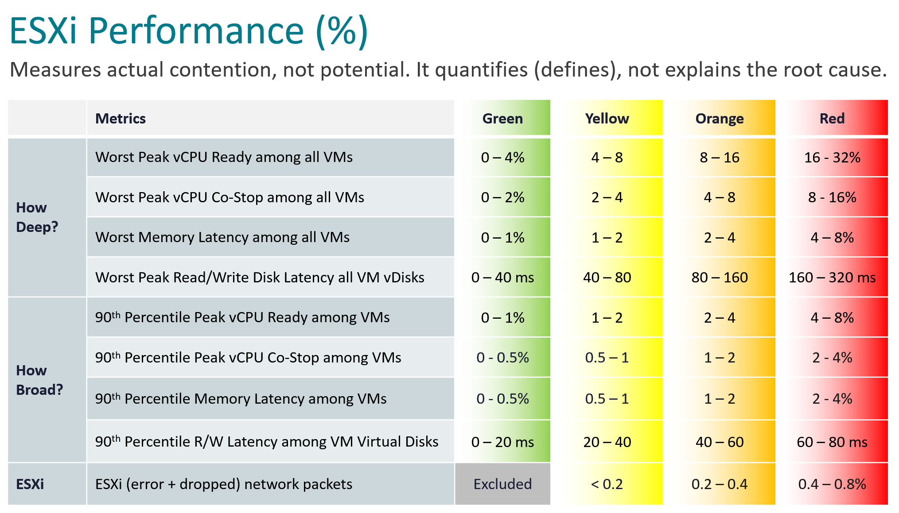

# ESXi Performance (%) (vCommunity management pack KPI for VCF Operations)

## What it is
- One score per ESXi host, 0-100%. 100 is perfect.
- It measures actual contention, not potential. It quantifies the problem; it does not explain the root cause.
- ESXi is a provider: it has no contention of its own. The KPI reads the contention of the powered-on VMs running on the host, plus the host's own physical network. See `vsphere/architecture/provider-consumer`.
- Not built into VCF Operations: a metric of the author's vCommunity management pack, published on the host object under `vCommunity|ESXi Performance|ESXi Performance Score`, with its 9 sub-metrics beside it.
- Use: the first step of the ESXi health check (`vsphere/object-types/esxi/health-check/esxi-health-check`). When the score drops, open the 9 sub-metrics of that host.

## Design
- Same 9 sub-metrics and the same limits as Cluster Performance (`vsphere/object-types/cluster/kpis/cluster-performance`), measured over the VMs of one host instead of the whole cluster.
- Two questions about the powered-on VMs on the host:
  - How deep? The worst VM. Shows a problem that hits one VM hard.
  - How broad? The 90th percentile across the VMs. Shows a problem that many VMs on the host have.
- VM stats are 20-second peaks, not 5-minute averages, to catch short bursts.
- A VM belongs to the host named in its `summary|parentHost` property; it counts only when `summary|runtime|powerState` is Powered On.

## Thresholds
| Dimension | Metric | Green | Yellow | Orange | Red |
|---|---|---|---|---|---|
| Depth | Worst peak vCPU Ready among VMs on the host (%) | 0-4 | 4-8 | 8-16 | 16-32 |
| Depth | Worst peak vCPU Co-stop among VMs on the host (%) | 0-2 | 2-4 | 4-8 | 8-16 |
| Depth | Worst memory latency among VMs on the host (%) | 0-1 | 1-2 | 2-4 | 4-8 |
| Depth | Worst peak read/write disk latency, all vDisks of VMs on the host (ms) | 0-40 | 40-80 | 80-160 | 160-320 |
| Breadth | 90th percentile peak vCPU Ready among VMs on the host (%) | 0-1 | 1-2 | 2-4 | 4-8 |
| Breadth | 90th percentile peak vCPU Co-stop among VMs on the host (%) | 0-0.5 | 0.5-1 | 1-2 | 2-4 |
| Breadth | 90th percentile memory latency among VMs on the host (%) | 0-0.5 | 0.5-1 | 1-2 | 2-4 |
| Breadth | 90th percentile read/write latency among virtual disks of VMs on the host (ms) | 0-20 | 20-40 | 40-60 | 60-80 |
| ESXi | ESXi (error + dropped) network packets (%) | Excluded | 0-0.2 | 0.2-0.4 | 0.4-0.8 |



- The red range ends where the sub-metric scores 0.
- Excluded: while bad packets are exactly 0, the row is left out of the KPI, so it does not add a free 100. Any bad packet is yellow and counts.

## How each sub-metric is calculated
| Sub-metric | Source (VCF Operations) |
|---|---|
| Ready (worst, 90th percentile) | VM `cpu\|20_sec_peak_readyPct` |
| Co-stop (worst, 90th percentile) | VM `cpu\|20_sec_peak_costopPct` |
| Memory latency (worst, 90th percentile) | VM `mem\|20_sec_peak_host_contentionPct` |
| Disk latency (worst, 90th percentile) | VM `virtualDisk\|20_sec_peak_totalLatency_average` |
| Bad network packets | Host: (errorsRx + errorsTx + droppedRx + droppedTx) / (packetsRx + packetsTx) × 100 in the last 5-minute cycle |

- Bad packets are never averaged over a longer time: that hides a spike. Packets Received and Transmitted totals are deactivated by default in VCF Operations; activate them in the policy first.
- It replaces the former "ESXi Bad Network Packets" super metric.

## Scoring
- Each sub-metric scores 100-0 against its limits; the KPI is a weighted average where a worse score weighs more. Rule shared by every KPI of the pack: `operations-management/performance/performance-kpi-design`, section Scoring.
- Nothing wrong: bad packets 0 (excluded), the other 8 score 100. KPI = 100.
- One VM with 200 ms disk latency: the worst-VM disk row is a quarter into red (160-320 ms) and scores 18.75 with weight 9.51. The 90th percentile stays 0: one VM is not a broad problem. KPI = (7 × 100 + 18.75 × 9.51) / (7 + 9.51) ≈ 53.2.
- A host with no powered-on VMs: no VM sub-metric has data; bad packets 0 are left out. KPI = 100.
- Missing data: a sub-metric with no data, or a stat older than 10 minutes, is left out, never counted as 0. A host that is not connected gets no KPI.

## Traps
- "ESXi CPU Ready is the host's contention" → host Ready sums its VMs and hides the one that suffers; this KPI takes the worst VM and the 90th percentile.
- "ESXi Performance is low, so the host is overloaded" → it scores VM contention and bad packets, not utilization. A host can be busy and score 100.
- "Host with no VMs scores 100, so the host is fine" → the KPI has nothing to score; availability and configuration are separate health check steps.
- "ESXi KPI = average of its VM Performance KPIs" → different metrics: depth and breadth across the VMs, plus the host network.

## Metadata
```yaml
id: vsphere/object-types/esxi/kpis/esxi-performance
retriever_guide: metric-meaning
scope: vsphere
technology:
- cpu
- memory
- storage
- network
- system
pillar:
- performance
product:
- vcf-operations
object:
- HostSystem
metric_class: contention
internal_derive:
- operations-management/performance/performance-kpi-design
- vsphere/object-types/cluster/kpis/cluster-performance
same_name: []
same_meaning: []
related:
- vsphere/object-types/esxi/health-check/esxi-health-check
- vsphere/object-types/vm/kpis/vm-performance
- vsphere/architecture/provider-consumer
images:
  - path: ../images/esxi-performance-thresholds-table.png
    product: [vcf-operations]
    object: [HostSystem]
    metric: ['ESXi Performance']
    image_type: table
source:
  document: VCF-vCommunity-Adapter documentation, ESXi Performance KPI (author, 2026-11-08)
  path: https://github.com/e1-rahabok/VCF-vCommunity-Adapter/blob/main/docs/reference/metrics/esxi-performance.md; formula/esxi-performance.png
corrections: []
review_notes:
- 'Whole file: from the adapter documentation and formula image (author decision 2026-11-08: ESXi has a KPI). Metric names follow Cluster Performance, with "on the host" added.'
- 'Section Thresholds, interval: every VM sub-metric is a 20-second peak (adapter documentation, including mem|20_sec_peak_host_contentionPct). The Cluster Performance memory rows carry interval 5m in the catalog; to check.'
- 'Section Traps: Claude''s, from the design text.'
status: draft
```
