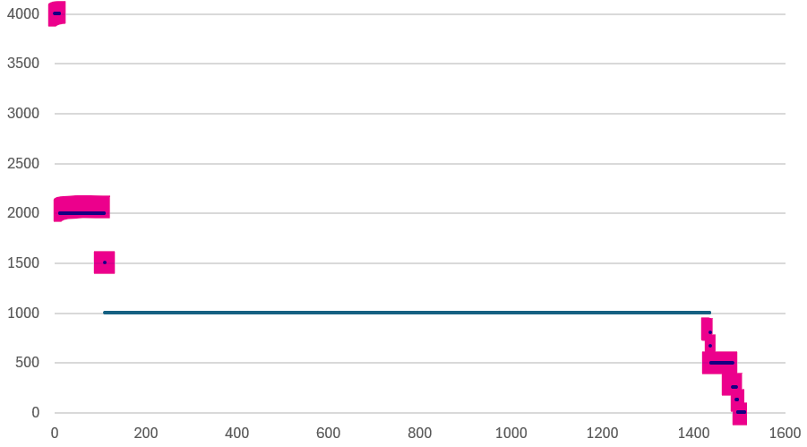

# VM resource settings

## Principle
- Use reservation, shares and limits only where the environment requires them. Each has its own job; set each for its purpose.
- What each control is and how ESXi applies it: [`vsphere/architecture/resource-controls`](../../../architecture/resource-controls.md). This file holds the advice.
- Shares, reservation and limit sit in one dialog and are learned together, but they affect operations differently. Over years in a large environment they drift out of consistency, so review them as a set.
- Limit affects the VM: an incorrect configuration. Reservation and shares affect the infrastructure: reservation is a suboptimal configuration, shares a complex one.

## Limit
- Avoid it on a VM: the Guest OS cannot see it and performance becomes unpredictable. Rightsize the VM instead.
- A limit set too low keeps a VM from using spare capacity in the cluster that would improve its performance. Spare capacity is wasted rather than used.
- In return the consumer never exceeds what it paid for, and a denial-of-service attack is contained. It cuts both ways: cost against performance.
- Limits exist for CPU, memory, disk IOPS and network adapter bandwidth, plus traffic shaping per port group. Do not use them on VMs.
- Matters more for containers, which have no ceiling by default.
- Valid use: a resource pool sold as a service. A tenant that bought 1 TB of RAM with no burst in the contract gets a 1 TB limit on its pool ([`vsphere/object-types/resource-pool/resource-pool-design`](../../resource-pool/resource-pool-design.md)).

## Reservation
- A hard guarantee, so reserved capacity cannot be overcommitted: use is less efficient. Keep the total low against cluster capacity.
- Avoid it unless shares are not enough. Reserve only for important VMs.
- High CPU and memory reservations complicate the cluster: they narrow DRS placement and, under the HA slot policy, raise the slot size. Under the default policy (cluster resource percentage) each reservation costs only its own size ([`vsphere/object-types/cluster/concepts/admission-control-and-cluster-state`](../../cluster/concepts/admission-control-and-cluster-state.md)).
- Leave headroom for memory virtualization overhead and migration overhead; reservations that fully commit a host or the cluster stop DRS migrations (same file, section Headroom).
- Reserve on the parent resource pool rather than per VM for the VMs of one application: easier to keep consistent.
- Reservations do not change when VMs are added or removed, and cannot exceed the configured size.

## Shares
- Use shares, not reservation, to protect a higher class of service (Gold relative to Silver) in an overcommitted cluster.
- Keep one share value per class of service, at most 3. Many values per vCPU and per GB make troubleshooting harder: each VM's entitlement fluctuates more.
- Keep share values consistent across clusters: a VM moved to another cluster keeps its number, which means another share there.
- After a hardware change, a VM keeps the same share count, but each share now represents more CPU or memory. Adjust the class values.
- Compare sibling values: if Gold should get 2x Silver, its shares must be 2x.

## Share audit
- Audit regularly: shares per vCPU should be 1,000 and per GB of RAM 10,240 (Normal), or the class values.
- In one sample of 1,500 VMs, most sat at 1,000 per vCPU, with others at 4,000, 2,000, 1,500, 800, 650, 500, 250, 125 and 0. Some VMs carried resource pool values (4,000 CPU, 163,840 memory) on 1-2 vCPU VMs: 160 shares per GB on a 1 GB VM.

- Values that drift usually come from an API resize (default shares not recalculated) or hand-set values copied from resource pools.

## Misconceptions
- "Reservation is a target to aim for" → reservation is a minimum. Shares divide the rest.
- "A CPU limit caps a noisy VM safely" → the Guest OS cannot see it; performance turns unpredictable. Rightsize instead.
- "The VM was resized, so its shares followed" → only a resize in the vSphere Client recalculates default shares; API resizes and hand-set values do not.
- "Set reservations high to be safe" → high reservations limit how many VMs can power on, and stop DRS migrations when they fully commit capacity.
- "Use reservations to give Gold priority over Silver" → shares give priority under contention without locking capacity; reserve only where a guarantee is needed.

## Metadata
```yaml
id: vsphere/object-types/vm/configuration/resource-settings-guidance
retriever_guide: what-to-set
scope: vsphere
technology:
- cpu
- memory
pillar:
- performance
- capacity
product:
- vsphere
object:
- ClusterComputeResource
- VirtualMachine
- HostSystem
internal_derive:
- vsphere/architecture/resource-controls
related:
- sp5-framework/concepts/configuration-management
- sp5-framework/concepts/class-of-service
- vsphere/architecture/resource-controls
- vsphere/object-types/resource-pool/resource-pool-design
- vsphere/object-types/cluster/concepts/drs-overview
- vsphere/object-types/cluster/concepts/dpm
images:
  - path: ../images/vm-cpu-shares-per-vcpu-across-vms-scatter.png
    product: [vsphere]
    object: [VirtualMachine]
    metric: [CPU shares per vCPU]
    topic: 'Share audit: shares per vCPU across VMs'
    image_type: scatter
    sample: 'about 1,500 VMs'
source:
  document: Performance Best Practices for VMware vSphere 9.1 (revision 20260624); Private Cloud Management by Iwan Rahabok (https://isvara.io/download)
  path: 'Virtual Infrastructure Management > General Resource Management (p. 65); Part 1, Configuration Management > Review List > Resource Management, Share, Reservation, Limit, Resource Pool (pp. 138-141)'
corrections: []
review_notes:
- 'Source URL: https://www.vmware.com/docs/vsphere-esxi-vcenter-server-9-1-performance-best-practices'
- 'To check: Headroom for memory virtualization overhead and migration overhead: the source defines no percentage; whether the book gives one.'
- 'Section Principle: the book''s impact table (limit, reservation, share) is written as text; the image is archived (2026-11-12). Its share row said reservation where it means share (Q108).'
status: draft
```
