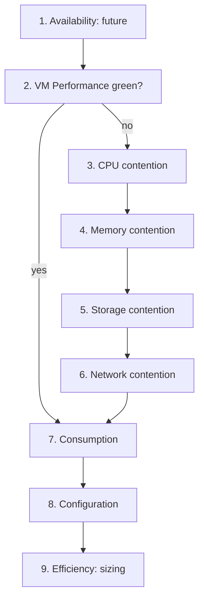

# VM: health check

## Answers
- Is this VM (virtual machine) healthy? Which VM metrics matter most, in what order: CPU, memory, storage, network.
- Which VM metrics show performance, and which only show consumption.

## Purpose
- A scheduled or on-demand check of one VM across every pillar: the what. What a health check is: [`sp5-framework/concepts/health-check`](../../../sp5-framework/concepts/health-check.md). A failed step opens a troubleshooting flow: the why.
- A user complaint ("the VM is slow") is reactive: skip the health check and start at [`sp5-framework/performance/vm-slow`](../../../sp5-framework/performance/vm-slow.md).

## Flow


## Principle
- A VM is a consumer. Its performance is the runtime, memory, IO and network it demanded and did not get: contention.
- Order: contention first, then consumption, then context. Consumption sizes the VM; it does not show whether the VM suffers.
- Read contention at the 20-second peak, not the 5-minute average: short waits disappear in averages. See [`vcf-operations/features/peak-20-second-metrics`](../../../vcf-operations/features/peak-20-second-metrics.md).
- The VM is the virtual motherboard. Run queue, page-outs and disk queue inside the guest belong to the Guest OS layer. See [`guest-os/system/guest-os-performance`](../../../guest-os/system/guest-os-performance.md).

## Checks, in order
Order: availability, performance, security, capacity; within each pillar the what before the why ([`sp5-framework/concepts/health-check`](../../../sp5-framework/concepts/health-check.md)).
1. Availability (VirtualMachine). Future, after 1.0: VM down, restarted by HA, unresponsive; mostly from logs and events. State what was not checked. → step 2.
2. Performance: VM Performance (%) (VirtualMachine). Combines the VM contention metrics into one KPI with colour bands. Start here at scale ([`vsphere/object-types/vm/vm-performance`](vm-performance.md)). Green → step 7. Yellow or worse → step 3, and read only the resources whose sub-metric fails.
3. CPU contention (VirtualMachine). Ready and Co-stop are the main counters; Overlap and Other Wait usually read much lower ([`vsphere/technology/cpu/metrics/comparisons/vm-contention-metrics`](../../technology/cpu/metrics/comparisons/vm-contention-metrics.md)). Read Ready against Run: 2% Ready on 10% Run is bad; 2% Ready on 98% Run is fine ([`vsphere/technology/cpu/metrics/virtual-motherboard/ready`](../../technology/cpu/metrics/virtual-motherboard/ready.md)). Co-stop: [`vsphere/technology/cpu/metrics/virtual-motherboard/co-stop`](../../technology/cpu/metrics/virtual-motherboard/co-stop.md). Contention (VCF Operations) includes limit time ([`vsphere/technology/cpu/metrics/virtual-motherboard/contention`](../../technology/cpu/metrics/virtual-motherboard/contention.md)). Latency includes Hyper-Threading and frequency effects: not a pure wait ([`vsphere/technology/cpu/metrics/virtual-motherboard/latency`](../../technology/cpu/metrics/virtual-motherboard/latency.md)). High → [`vsphere/technology/cpu/troubleshooting/vm-cpu-contention-high`](../../technology/cpu/troubleshooting/vm-cpu-contention-high.md). → step 4.
4. Memory contention (VirtualMachine). Latency is the only true memory contention counter ([`vsphere/technology/memory/metrics/virtual-motherboard/latency`](../../technology/memory/metrics/virtual-motherboard/latency.md)). Then, in order: swap-in, decompression, host cache, balloon. Ballooned, swapped and compressed memory are past reclamation, not current waiting ([`vsphere/technology/memory/metrics/comparisons/vm-memory-metrics`](../../technology/memory/metrics/comparisons/vm-memory-metrics.md)). High → [`vsphere/technology/memory/vm-memory-latency-high`](../../technology/memory/vm-memory-latency-high.md). → step 5.
5. Storage contention (VirtualMachine). Disk latency per virtual disk, read and write separately ([`vsphere/technology/storage/metrics/virtual-motherboard/disk-latency`](../../technology/storage/metrics/virtual-motherboard/disk-latency.md)). Outstanding IO: queued IO adds latency at any load ([`vsphere/technology/storage/metrics/virtual-motherboard/outstanding-io`](../../technology/storage/metrics/virtual-motherboard/outstanding-io.md)). Bus resets and commands aborted should stay at 0. High → [`vsphere/technology/storage/troubleshooting/vm-storage-performance-checks`](../../technology/storage/troubleshooting/vm-storage-performance-checks.md). → step 6.
6. Network contention (VirtualMachine). Dropped packets are the only network contention metric of a VM; vSphere has no network latency or retransmit counter ([`vsphere/technology/network/metrics/virtual-motherboard/packets-dropped`](../../technology/network/metrics/virtual-motherboard/packets-dropped.md)). Receive drops → [`vsphere/technology/network/vnic-rx-drops`](../../technology/network/vnic-rx-drops.md). → step 7.
7. Consumption (VirtualMachine). CPU Run and Usage, memory Consumed, disk IOPS and throughput, network throughput ([`vsphere/technology/cpu/metrics/comparisons/consumption-metrics`](../../technology/cpu/metrics/comparisons/consumption-metrics.md)). Very high consumption can cause the contention of steps 3-6; with no contention, it explains the load. The same order as [`sp5-framework/performance/vm-slow`](../../../sp5-framework/performance/vm-slow.md), step 5. → step 8.
8. Configuration (VirtualMachine). [`vsphere/object-types/vm/configuration/vm-configuration-review`](configuration/vm-configuration-review.md). Also the drill-down when an earlier step failed: a configuration issue can cause an availability, performance or security problem, and known bugs are mostly configuration (older version, incompatible settings). Limits, shares and reservations explain contention the host does not cause ([`vsphere/architecture/resource-controls`](../../architecture/resource-controls.md)). vMotion stun time: [`vsphere/object-types/vm/vmotion`](vmotion.md). → step 9.
9. Efficiency (VirtualMachine). Consumption sizes the VM:
   - CPU: Run, Usage, Demand. Usage includes Turbo; compare with Run before upsizing ([`vsphere/technology/cpu/metrics/comparisons/consumption-metrics`](../../technology/cpu/metrics/comparisons/consumption-metrics.md)). Oversized: [`vsphere/technology/cpu/decision-tree/oversized-vm-downsizing`](../../technology/cpu/decision-tree/oversized-vm-downsizing.md).
   - Memory: Consumed is the main counter; size the VM from Guest OS metrics, not VM metrics ([`vsphere/technology/memory/metrics/virtual-motherboard/consumed`](../../technology/memory/metrics/virtual-motherboard/consumed.md)).
   - Storage: IOPS and throughput ([`vsphere/technology/storage/metrics/virtual-motherboard/iops`](../../technology/storage/metrics/virtual-motherboard/iops.md)). Network: throughput ([`vsphere/technology/network/metrics/virtual-motherboard/throughput`](../../technology/network/metrics/virtual-motherboard/throughput.md)).
   - Idle VM: [`vsphere/technology/cpu/metrics/virtual-motherboard/idle-vm`](../../technology/cpu/metrics/virtual-motherboard/idle-vm.md).
- Not checked in 1.0: security and compliance (future phase).

## Order rationale
- Availability first: a VM that is down has no performance problem.
- Contention before consumption: consumption sizes the VM; it does not show whether the VM suffers.
- No Guest OS step: the Guest OS is a separate realm. The hypervisor neither sees nor controls its run queue, disk queue or page-outs, so they do not decide the health of the VM. The Guest OS is checked as its own object.
- Efficiency last: sizing is done when there is no problem.

## Interpretation
- Present health, risk and efficiency are read separately, never as one score.
- VM Performance green and the application slow → the VM gets what it demands; the wait is inside the Guest OS ([`guest-os/system/guest-os-performance`](../../../guest-os/system/guest-os-performance.md)).

## Misconceptions
- "VM CPU Usage is 95%, so the VM is short of CPU" → Usage includes Turbo and is consumption. Check Ready, Co-stop and Run.
- "Ballooned memory above 0, so the VM is slow" → balloon is reclamation. Check memory Latency.
- "The 5-minute average is low, so the VM did not wait" → check the 20-second peak.
- "Guest OS run queue is a VM metric" → it is the Guest OS layer.

## Metadata
```yaml
id: vsphere/object-types/vm/vm-health-check
retriever_guide: health-check
scope: vsphere
technology:
- cpu
- memory
- storage
- network
pillar:
- availability
- performance
- capacity
- value
product:
- vsphere
- vcf-operations
object:
- VirtualMachine
internal_derive:
- sp5-framework/concepts/health-risk-efficiency
- vsphere/technology/cpu/troubleshooting/vm-cpu-contention-high
- vsphere/technology/memory/vm-memory-latency-high
- vsphere/technology/network/vnic-rx-drops
- vsphere/object-types/vm/configuration/vm-configuration-review
- vsphere/technology/cpu/metrics/comparisons/vm-contention-metrics
- vsphere/technology/memory/metrics/comparisons/vm-memory-metrics
- vsphere/technology/storage/troubleshooting/vm-storage-performance-checks
- vsphere/technology/network/metrics/vm-network-metrics
- vsphere/object-types/vm/vm-performance
related:
- sp5-framework/concepts/health-check
- sp5-framework/performance/vm-slow
- vsphere/object-types/esxi/esxi-health-check
- vsphere/object-types/cluster/cluster-health-check
- vcf-operations/features/peak-20-second-metrics
- guest-os/system/guest-os-performance
source:
  document: Knowledge base synthesis of the linked files (book; vSphere 9.1 documentation)
  path: Linked files in each section
corrections:
- 'Whole file: "what to monitor" is a health check; troubleshooting is part of the health check and comes after it; availability, security and compliance are future, after 1.0.'
review_notes:
- 'To check: Section ''Checks, in order'': the order inside performance (CPU, memory, storage, network), a synthesis of the linked files; the order of the pillars follows health-risk-efficiency (Q062).'
status: draft
```
