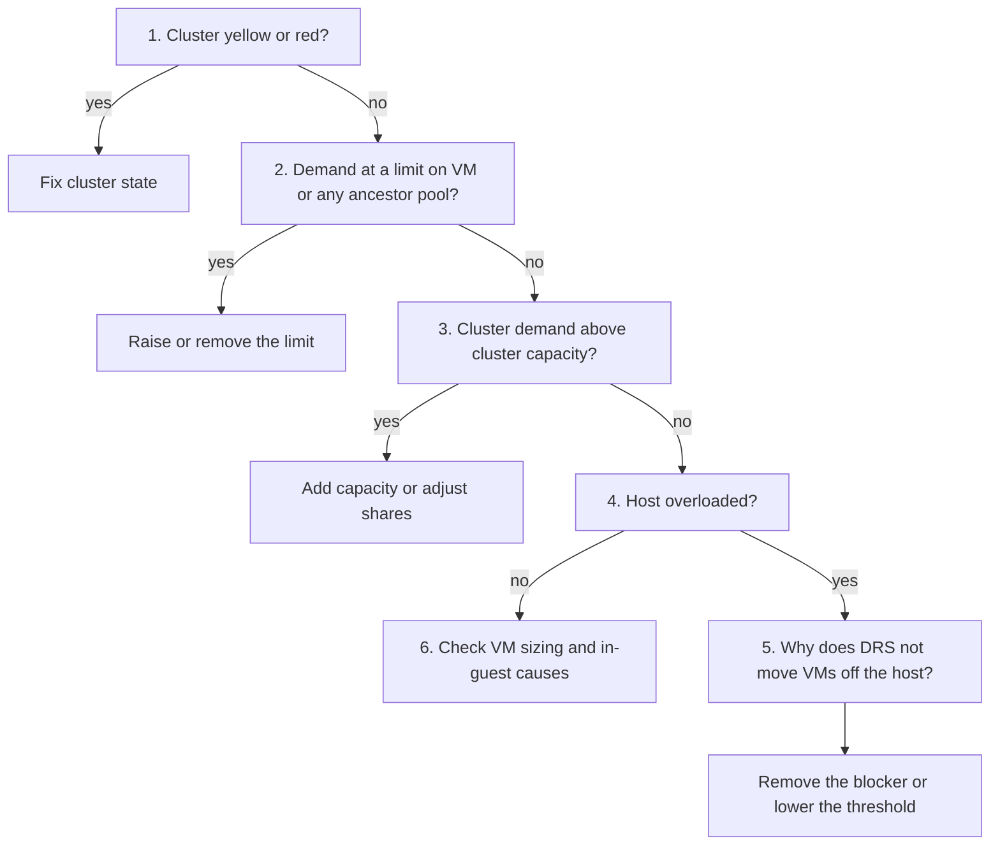

# VM gets too little CPU or memory in a DRS cluster

## Symptom
- A VM in a DRS cluster shows contention: CPU Ready or Co-stop, or Memory Latency or swap-in.
- Its demand exceeds its entitlement. Entitlement is what the scheduler grants after reservations, limits and shares are applied.

## Flow


## Checks, in order
1. Cluster state (ClusterComputeResource). Yellow or red: capacity no longer covers all configured reservations; this VM may be one not getting its reservation → fix the cluster state first. See `vsphere/resource-management/concepts/admission-control-and-cluster-state`. Green → step 2.
2. Limits (VirtualMachine, then every parent ResourcePool up to the cluster). VM demand equal to or above a configured limit → the limit causes the contention; esxtop %MLMTD confirms a CPU limit. Raise or remove the limit. No limit reached → step 3.
3. Cluster demand vs capacity (ClusterComputeResource). Demand above capacity → the cluster is overloaded; shares decide who gets what, and this VM's shares give others more. Add capacity, or raise this VM's shares or reservation. Capacity sufficient → step 4.
4. Host statistics (HostSystem where the VM runs). Host oversubscribed while the cluster has room → step 5. Host not oversubscribed → step 6.
5. DRS blockers. DRS does not move this VM, or enough other VMs, when:
   - a VM/VM or VM/Host rule requires the current placement;
   - DRS is deactivated (automation overridden) for the VM;
   - a host device (for example, a CD-ROM or USB device) is mounted to the VM;
   - the VM's reservation is too large for any other host;
   - the VM is not compatible with any other host (CPU, network, storage);
   - vMotion is not configured on the hosts;
   - the migration threshold is conservative, so only mandatory moves happen;
   - the load is unstable or vMotion cost exceeds the expected gain.
   Remove the blocker, or move the migration threshold toward Aggressive and check again. If no blocker exists for this VM, look for the same blockers on the other VMs of the host.
6. No cluster-level cause. Check the VM itself: vCPU or memory size, NUMA placement, in-guest load. See `vsphere/cpu/diagnosis/vm-cpu-contention-high` and `vsphere/memory/diagnosis/vm-memory-latency-high`.

## Why this order
- Cluster state first: in yellow or red, reservations themselves are not met, so the rest of the analysis is built on wrong assumptions.
- Limits second: a limit throttles the VM even on an idle cluster, and no DRS move fixes it.
- Cluster capacity before host: if the cluster as a whole is short, balancing cannot help.
- DRS blockers last: they explain why an imbalance persists when capacity exists elsewhere.

## How to read the result
- Contention on one host only, other hosts idle → DRS blocker (step 5).
- Contention on all hosts → cluster capacity or shares (step 3).
- Contention on one VM only, host not busy → limit (step 2) or the VM itself (step 6).

## Traps
- "DRS is enabled, so it balances" → rules, mounted devices, overrides, incompatibility and the threshold can all stop it.
- "The cluster DRS Score is fine, so this VM is fine" → the cluster score is a weighted average of VM scores; check the VM's own DRS score.
- "A limit only matters when the host is busy" → a limit caps the VM even when resources are idle.
- "Increase the VM's reservation to fix contention" → only effective when the cluster has unreserved capacity; it can also block DRS moves.

## Metadata
```yaml
id: vsphere/resource-management/diagnosis/vm-insufficient-resources-in-drs-cluster
retriever_guide: what-to-check
scope: vsphere
technology:
- cpu
- memory
pillar:
- performance
product:
- vsphere
object:
- VirtualMachine
- HostSystem
- ClusterComputeResource
- ResourcePool
internal_derive:
- vsphere/resource-management/concepts/admission-control-and-cluster-state
- vsphere/resource-management/concepts/resource-controls
- vsphere/resource-management/configuration/drs-migration-levels
related:
- vsphere/resource-management/concepts/drs-overview
- vsphere/cpu/diagnosis/vm-cpu-contention-high
- vsphere/memory/diagnosis/vm-memory-latency-high
- vsphere/system/diagnosis/cluster-vm-contention
source:
  document: VMware vSphere 9.1 product documentation (PDF built 2026-11-02; the copyright page carries no revision number)
  path: vSphere Resource Management > DRS Troubleshooting Information > Load Imbalance on Cluster, DRS Seldom or Never Performs vMotion Migrations, Virtual Machine Problems > Insufficient CPU or Memory Resources, DRS Does Not Move Any Virtual Machines from a Host (pp. 1950-1955)
corrections: []
review_notes:
- 'Whole file: the order of steps 1-5 follows the documentation section Insufficient CPU or Memory Resources (cluster yellow or red, limit too restrictive, cluster overloaded, host overloaded). Step 6 and the symptom metrics link to existing knowledge-base files.'
- 'Section ''Checks'': the DRS blockers combine the documentation lists for load imbalance, DRS seldom migrating, and DRS not moving VMs from a host.'
- 'Section ''Traps'': cluster DRS Score as a weighted average of VM DRS Scores is from the documentation (DRS Migration Threshold > DRS Score, p. 1896).'
status: draft
```
