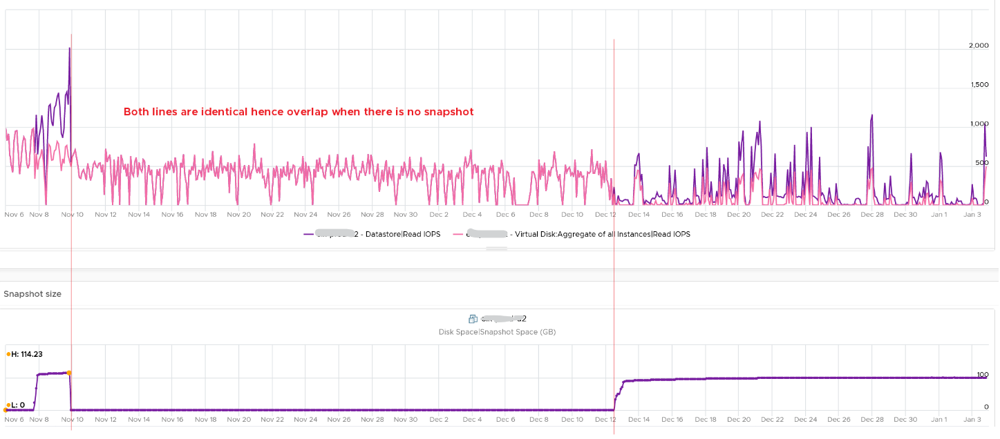

# Snapshot impact on metrics

## IO
- Reads must check all snapshot files. Datastore-level read IOPS rise; write is less affected (writes go to the newest file).
- The extra reads return no data: datastore throughput stays equal to virtual-disk throughput while datastore read IOPS is consistently higher.
- Test: with no snapshot, datastore and virtual-disk read IOPS overlap 100%. With a snapshot, datastore read IOPS is consistently higher.
- The .vmsd metadata file is updated on every snapshot create and delete.


## Space
- A snapshot can exceed the size of its VMDK, especially for thin disks snapshotted early while nearly empty.
- Disk Space | Snapshot | Virtual Machine Used shows reclaimable space.

## CPU
- Snapshots are a cause of Co-stop (KB 2000058) and of Other Wait.
- System time rises: the kernel traverses the snapshot chain.

## Metric scope
- Virtual disk metrics exclude snapshot IO and space.
- Datastore metrics include them.

## Traps
- "Datastore IOPS above virtual disk IOPS means another VM" → check for snapshots on this VM.

## Metadata
```yaml
id: vsphere/storage/concepts/snapshot-impact
retriever_guide: how-it-works
scope: vsphere
technology:
- storage
pillar:
- performance
- capacity
product:
- vsphere
object:
- VirtualMachine
- Datastore
internal_derive: []
related:
- vsphere/storage/concepts/vm-files
- vsphere/storage/metrics/virtual-machine/datastore
- vsphere/cpu/metrics/virtual-machine/co-stop
- vsphere/cpu/metrics/virtual-machine/other-wait
- vsphere/cpu/metrics/virtual-machine/system
source:
  document: PART 3 - Counters.docx
  path: Storage > VM > Performance Metrics > Consumption metrics > Datastore
corrections: []
review_notes:
- 'Best-practice blog from the book: https://blogs.vmware.com/performance/2021/06/performance-best-practices-for-vmware-snapshots.html (not read). Snapshot file docs linked by the book are vSphere 7.0.'
status: draft
```
