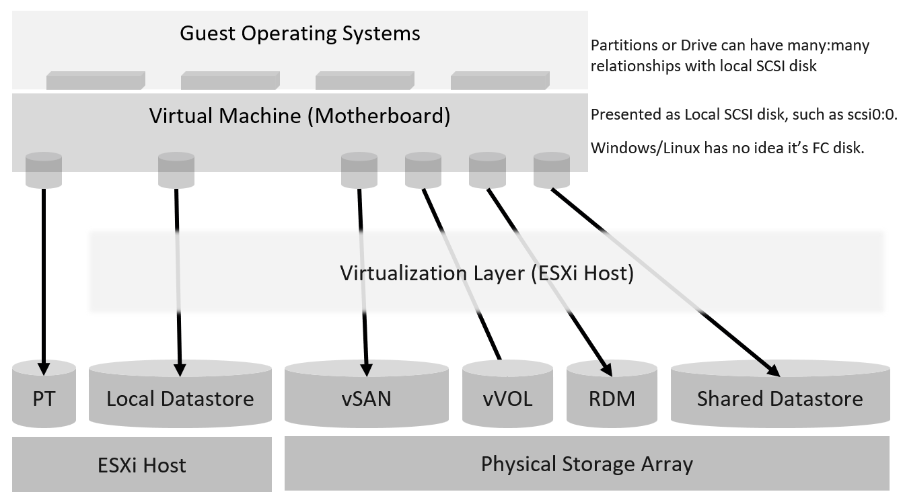
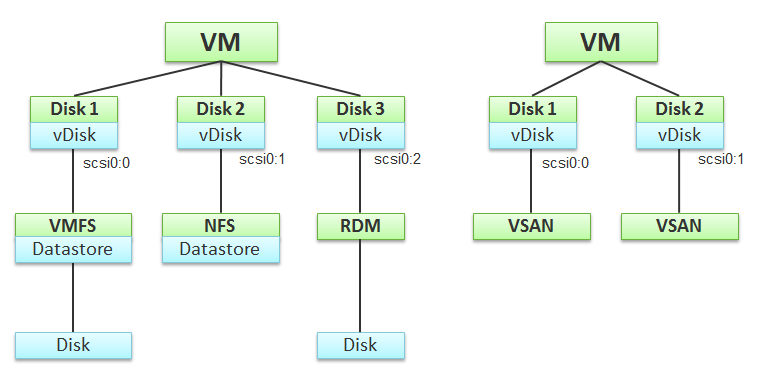
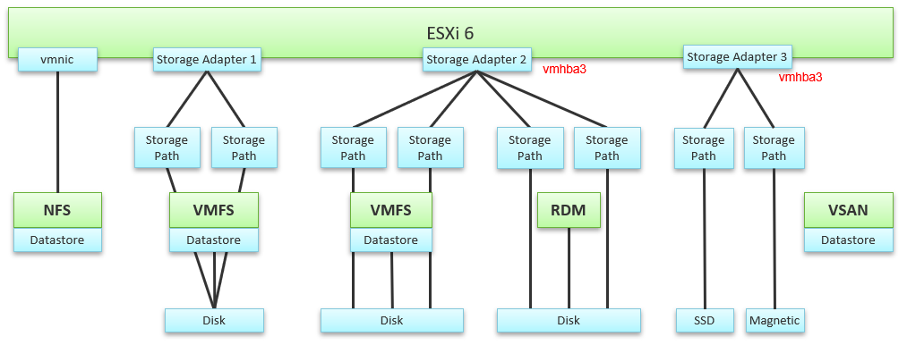
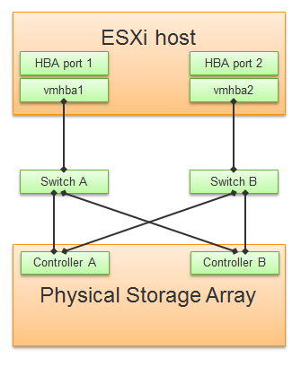
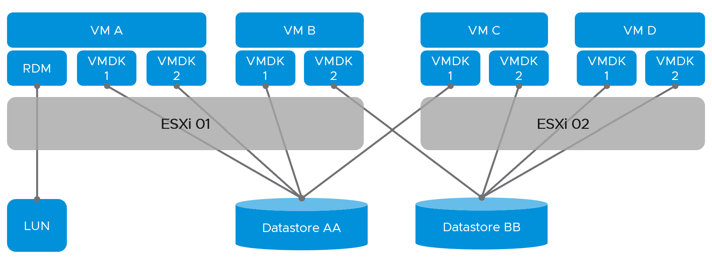

# Storage layers

## Layers

| Layer | Facts |
|---|---|
| Guest OS | Sees virtual disks presented by the VM motherboard. Has partitions, each with a filesystem (OS, page file, data). |
| Guest OS | Partitions may not map 1:1 to virtual disks. No visibility of the mapping. So unmapped blocks cannot be calculated accurately for RDM. |
| Guest OS | Network drives (SMB and similar) go out through the vNIC. Not virtual disks; invisible to the hypervisor as disk IO. |
| VM | Virtual disks. See below. |
| ESXi | Adapters, paths, devices. See below. |
| Datastore | Filesystem: VMFS (block) or NFS (file). vSAN presents as VMFS. |
| Storage subsystem | Virtual (vSAN) or physical (array). NFS can be a virtual or physical server. |

- Each layer controls only itself and may use its own terms. Disk, LUN and device can mean the same thing. A device is typically physical; a LUN is typically virtual, striped across physical devices.
- vSphere Client uses device and disk interchangeably: a physical disk or LUN presented to ESXi.
- The storage protocol (FC, iSCSI, vSAN, vVOL) is not exposed to the guest. The guest needs no support for it.
- VM-level visibility is lost at the physical adapter and path: the IOPS on vmhba2 cannot be attributed to a VM.
- A datastore is normally backed 1:1 by a LUN, so datastore and LUN values match.
- Datastores on the same array can have problems at the same time. The array can have its own hot spots.

## VM layer: 3 disk layers

- vSphere Client shows exactly 3 layers: virtual disk, datastore, disk (device).
- The VM sees simple local SCSI disks. That is why MS-DOS can run on Fibre Channel.
- A virtual disk is identified as scsiM:N, starting at scsi0:0. M is the adapter bus number.
- Backing: VMFS, NFS, vSAN, RDM, or a local disk passed through (the VM is then tied to that host).
- A VMFS datastore can span several disks (extents). Avoid: it complicates operations, and each extent adds about 4 paths.

## ESXi layer

- ESXi virtualizes different storage subsystems. The kernel does IO for all VMs and its own modules (for example vSAN).
- IO blender: sequential IO from many VMs and hosts becomes random when combined. The kernel also re-sequences IO to lower average latency.
- No VM breakdown at physical layers: vmnic, adapter, path and vSAN objects (cache tier, capacity disk, disk group) are aggregates.
- NFS: uses the vmnic. Adapter types (FC, FCoE, iSCSI) do not apply. Multipathing is in the network, not visible in the storage layer.
- VMFS and RDM: adapters are visible. One adapter serves many devices. One device is typically reached through 2 adapters with 2 paths each: 4 paths.

- A path runs from ESXi to the LUN (device), not to the datastore.
- Not all paths carry IO: it depends on configuration and multipathing.
- Example FC: vmhba2 connected to 5 devices × 4 paths = 20 paths.
- vSAN: adapter, target, device and path map 1:1. No WWNN/WWPN identifier: vSAN is not on a storage fabric. One path per device. No Connectivity and Multipathing or Capability Sets menus. A vSAN datastore is backed by disk groups, not a LUN.
- The hypervisor sees the LUN ID, so it can report performance and availability issues. A disk passed directly to a VM loses that visibility.

## Datastore layer
- VMFS: VM IO commands pass down as is to the Pluggable Storage Architecture (PSA). One queue (schedQ) per VMDK per VM. Metrics are collected there.
- NFS: no visibility of the underlying storage. Fewer metrics. Network metrics become critical.
- VMFS datastore on a 1:1 LUN: datastore and disk metrics are identical.
- A datastore relates to VMs (1:M), ESXi hosts (shared) and clusters.
- Datastore metrics include every file on the datastore, including orphaned files. They exclude VMDKs on other datastores and RDMs.
- VMs spanning datastores and datastores spanning clusters create many-to-many relationships. ESXi and cluster metrics then do not match datastore metrics. Cluster storage capacity cannot be aggregated when datastores are shared with other clusters.


## Backing device
- A datastore is a filesystem. Monitor the backing device (LUN or NFS export) in the storage system.
- Compare with a ratio. LUN IOPS / datastore IOPS = 1 with a 1:1 mapping.
- Ratio above 1: the array does its own IO, such as replication or snapshots.

## Traps
- "Adapter IOPS can be split per VM" → physical layers have no VM breakdown.
- "vSAN has 4 paths like FC" → one path per device.
- "Sum datastore capacity per cluster" → shared datastores make it impossible.

## Metadata
```yaml
id: vsphere/storage/concepts/storage-layers
retriever_guide: how-it-works
scope: vsphere
technology:
- storage
pillar:
- performance
- capacity
- availability
product:
- vsphere
object:
- VirtualMachine
- HostSystem
- Datastore
internal_derive:
- vsphere/foundations/object-relationships
related:
- vsphere/storage/concepts/storage-dimensions
- vsphere/storage/concepts/guest-os-vs-vm-storage
- vsphere/storage/metrics/virtual-machine/virtual-disk
- vsphere/storage/metrics/datastore/virtual-disk
source:
  document: PART 3 - Counters.docx
  path: Storage > Architecture > Storage Layers; VM Layer; ESXi Layer; Datastore Layer
corrections: []
review_notes:
- 'VMFS extent article from the book: http://blogs.vmware.com/vsphere/2012/02/vmfs-extents-are-they-bad-or-simply-misunderstood.html (not read).'
status: draft
```
