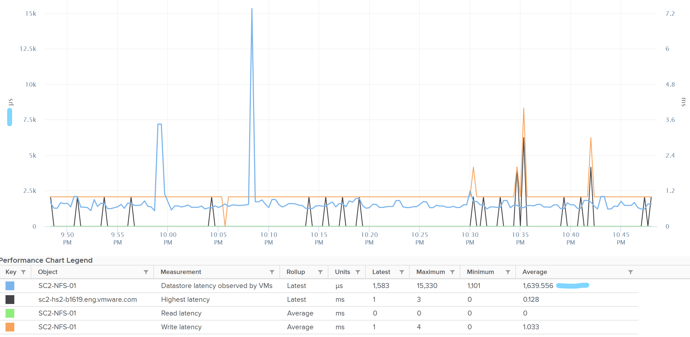

# ESXi Datastore metrics (host view)

## Scope
- This host's view only. For a shared datastore, values differ from the datastore object, which spans all hosts.
- Performance only. Capacity is covered at the datastore object.

## Counters
- IOPS, throughput and latency, each read and write: 6 counters.
- Block size: derive as throughput / IOPS.
- Datastore latency observed by VMs: much higher than the datastore latency in the book's example. Only the kernel sits between them; the gap is unexplained.
- Highest latency: a normalized average of read and write, so it can be lower.
- Outstanding IO: derive from latency and IOPS. Latency is more insightful: little IO in the queue can still mean high latency.
- Queue depth per datastore (likely the backing LUN). Check settings are as expected and consistent; list them per cluster.


## Traps
- "Host datastore IOPS = datastore total" → one host's share only.
- "Write latency high, read low is odd" → expected when reads are served by cache.

## Metadata
```yaml
id: vsphere/storage/metrics/host/datastore
retriever_guide: metric-meaning
scope: vsphere
technology:
- storage
pillar:
- performance
product:
- vsphere
object:
- HostSystem
metric_class: contention
internal_derive: []
same_name: []
same_meaning: []
related:
- vsphere/storage/metrics/virtual-machine/datastore
- vsphere/storage/metrics/host/disk
images:
  - path: ../../images/datastore-latency-vs-latency-observed-by-vms.png
    product: [vsphere]
    object: [Datastore, VirtualMachine]
    metric: ['Datastore Latency', 'VM Disk Latency']
    image_type: timeline
source:
  document: PART 3 - Counters.docx
  path: Storage > ESXi > Datastore
corrections: []
review_notes:
- 'Section ''Counters'': the gap between Datastore latency observed by VMs and datastore latency is unexplained in the book.'
status: draft
```
