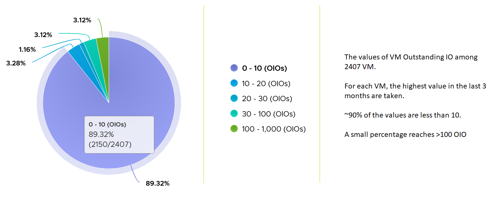

# VM Disk Latency

## Meaning
- Indicates a performance problem. A primary counter for how well the VM is served.
- Contrast: CPU Latency does not always indicate a performance problem. See `vsphere/cpu/metrics/virtual-machine/latency`.
- Threshold setting by layer: see `foundations/thresholds`.

## Mechanism
- Latency can be high at low IOPS and throughput: each layer in the stack has its own queue (process, Guest OS storage subsystem, VM driver, kernel, array).
- Total latency is not (read latency + write latency) / 2. It is the average over all commands. 100 reads and 10 writes per second: total latency follows read latency.
- Read and write latency have different patterns. Often only one has a problem. Check both when troubleshooting.
- IP storage: read and write both map to network Transmit, because ESXi issues the commands.

## Units and levels
- Virtual disk latency is provided in ms and in microseconds.
- Disk and datastore levels add Highest Latency, rolled up as Latest.
- Contention can come from the VM (an IOPS limit) or from the infrastructure.

## Threshold
- No universal threshold: ranges vary widely by storage. Profile your environment and compare with what the storage vendor sold.
- Example profile: more than 63 million data points (2,400 VMs × 3 months).


## Traps
- "Total latency = average of read and write latency" → it is weighted by command count.

## Metadata
```yaml
id: vsphere/storage/metrics/virtual-machine/disk-latency
retriever_guide: metric-meaning
scope: vsphere
technology:
- storage
pillar:
- performance
product:
- vsphere
object:
- VirtualMachine
metric_class: contention
internal_derive:
- vsphere/foundations/visibility-layers
same_name:
- vsphere/cpu/metrics/virtual-machine/latency
- vsphere/memory/metrics/virtual-machine/latency
same_meaning: []
related:
- vsphere/storage/metrics/virtual-machine/iops
- vsphere/storage/diagnosis/vm-storage-performance-checks
- vsphere/storage/concepts/guest-os-vs-vm-storage
- vsphere/storage/metrics/virtual-machine/outstanding-io
- vsphere/storage/metrics/virtual-machine/disk
- vsphere/storage/metrics/virtual-machine/datastore
source:
  document: PART 3 - Counters.docx
  path: The World of Metrics > Metrics Nuances > Complexity > Naming Complexity; Storage > Architecture > VM Layer > Performance; Storage > VM > Performance Metrics > Contention Metrics
corrections: []
review_notes:
- 'Section ''Mechanism'': from Storage > Architecture.'
- 'Sections Units and levels, Threshold: from Storage > VM.'
status: draft
```
