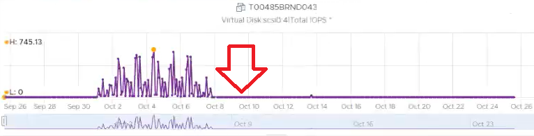

# VM Virtual Disk

## Meaning
- Includes RDM.
- The term virtual disk covers both VMDK and RDM, because an RDM appears as a virtual disk when browsing the datastore directory. The RDM file is only a pointer to an external LUN.

## Why it differs from Datastore Virtual Disk
- Different vantage points. The RDM belongs to the VM, but its data is on an external LUN, not on the datastore.

## Scope
- The most important of the 3 layers: closest to the VM, most detailed.
- Covers VMFS VMDKs, NFS VMDKs and RDMs.
- Excludes everything else, such as snapshot data.
- Typically one guest partition per virtual disk.
- vSphere Client has no VM-level aggregate: target objects are individual scsiM:N. VCF Operations has an aggregate of all instances.

## Properties (VCF Operations)
| Property | Values |
|---|---|
| Virtual Device Node | SCSI bus location. Enumerated from the first controller along the bus. |
| Compatibility Mode | Physical (minimal SCSI virtualization) or Virtual (full virtualization) |
| Disk Mode | Dependent, Independent - Persistent, Independent - Nonpersistent |
| SCSI Bus Sharing | None, Physical, Virtual |
| SCSI Controller Type | BusLogic Parallel, LSI Logic Parallel, LSI Logic SAS, VMware Paravirtual |
| Encryption Status | - |
| Is RDM | true or false (false = VMDK) |
| Virtual Disk Sharing | Unspecified, No Sharing, Multi-Writer |
- Number of VMDK excludes RDM. Number of RDMs counts only RDMs attached to the VM.
- Unused RDM check: per physical array, sum Number of RDMs over all VMs and compare with the LUNs carved for RDM. More LUNs: unused RDMs.
- An RDM looks like a regular VMDK when browsing the VM folder.

## Multi-writer disks
- Several VMs share one VMDK or RDM, for example database clusters. Complicates capacity, cost and performance management.
- Active/passive pair: after failover the passive VM reports 0 (vCenter returns 0, not blank). The new active VM reported blank before it took over.
- Disk Space | Active Not Shared (GB) = Disk Space | Not Shared (GB) - Disk Space | Snapshot Space (GB). Space of VMDKs and RDMs owned only by this VM. Snapshots count as non-active.


## Traps
- "VM disk totals should match datastore totals" → RDM and many-to-many relationships break that. See `vsphere/foundations/object-relationships`.

## Metadata
```yaml
id: vsphere/storage/metrics/virtual-machine/virtual-disk
retriever_guide: metric-meaning
scope: vsphere
technology:
- storage
pillar:
- capacity
- performance
product:
- vsphere
object:
- VirtualMachine
metric_class: consumption
internal_derive:
- vsphere/foundations/object-relationships
same_name:
- vsphere/storage/metrics/datastore/virtual-disk
same_meaning: []
related:
- vsphere/storage/metrics/virtual-machine/disk
- vsphere/storage/metrics/virtual-machine/datastore
- vsphere/storage/concepts/vm-files
images:
  - path: ../../images/vm-disk-multi-writer-passive-vm-shows-zero-iops.png
    product: [vsphere]
    object: [VirtualMachine]
    metric: ['VM Disk IOPS']
    topic: 'Multi-writer disk'
    image_type: timeline
source:
  document: PART 3 - Counters.docx
  path: The World of Metrics > Metrics Nuances > Complexity > Naming Complexity; Storage > VM > Overview > Virtual Disk; Multi-Writer Disk
corrections: []
review_notes:
- 'Sections Scope, Properties, Multi-writer disks: from Storage > VM.'
status: draft
```
