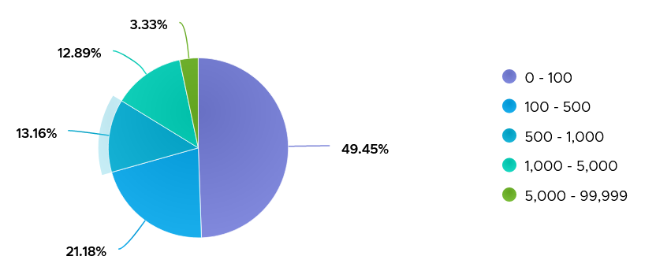

# VM Disk IOPS

## Under-reporting
- IO queued inside the Guest OS has not reached the hypervisor. VM-level IOPS does not include it. See `vsphere/foundations/visibility-layers`, area A.

## Limits
- A disk IOPS limit exists.
- A disk throughput limit does not exist. Throughput depends on block size, which varies, so a throughput limit is not practical.

## Values
- IOPS vary widely by workload and by busy vs quiet time.
- 1,000 IOPS averaged over 5 minutes = 300,000 commands. 10,000 IOPS = 3 million commands in 300 seconds.
- 3,500 production VMs over 1 week: about 85% never exceeded 1,000 IOPS; about 3% exceeded 5,000.
- High IOPS also load the shared pipe: a few VMs at 1 Gb/s each can saturate a 10 Gb link.
- Sustained load raises the chance of affecting other VMs. Discuss unusually high IOPS with the application team.
- Low IOPS with high throughput: large blocks. Compare with the planned block size.


## IOPS limit
- Set per virtual disk, not per VM. Not possible for snapshots or swap files.
- Default: no limit. The book recommends keeping it.
- A limit shows as latency in the Guest OS, not in VM metrics: IO that passes is not delayed. Same as any problem above the VM layer, such as a guest LSI Logic or PVSCSI driver issue.
- VCF Operations per virtual disk: IOPS Limit property, IOPS per GB metric.

## Traps
- "VM latency normal, so an IOPS limit is not hurting" → the latency shows in the Guest OS.

## Metadata
```yaml
id: vsphere/storage/metrics/virtual-motherboard/iops
retriever_guide: metric-meaning
scope: vsphere
technology:
- storage
pillar:
- performance
product:
- vsphere
object:
- VirtualMachine
layer:
- virtual-motherboard
metric_class: consumption
internal_derive:
- vsphere/foundations/visibility-layers
- foundations/resource-nature
same_name: []
same_meaning: []
related:
- vsphere/storage/metrics/virtual-motherboard/disk-latency
images:
  - path: ../../images/vm-disk-iops-distribution-across-vms.png
    product: [vsphere]
    object: [VirtualMachine]
    metric: ['VM Disk IOPS']
    image_type: distribution
    sample: '3,500 VMs'
source:
  document: PART 3 - Counters.docx
  path: The World of Metrics > Metrics Nuances > Complexity > Architecture Complexity; Storage > VM > Performance Metrics > Consumption metrics
corrections: []
review_notes:
- 'Sections Values, IOPS limit: from Storage > VM.'
status: draft
```
