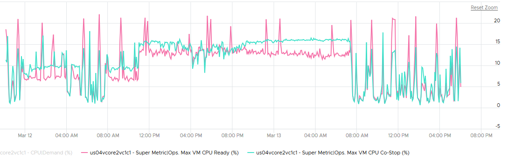
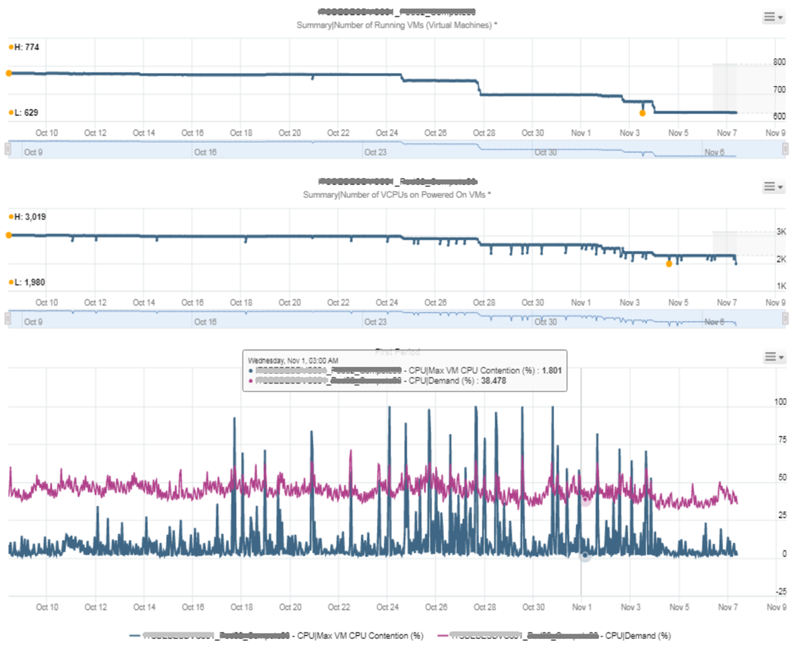
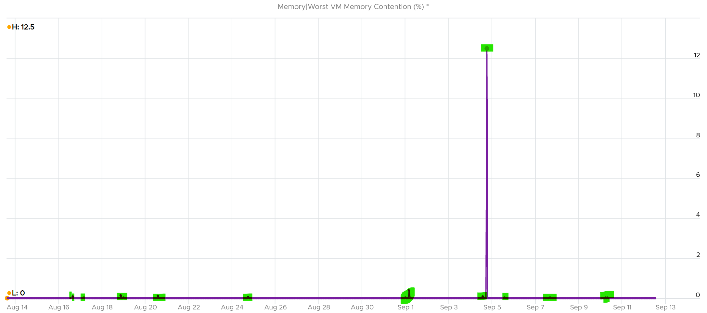

# Cluster utilization vs VM contention

## Principle
- Manage at cluster level: the sweet spot for monitoring and troubleshooting.
- Cluster metrics are averages, even totals: Total CPU Wait is the sum of hosts, each the sum of VMs; dividing by the cluster total gives an average. One suffering VM is hidden.
- Performance is unmet demand per consumer. One VM can suffer while the others are fine.
- Cluster utilization is the provider view; performance is the consumer view. Low utilization does not rule out contention.

## Correlation case
- When every VM gets the same treatment, utilization and contention move together.
- Example: 14 hosts, 550 VMs. Percentage of VMs with CPU Ready > 1% followed the utilization pattern (breadth). Worst VM CPU Ready showed the depth.

## No-correlation cases
- 32 hosts, 2,357 VMs, average demand below 40% (8 hosts could be retired), yet VM Ready and Co-stop were high.

- Mission-critical cluster at about 50% utilization for a month. Max VM CPU Contention spiked above 75% several times. Complaints led to evacuations: running VMs fell from 774 to 629 (19%), vCPUs from 3,019 to 1,980 (34%; large VMs moved out). Contention then fell while utilization stayed flat.


## Memory case
- Host: 759 GB usable, VMs configured 444 GB, 413 GB mapped. No ballooning: no host pressure.
- Max VM memory contention on the host still spiked: a page had to come back from compression.
- Swapped was always 0: every page could be compressed.
- Compression started about a month earlier and was only 342 MB (under 0.1% of consumed), but it hit an active VM.
- The book's guess: a limit, directly or via a resource pool.


## Traps
- "Low cluster utilization means no performance problem" → check worst VM contention.
- "No ballooning, so no memory contention" → past compression can cause contention now.

## Metadata
```yaml
id: vsphere/system/concepts/cluster-utilization-vs-contention
retriever_guide: how-it-works
scope: vsphere
technology:
- cpu
- memory
- storage
- network
- system
pillar:
- performance
- capacity
product:
- vsphere
- vcf-operations
object:
- ClusterComputeResource
- HostSystem
internal_derive:
- vsphere/foundations/provider-consumer
related:
- vsphere/system/metrics/cluster/cluster-performance
- vsphere/system/diagnosis/cluster-vm-contention
source:
  document: PART 3 - Counters.docx
  path: Provider Objects > Performance > Contention vs Consumption
corrections: []
review_notes: []
status: draft
```
