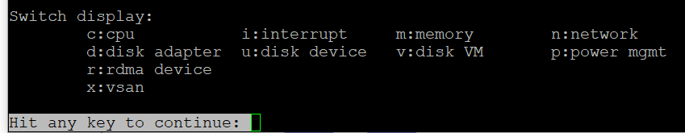

# esxtop: how to read it

## Nature
- esxtop has no Guest OS metrics, although its manual says "guest". Guest OS and VM are different realms.
- It shows consumer (VM, vCPU) and provider (core, thread) objects side by side.
- Best for real-time troubleshooting on a known host. Not for capacity (weeks or months).

## Panels regrouped

| Group | Consumer view | Provider view | Panels |
|---|---|---|---|
| CPU | Yes | Partly: the 4-line summary | CPU, Power Management (CPU only, no socket level; thread level when HT is on), Interrupt |
| Memory | One shared panel | Summary at top | Memory |
| Storage | Disk VM | Disk Adapter + Disk Device (analyze together) | Plus vSAN (disk metrics only). No path panel. |
| Network | One shared panel | - | Network, RDMA device |

## Navigation
- V: show only VMs.
- G: show only groups matching a string (regular expressions allowed).
- g: inside an expanded group, show only matching worlds (for example storage or network worlds of a large VM).
- F: choose fields; %State Times is the most useful CPU field set.
- A VM row has %VMWAIT; non-VM worlds do not.

## Export
- Avoid CSV export of everything: over 100 MB and more than 10,000 metrics (example: 16,384). Limit metrics and duration.

## Traps
- "esxtop shows guest metrics" → VM and kernel only.

## Metadata
```yaml
id: vsphere/system/concepts/esxtop
retriever_guide: how-it-works
scope: vsphere
technology:
- cpu
- memory
- storage
- network
- system
pillar:
- performance
product:
- vsphere
object:
- HostSystem
- VirtualMachine
internal_derive: []
related:
- vsphere/cpu/metrics/comparisons/esxtop-cpu
images:
  - path: ../images/esxtop-panels-overview.png
    product: [vsphere]
    object: [HostSystem]
    topic: 'esxtop panels'
    image_type: diagram
source:
  document: PART 3 - Counters.docx
  path: Provider Objects > esxtop > Overview
corrections: []
review_notes: []
status: draft
```
