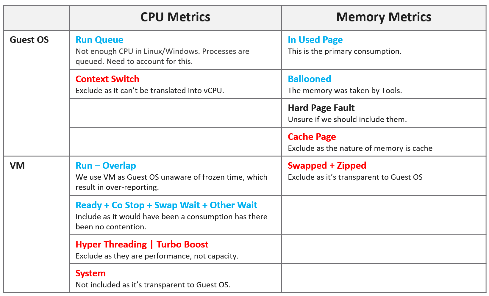
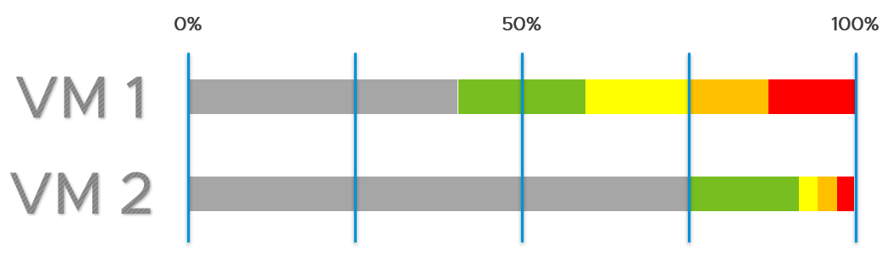

# Guest OS sizing



## CPU: exclude
| Item | Reason |
|---|---|
| Hyper-Threading | The guest is unaware. On a shared core it runs at 62.5%: a 3 GHz core feels like 1.875 GHz. |
| CPU frequency | Same. VM CPU Demand and Usage include frequency and HT, so they do not suit guest sizing. Exception: initial sizing, for example a request for 32 vCPU at 3 GHz on a 2 GHz host. |
| CPU idle time | Idle while waiting for IO is a separate scope: a faster IO subsystem raises CPU use. |
| CPU context switch | No translation to vCPU count; not controllable; caused by too many vCPUs or IO. |
| Hypervisor overhead | MKS, VMX, System are not guest demand. So VM Used, Demand and Usage (which include System at VM level) do not suit. |

## CPU: include
| Item | Reason |
|---|---|
| Co-stop, Ready | Runtime the guest demanded. Guest numbers miss it: its time was frozen. Limits are already accounted. Adding or removing vCPUs does not change these waits: the bottleneck is elsewhere. |
| Other Wait, Swap Wait | Same as Ready: the CPU waited for RAM or IO. |
| Overlap | Runtime the guest demanded. Already inside Run, so not added separately when using Run. |
| Guest OS CPU run queue | The primary counter that Windows or Linux cannot keep up. |

## CPU formula
```text
Guest OS CPU Needed (vCPU) = configured vCPU - Idle + run queue factor
```
- Unit: vCPU, not % or GHz.
- Configured - Idle includes Ready, Co-stop, Swap Wait and Other Wait.
- Run queue factor example: 8 vCPU, run queue 28. At 3 per vCPU, 8 vCPU absorb 24. Shortage 4. Each added vCPU takes 1 process + 3 queued: add 1 vCPU.
- Without the run queue factor, Guest OS Needed is usually within 10% of CPU Usage. Usage is higher with System time and Turbo; lower with HT and down-clocking.

## CPU recommendation
```text
Guest OS Recommended Size (vCPU) = round up for NUMA (projection (Guest OS Needed))
```
- Size first, then adjust for NUMA. NUMA depends on the hosts, so it can differ per cluster.
- Use 1 socket with many cores until the socket boundary is exceeded (2 cores × 1 socket, not 2 sockets × 1 core).
- 1 vCPU is valid: since 64-bit Windows there is no separate uniprocessor HAL.
- Mixed hosts: use the smallest NUMA node in the cluster. Example: a 12-vCPU VM as 2 sockets × 6 cores fits both 2 × 10-core and 2 × 12-core hosts. Assumes memory is not the limit.
- Usually an even number once the VM crosses a socket.
- Applications that manage their own memory or fixed thread counts (databases, JVM) may require setting changes after resizing.
- CPU Hot Add affects NUMA.

## Memory
- Memory is cache. Unused memory is waste: aim high, with a narrow green band.
- The book recommends option 2 of two range schemes: wide grey (waste) zone, then a narrow green band near the top.
- Applications touch only part of their working set; the rest becomes cache. Active + cache above 95% is fine.
- ESXi waits until about 99% before ballooning. Windows and Linux also cache.


| Rule | Reason |
|---|---|
| Include cache | Sizing on in-use only leaves no cache or free memory: the guest pages out. Name the result Needed Memory, not Demand. How much cache to include is open. |
| Exclude page file | Too conservative: In Use already contains cache. Proactive page-in (memory-mapped files) makes unmet demand impossible to isolate. |
| Exclude balloon | It inflates In Use when taken from free pages. |
| No fallback to VM metrics | Inaccurate for the guest. |
| Exclude latency | Memory contention measures speed; sizing measures space. |
- Windows and Linux differ more for memory than for CPU.

## Traps
- "Size the guest with VM CPU Usage" → includes HT, frequency and System.
- "Free memory is safe headroom" → for memory, unused is waste.

## Metadata
```yaml
id: vsphere/system/concepts/guest-os-sizing
retriever_guide: how-it-works
scope: vsphere
technology:
- cpu
- memory
- system
pillar:
- capacity
- performance
- value
product:
- vsphere
- vcf-operations
object:
- VirtualMachine
internal_derive:
- vsphere/cpu/concepts/guest-os-vs-vm-cpu
- vsphere/memory/concepts/guest-os-vs-vm-memory
related:
- vsphere/system/concepts/rightsizing
- vsphere/system/concepts/vm-footprint-sizing
- vsphere/memory/metrics/virtual-machine/utilization
source:
  document: PART 3 - Counters.docx
  path: 'Consumer Objects > Capacity: Guest OS > Guest OS Sizing'
corrections: []
review_notes:
- 'Section ''Memory'': the book''s text describes waste below 50% and risk above 75%, while its recommended option 2 shows green starting near 75%. Open question in docs/author-questions.md.'
- 'Section ''Memory'': the book''s sizing table marks Ballooned as included, while the text says exclude balloon. Open question in docs/author-questions.md.'
- 'References from the book: https://blogs.vmware.com/management/2020/01/rightsizing-vms-with-vrealize-operations.html and https://blogs.vmware.com/management/2019/09/26212.html (not read).'
status: draft
```
