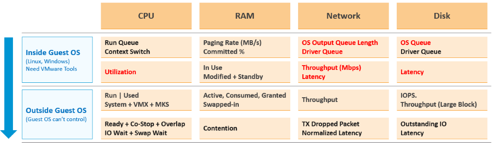

# Performance KPI design: VM Performance (%) and Guest OS Performance (%)

## Why a KPI
- 5,000 VMs every 5 minutes over 24 hours is too many trend charts. One score per VM makes monitoring at scale possible.

## Two KPIs, not one
- VM Performance (%) and Guest OS Performance (%): one per realm.
- Pros: the direction of troubleshooting is clear; each score is higher (a single number dilutes less).
- Cons: twice the metrics; application teams see both as infrastructure and ask for one number.


## Which metrics qualify
- A metric qualifies only if its values map to the 4 ranges (green, yellow, orange, red). Otherwise it distorts the KPI.
- So most utilization metrics (disk IOPS, network throughput) are excluded: no universal mapping fits all VMs.
- Only VM and Guest OS metrics. ESXi, resource pool, datastore and cluster metrics are averages of VMs: less visibility, and derivable from the VM metrics. You troubleshoot VMs, not infrastructure.

## Excluded metrics
| Area | Metric | Reason |
|---|---|---|
| Guest OS | CPU context switch | Very wide band in profiling. |
| Guest OS | Memory page-in | Can include application binaries and proactive fetch. More volatile in 3,300 VMs. |
| Guest OS | Swap file free capacity | Effect of a low value on performance unknown. Correlates with free memory: double counting. |
| Guest OS | Dead processes | Range values unknown; Windows and Linux require separate profiles. |
| Guest OS | RAM page fault | VMware Tools does not provide it. |
| Ratio | Guest OS IOPS : VM IOPS | Should be near 1 or stable. Guest reports the last value, VM the average. No data yet. |
| CPU | Other Wait | Too many CPU metrics inflate CPU weight. A rare bug gives false positives. |
| Memory | Consumed, Active, Granted | Do not indicate performance problems. |
| Storage | Outstanding IO | A function of IOPS and latency: duplicate. |
| Storage | Snapshot latency | Covered by CPU Other Wait. |
| Network | Broadcast, multicast | Undesirable, but do not cause performance problems. |
| Network | Error packets | VMware Tools does not provide them. |
| Network | Network queue | No such metric. |
| Network | Receive dropped | Too many false positives. |
| Network | Packets per second | 100% cannot be quantified. |
| Cluster | VM DRS Score | About execution efficiency and cluster performance; reuses KPI metrics. |
| vMotion | Downtime, stun time | Not enough data for ranges beyond green (0.2 s). |

## VM DRS Score
```text
VM DRS score = Performance Goodness × 0.8 / CPU Demand
```
- 0.8 is the performance degradation threshold.
- Considers CPU, memory (including tiering), network, Fault Tolerance, vSAN, storage and maintenance.
- A low score does not mean the VM runs badly (Niels Hagoort). It reflects execution efficiency.

## Scoring
- Each metric maps to a score: green 100-75, yellow 75-50, orange 50-25, red 25-0.
- Within a range the value is prorated: value / range size × 25, subtracted from the range's starting score.
- Weights: green 1x, yellow 2x, orange 4x, red 8x. The weighted values are normalized afterwards. Worse ranges count more.
- Red uses min() so very large values score 0, not negative. Example: CPU Ready above 16% scores 0.
- CPU Net Run is special: green is 60-95%. Below 60% scores 100: max(Run - 60, 0).
- Guest OS Free Memory is descending: more is better. Above 512 MB scores 100. KB is converted to MB.
- Free Memory uses the 5-minute average, not the lowest 20-second value: it measures space, and the latest value matters.
- Swapped + Compressed has no built-in metric: a super metric sums them.
- The 4-range concept: Chapter 1, Performance Modelling.

## Traps
- "Add IOPS to the KPI" → no universal range; it masks real problems.
- "Use datastore latency in the VM KPI" → it is an average of VMs.

## Metadata
```yaml
id: vsphere/system/concepts/performance-kpi-design
retriever_guide: how-it-works
scope: vsphere
technology:
- cpu
- memory
- storage
- network
- system
pillar:
- performance
product:
- vcf-operations
object:
- VirtualMachine
internal_derive:
- foundations/thresholds
related:
- vsphere/system/metrics/virtual-machine/vm-performance
- vsphere/system/metrics/virtual-machine/guest-os-performance
- vsphere/system/metrics/comparisons/peak-20-second-metrics
source:
  document: PART 3 - Counters.docx
  path: 'Consumer Objects > Performance: VM & Guest OS > Approach; Metrics Not Used; Implementation'
corrections: []
review_notes:
- 'VM DRS Score blog from the book: https://blogs.vmware.com/vsphere/2020/05/vsphere-7-a-closer-look-at-the-vm-drs-score.html (vSphere 7; not read).'
status: draft
```
