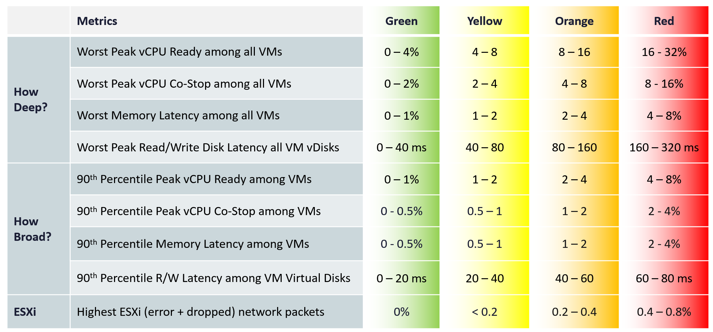

# Cluster Performance (%) (VCF Operations KPI)

## Design
- Not the average of VM KPIs. A cluster serves VMs: guest contention matters little to it; ESXi physical network matters to it but not to a VM.
- Two dimensions: depth (worst VM) and breadth (90th percentile of VMs).
- Uses 20-second peaks to catch short bursts. Limitation: outliers, for example one VM with a limit in a large cluster. Higher thresholds reduce false positives.
- Breadth uses the 90th percentile: the average reacts too late; the 95th percentile suffers from host imbalance.
- Aggregate directly from VMs, not from hosts first: two-level aggregation misrepresents the VM population. Drill to hosts only when troubleshooting.

## Thresholds (book)
| Dimension | Metric | Green | Yellow | Orange | Red |
|---|---|---|---|---|---|
| Depth | Worst peak vCPU Ready among all VMs (%) | 0-4 | 4-8 | 8-16 | 16-32 |
| Depth | Worst peak vCPU Co-stop among all VMs (%) | 0-2 | 2-4 | 4-8 | 8-16 |
| Depth | Worst memory latency among all VMs (%) | 0-1 | 1-2 | 2-4 | 4-8 |
| Depth | Worst peak read/write disk latency, all VM vDisks (ms) | 0-40 | 40-80 | 80-160 | 160-320 |
| Breadth | 90th percentile peak vCPU Ready among VMs (%) | 0-1 | 1-2 | 2-4 | 4-8 |
| Breadth | 90th percentile peak vCPU Co-stop among VMs (%) | 0-0.5 | 0.5-1 | 1-2 | 2-4 |
| Breadth | 90th percentile memory latency among VMs (%) | 0-0.5 | 0.5-1 | 1-2 | 2-4 |
| Breadth | 90th percentile read/write latency among VM virtual disks (ms) | 0-20 | 20-40 | 40-60 | 60-80 |
| ESXi | Highest ESXi (error + dropped) network packets (%) | 0 | below 0.2 | 0.2-0.4 | 0.4-0.8 |



## Threshold reasons (book text)
- Co-stop, Overlap and Other Wait have the same VM impact as Ready, but practically lower values. The same range would inflate the score.
- Dropped and error packets are rare. Take the worst host, not a sum (a sum becomes an average). Low threshold, as many hosts have 25 Gb NICs.
- Ballooning does not impact performance: 4x the threshold of zipped + swapped (possibly 6x). Large clusters matter: 4% ballooned of 20 TB is 800 GB.
- Ballooned, swapped and zipped are sticky (can be historical) and get higher thresholds.
- vMotion is a leading indicator that the cluster struggles: example 26 of 488 VMs (5.3%) moved, and Ready and Co-stop rose slightly.

## Not used
| Metric | Reason |
|---|---|
| % VMs with CPU Ready > 1%, % VMs with memory contention > 0% | Same purpose as the percentile. |
| VM utilization | Irrelevant. Use host metrics. |
| ESXi Consumed | Higher consumed is better. Use balloon, swapped, compressed as secondary KPI. |
| ESXi CPU utilization | Does not impact performance. If used, take the highest host, not the average. |
| VM DRS Score | About demand, not contention. Example: 23 VMs on a host; 15 low-memory VMs scored 68, 8 high-memory VMs scored below 25, at 117% memory over-provisioning. Cluster DRS score is a weighted average of VM DRS scores. |
| Disk latency | Storage troubleshooting differs from compute (exception: HCI). |
| % VMs facing disk latency | Belongs to the datastore KPI. |
| CPU Other Wait | False positives seen. |
| CPU Overlap | Values so low they could mask other problems. |
| Storage bus resets and aborts | - |

## Implementation
- Super metrics: average or maximum over the cluster's hosts or VMs.
- Future: esxtop-only metrics (for example VM local:remote memory ratio) are not in the vCenter API; two-level roll-up under evaluation.

## Traps
- "Cluster KPI = average VM KPI" → different purpose and metrics.

## Metadata
```yaml
id: vsphere/system/metrics/cluster/cluster-performance
retriever_guide: metric-meaning
scope: vsphere
technology:
- cpu
- memory
- storage
- network
- system
pillar:
- performance
product:
- vcf-operations
object:
- ClusterComputeResource
metric_class: contention
internal_derive:
- vsphere/system/concepts/performance-kpi-design
same_name: []
same_meaning: []
related:
- vsphere/system/concepts/cluster-utilization-vs-contention
- vsphere/system/metrics/cluster/cluster-sla-sli
- vsphere/system/metrics/virtual-motherboard/vm-performance
images:
  - path: ../../images/cluster-performance-thresholds-table.png
    product: [vcf-operations]
    object: [ClusterComputeResource]
    metric: ['Cluster Performance']
    image_type: table
source:
  document: PART 3 - Counters.docx
  path: Provider Objects > Performance > Cluster Performance (%)
corrections: []
review_notes:
- 'Sections ''Thresholds'' and ''Not used'': the table includes disk latency, which the text lists as not used; the text describes balloon and vMotion thresholds that are not in the table; the text says green is not set to 0 for packets, the table shows 0%. Open questions in project/author-questions.md.'
status: draft
```
