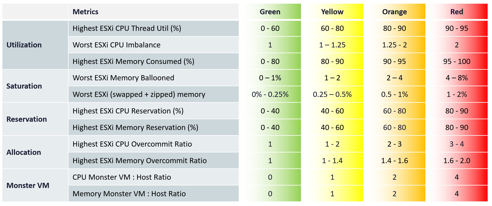

# Cluster Risk (%) (VCF Operations KPI)

## Purpose
- A leading indicator of capacity and performance problems.
- Takes the worst host per metric: many clusters have 8 hosts or fewer, so the worst warns early. Different metrics can come from different hosts; fine for monitoring, not troubleshooting.

## Thresholds (book)
| Group | Metric | Green | Yellow | Orange | Red |
|---|---|---|---|---|---|
| Utilization | Highest ESXi CPU thread utilization (%) | 0-60 | 60-80 | 80-90 | 90-95 |
| Utilization | Worst ESXi CPU imbalance | 1 | 1-1.25 | 1.25-2 | 2 |
| Utilization | Highest ESXi memory consumed (%) | 0-80 | 80-90 | 90-95 | 95-100 |
| Saturation | Worst ESXi memory ballooned (%) | 0-1 | 1-2 | 2-4 | 4-8 |
| Saturation | Worst ESXi swapped + zipped memory (%) | 0-0.25 | 0.25-0.5 | 0.5-1 | 1-2 |
| Reservation | Highest ESXi CPU reservation (%) | 0-40 | 40-60 | 60-80 | 80-90 |
| Reservation | Highest ESXi memory reservation (%) | 0-40 | 40-60 | 60-80 | 80-90 |
| Allocation | Highest ESXi CPU overcommit ratio | 1 | 1-2 | 2-3 | 3-4 |
| Allocation | Highest ESXi memory overcommit ratio | 1 | 1-1.4 | 1.4-1.6 | 1.6-2.0 |
| Monster VM | CPU monster VM : host ratio | 0 | 1 | 2 | 4 |
| Monster VM | Memory monster VM : host ratio | 0 | 1 | 2 | 4 |



## Reasons
- CPU reservation is against base clock speed: All-Core Turbo is unknown.
- Allocation is per host, not cluster-wide: the metric is about performance as well as capacity.
- Monster VMs cause contention despite low utilization, reservation and allocation.

## Not used
- Inter-host imbalance: partly covered by highest host utilization; complex; field validation that it changes remediation is pending.
- vMotion: involves the network across top-of-rack switches. High vMotion downtime should be investigated as basic health.

## Monster VM
- Horizontal risk: more monster VMs, unevenly spread across hosts.
- Vertical risk: bigger VMs. One 96-vCPU VM is riskier than four 24-vCPU VMs.
- Factors: NUMA (most Xeon and EPYC use 8-core CCDs; 16 vCPU could count, which flags too many VMs), Hyper-Threading, hypervisor overhead (vSAN + NSX + VMkernel above 10% CPU).

| Resource | Monster VM (book recommendation) | Example |
|---|---|---|
| CPU | More than 50% of physical cores (not threads) | 64 cores, 128 threads: above 32 vCPU |
| Memory | More than 40% of physical RAM, or 256 GB. DIMM only, excluding memory tiering. | 768 GB RAM + 768 GB NVMe: 256 GB |

## Traps
- "Cluster average utilization shows risk" → use the worst host.

## Metadata
```yaml
id: vsphere/system/metrics/cluster/cluster-risk
retriever_guide: metric-meaning
scope: vsphere
technology:
- cpu
- memory
- system
pillar:
- capacity
- performance
product:
- vcf-operations
object:
- ClusterComputeResource
metric_class: context
internal_derive: []
same_name: []
same_meaning: []
related:
- vsphere/system/metrics/cluster/cluster-consumption
- vsphere/cpu/metrics/host/imbalance
- vsphere/system/concepts/cluster-operations
- vsphere/cpu/concepts/cpu-measurement-levels
images:
  - path: ../../images/cluster-risk-thresholds-table.png
    product: [vcf-operations]
    object: [ClusterComputeResource]
    metric: ['Cluster Risk']
    image_type: table
source:
  document: PART 3 - Counters.docx
  path: Provider Objects > Other Metrics > Cluster Risk (%); Monster VM
corrections: []
review_notes:
- 'Section ''Monster VM'': the book gives several CPU thresholds: above 45% of threads (Overview), above 40% of threads (Monster VM factors), at least half the host (Cluster Risk), and above 50% of physical cores (recommendation). Open question in project/author-questions.md.'
status: draft
```
