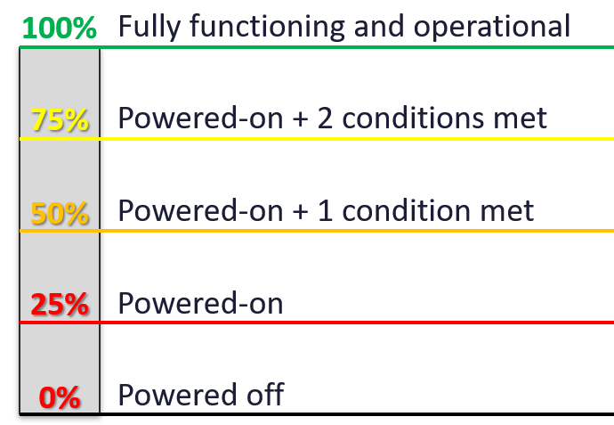
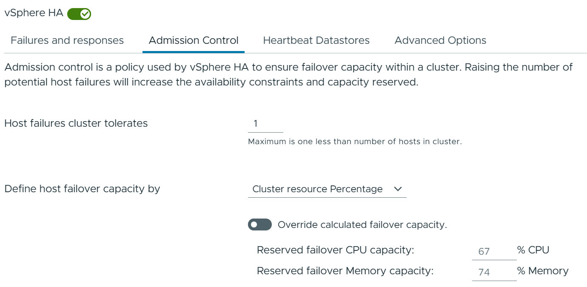

# Cluster and ESXi availability metrics

## Two kinds of availability
| Metric | Meaning |
|---|---|
| Operational availability (%) | Primary. Reflects operations maturity. A host can have perfect hardware but be in maintenance mode, quarantine or disconnected. |
| Hardware availability (%) | Redundant components (power, NICs, fans, memory) let a host keep running through component failures. Causes: manufacturing batch, heat, wear (finite SSD writes). |

## ESXi operational availability (%)
| State | Score |
|---|---|
| Powered off | 0% |
| Powered on | 25% |
| + not in maintenance mode | +25% |
| + not in quarantine | +25% |
| + connected to vCenter | +25% |
- VCF Operations super metric: 1 point per condition met (0-4), × 25.


## Cluster availability
- Not the average of hosts: HA matters.
| Metric | Rule |
|---|---|
| Operational availability (%) | Considers HA: N+1 reports 100% with 1 host unavailable (ignore the worst host, average the rest). Excludes approved planned downtime (requires authoritative start and end times). Ignores hardware issues. |
| Actual availability (%) | Reality: a down is a down. Per host: average of operational and hardware availability (not the lowest). Cluster: average of all hosts, no HA. |
- Capped at 100%. Uncapped, a small N+1 cluster could exceed a large N+2 cluster (a 2-node cluster would show 200%). The cap allows averaging and needs no explanation.
- Operational availability should be near 100%. 99.9% in a month signals operations to improve.
- Actual availability is likely lower.
- In VM-as-a-service, a cluster is internal: no official SLA.


## Roll-up (Datacenter, vCenter, vSphere World)
| Roll-up | Use |
|---|---|
| Average of cluster operational availability | Should be high except during large upgrade windows. |
| Worst cluster operational availability | Practical with a few dozen clusters. |
| Count of clusters below 100% | Best with hundreds of clusters. |

## Traps
- "Cluster availability = average host availability" → HA changes it.

## Metadata
```yaml
id: vsphere/system/metrics/comparisons/availability
retriever_guide: metric-meaning
scope: vsphere
technology:
- system
pillar:
- availability
product:
- vsphere
- vcf-operations
object:
- ClusterComputeResource
- HostSystem
metric_class: context
internal_derive: []
same_name: []
same_meaning: []
related:
- vsphere/system/concepts/capacity-model
- vsphere/system/concepts/cluster-operations
source:
  document: PART 3 - Counters.docx
  path: Provider Objects > Other Metrics > Availability
corrections: []
review_notes: []
status: draft
```
