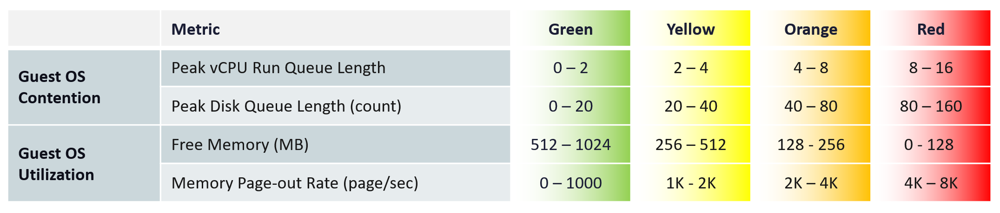

# Guest OS Performance (%) (VCF Operations KPI)

## Thresholds (book)
| Group | Metric | Green | Yellow | Orange | Red |
|---|---|---|---|---|---|
| Guest OS contention | Peak vCPU run queue length | 0-2 | 2-4 | 4-8 | 8-16 |
| Guest OS contention | Peak disk queue length (count) | 0-20 | 20-40 | 40-80 | 80-160 |
| Guest OS utilization | Free memory (MB) | 512-1,024 | 256-512 | 128-256 | 0-128 |
| Guest OS utilization | Memory page-out rate (pages/s) | 0-1,000 | 1K-2K | 2K-4K | 4K-8K |


## Reasons
- Guest OS metrics with no VM equivalent, which change the course of troubleshooting.
- The run queue threshold is set higher than normal to reduce false positives.
- Linux and Windows track memory space, throughput and IOPS, but not memory latency. A Guest OS memory performance metric is still missing.
- Utilization metrics are included because the Guest OS has only 4 metrics: combining keeps it simple.

## Traps
- "Guest OS memory latency is in the KPI" → Windows and Linux do not track it.

## Metadata
```yaml
id: vsphere/system/metrics/virtual-machine/guest-os-performance
retriever_guide: metric-meaning
scope: vsphere
technology:
- cpu
- memory
- storage
- network
- system
pillar:
- performance
product:
- vcf-operations
- windows
- linux
object:
- VirtualMachine
metric_class: contention
internal_derive:
- vsphere/system/concepts/performance-kpi-design
same_name: []
same_meaning: []
related:
- vsphere/system/metrics/virtual-machine/vm-performance
source:
  document: PART 3 - Counters.docx
  path: 'Consumer Objects > Performance: VM & Guest OS > Guest OS Performance (%)'
corrections: []
review_notes: []
status: draft
```
