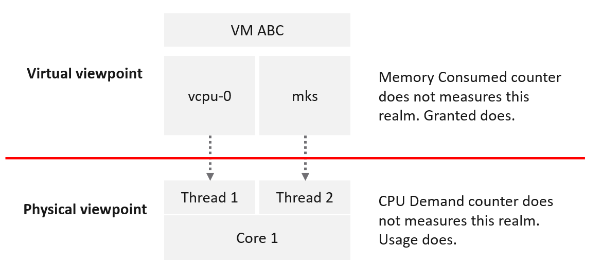
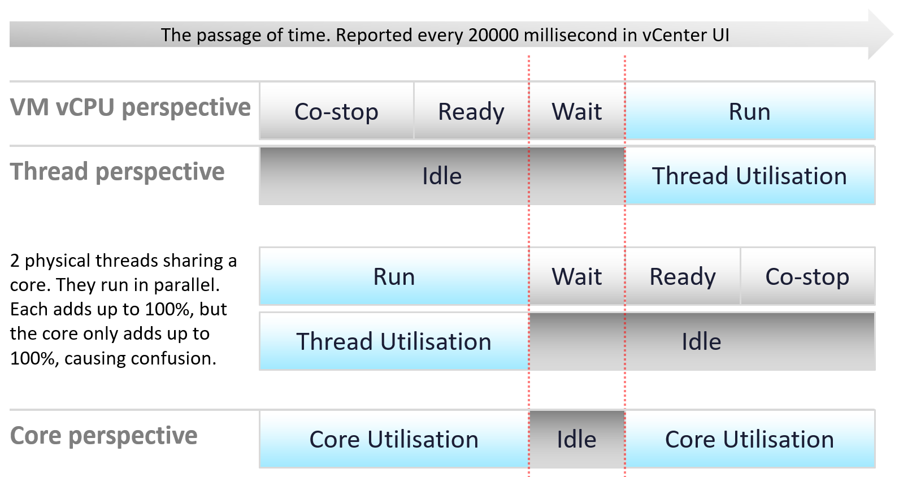
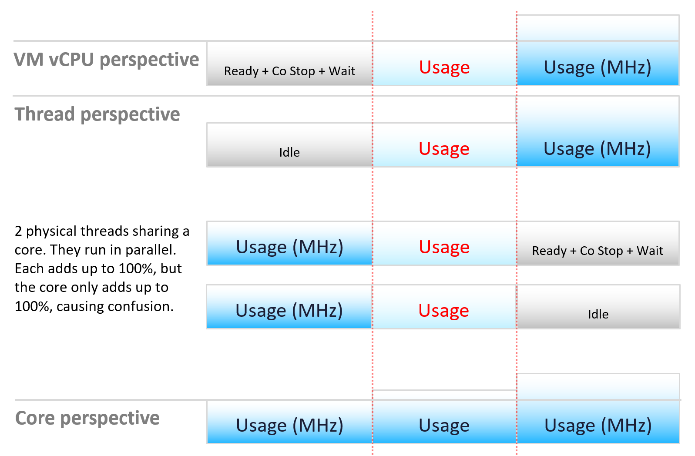
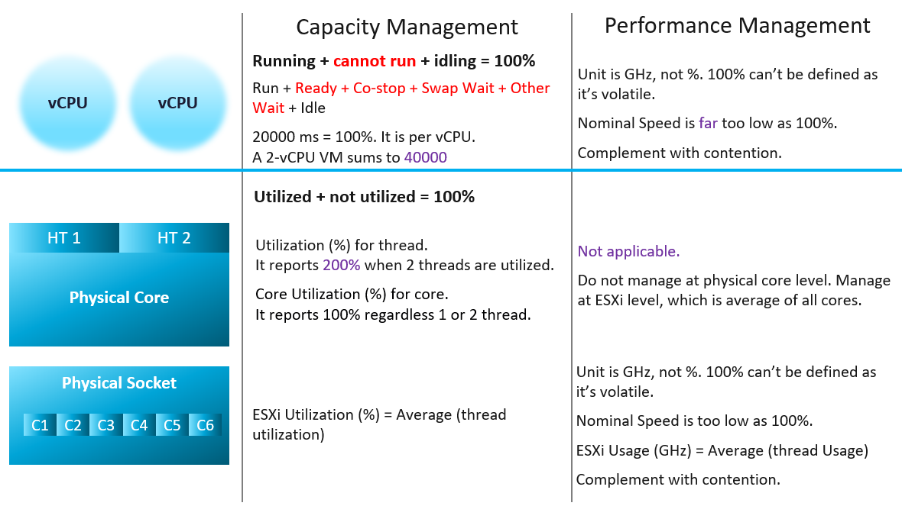
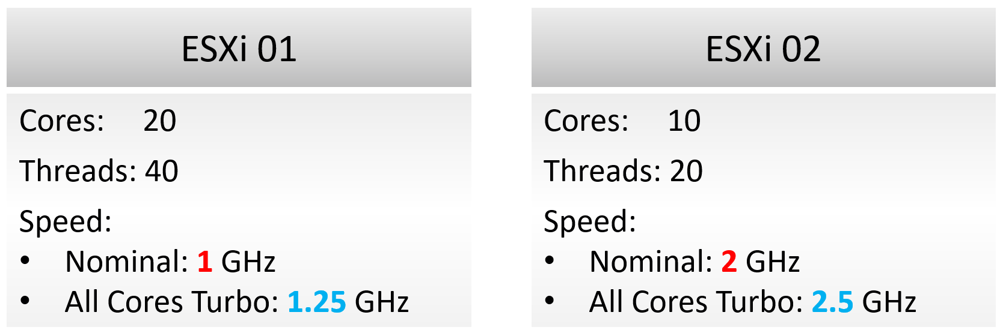

# CPU measurement levels

## ESXi vs VMs plus kernel

- VM and ESXi metrics come from different vantage points. They measure different things.
- So an ESXi CPU counter is not the sum of its VM counters plus the kernel.
- VM: consumer view. It sees the virtual layer. Example: 2 vCPUs, unaware of Hyper-Threading.
- VMs compete with one another but are unaware of one another.
- ESXi: provider view. It sees the physical layer. Example: 1 core with 2 threads, aware of Hyper-Threading.
- Ready and Wait do not apply to ESXi. A core either runs or is idle.
- The kernel has the highest priority. It practically does not experience contention.

## Three levels


| Level | Side | Behaviour |
|---|---|---|
| VM vCPU | Consumer | When it does not get the runtime it demands, the gap is accounted. Hence Ready and Co-stop. |
| ESXi thread | Provider | Physical thread of a core. Never experiences contention. It runs or it does not. |
| ESXi thread | Provider | Threads run in parallel. Each gets its own 100%. Two busy threads show 200% in esxtop. Not wrong, but read the core instead. |
| ESXi core | Provider | The core does the actual work, not the thread. A core registers 100%, not 50%, when only one of its threads runs. |

## Two meanings of thread
- Physical thread (hardware thread of a CPU core): a provider.
- Software thread (in the VMkernel, Windows, Linux): a consumer.
- Read the context before deciding which side a thread is on.

## Frequency and efficiency

- A running core can run at different frequency and efficiency.
- Usage (MHz) captures this. Read "Usage" as throughput: cycles completed.
- Two threads sharing a core run in parallel. Each thread adds up to 100%. The core adds up to 100%. This is the source of confusion.

## Capacity vs performance


| Level | Capacity management | Performance management |
|---|---|---|
| VM vCPU | Running + cannot run + idling = 100%. | Unit is GHz, not %. 100% cannot be defined: it is volatile. |
| VM vCPU | Run + Ready + Co-stop + Swap Wait + Other Wait + Idle = 100%. | Nominal speed is far too low as 100%. |
| VM vCPU | 20,000 ms = 100%, per vCPU. A 2-vCPU VM sums to 40,000 ms. | Complement with contention counters. |
| Physical core | Utilized + not utilized = 100%. | Not applicable. Do not manage at physical core level. |
| Physical core | Utilization (%) per thread. Reports 200% when 2 threads are utilized. | Manage at ESXi level: the average of all cores. |
| Physical core | Core Utilization (%). Reports 100% with 1 or 2 threads running. | - |
| ESXi (all sockets) | ESXi Utilization (%) = average of thread utilization. | Unit is GHz, not %. Nominal speed is too low as 100%. |
| ESXi (all sockets) | - | ESXi Usage (GHz) = average of thread Usage. Complement with contention counters. |

## Rules
- Capacity uses static counters. That is why % works as the unit.
- VM capacity: consumption of the configured vCPUs.
- ESXi capacity: utilization of the threads.
- CPU frequency is about performance, not capacity. So Usage and Demand are not used for capacity.
- Performance is about speed, not space. So CPU frequency must be included.
- CPU speed varies over time and among cores. The upper limit cannot be determined, so there is no 100%.
- Even where the limit could be determined, no API exposes it.
- So % cannot be the unit for performance.
- With no known upper limit, complement with contention counters (for example Ready and Overlap) to manage proactively.

## vSphere's number
- ESXi CPU total capacity = base frequency × cores. No Turbo, no Hyper-Threading.
- Conservative: suits mission-critical clusters. Other workloads can be packed more.
- Sum of VM CPU Usage can exceed ESXi total capacity: total capacity is nominal.
- vSphere's GHz total is a throughput reference, not capacity in the sense of space: two hosts with the same GHz total can hold different numbers of vCPUs. Capacity is counted in physical threads (section CPU capacity: Rules).
- A GHz figure with Turbo or a Hyper-Threading factor is still throughput. It changes with load and power policy; the thread count of a host does not.

## CPU capacity: Example

- ESXi 1: 20 cores × 1 GHz = 20 GHz. ESXi 2: 10 cores × 2 GHz = 20 GHz. Same by vSphere's measure.
- On ESXi 2, VMs run 2x faster, but only half as many fit. The same vCPU count on ESXi 2 gives about 50% CPU Ready, unpredictable performance and very high context switching.
- ESXi 2 has 2x performance and 0.5x capacity. Performance and capacity do not correlate: one number cannot measure both.
- Capacity (space): ESXi 1 = 40 threads, ESXi 2 = 20 threads.

## CPU capacity: Rules
- Capacity is counted in physical threads: where a vCPU can run. Speed is performance.
- Running 40 vCPU on 40 threads is not overcommit (ignoring hypervisor overhead): no Ready. They run slower, like on slower hardware.
- Do not express capacity in MHz: Hyper-Threading adds only 1.25x while each thread slows 37.5%, and All-Core Turbo varies per model. GHz mixes performance and capacity.
- Enable Hyper-Threading, but set customer expectations on speed. Future CPUs may drop HT (some new Intel Xeon use performance and efficiency cores; AMD keeps SMT).
- Reservation is in hertz; allocation is in vCPUs. After vMotion to a faster host, adjust reservations manually if they do not scale.

| Metric | Allocation model | Demand model |
|---|---|---|
| Total capacity | Physical threads in the host | Core and thread utilization. Not GHz. |
| Hypervisor overhead | Threads assigned manually | Already in ESXi counters |
| Consumption | Sum of running VM vCPUs | Core and thread utilization; max(Usage, Reservation) per running VM. Usage tends to over-report. |
| Performance | Not applicable | Ready + Co-stop (Swap Wait and Other Wait are not CPU causes) |

- Do not add VM CPU contention to consumption; track performance explicitly.

## Misconceptions
- "ESXi CPU = sum of VM CPU + kernel CPU" → different vantage points. The sum does not hold.
- "esxtop shows 200% on a core, so the core does 2x the work" → each thread reports its own 100%. Read Core Utilization.
- "Core Utilization 50% when one of two threads runs" → the core registers 100%.
- "Use Usage or Demand for capacity" → they include frequency. Capacity uses static counters (Run, Utilization).
- "Usage (%) near 100% means no headroom" → nominal speed is not the upper limit. Check contention counters.
- "Faster CPU = more capacity" → more speed, not more space.
- "Host CPU capacity = cores × GHz, with or without Turbo and Hyper-Threading" → that is throughput. Capacity is the count of physical threads: 16 cores with Hyper-Threading = 32 threads, at any clock speed.
- "Host CPU capacity depends on Turbo and the power policy" → those change throughput. The thread count is fixed by the hardware and the Hyper-Threading setting.
- "Sum of VM Usage above total capacity is impossible" → total is nominal; Turbo exceeds it.

## Metadata
```yaml
id: vsphere/technology/cpu/concepts/cpu-measurement-levels
retriever_guide: how-it-works
scope: vsphere
technology:
- cpu
pillar:
- performance
- capacity
product:
- vsphere
- vcf-operations
object:
- VirtualMachine
- HostSystem
- ClusterComputeResource
internal_derive:
- vsphere/architecture/provider-consumer
- vsphere/technology/cpu/concepts/hyper-threading
related:
- vsphere/technology/cpu/concepts/vcpu-states
- vsphere/technology/cpu/concepts/run-time-vs-run-quality
- vsphere/technology/cpu/concepts/cpu-frequency
- vsphere/technology/cpu/concepts/hyper-threading
- vsphere/technology/cpu/metrics/host/core-utilization
- vsphere/technology/cpu/metrics/host/utilization
- vsphere/technology/cpu/metrics/host/usage
- vsphere/technology/cpu/metrics/host/demand
- vsphere/technology/cpu/metrics/comparisons/consumption-metrics
- sp5-framework/capacity/supply
- vsphere/architecture/overhead
images:
- path: ../images/vm-sees-2-vcpus-vs-esxi-sees-1-core-2-threads.png
  product:
  - vsphere
  object:
  - VirtualMachine
  - HostSystem
  topic: CPU measurement levels
  image_type: diagram
- path: ../images/cpu-measurement-at-vcpu-thread-core-level.png
  product:
  - vsphere
  object:
  - VirtualMachine
  - HostSystem
  topic: CPU measurement levels
  image_type: diagram
- path: ../images/cpu-usage-and-usage-mhz-from-vcpu-thread-core-perspective.png
  product:
  - vsphere
  object:
  - VirtualMachine
  - HostSystem
  metric:
  - CPU Usage
  - CPU Usage (MHz)
  topic: CPU measurement levels
  image_type: diagram
- path: ../images/cpu-capacity-vs-performance-metrics-at-vcpu-core-socket-level.png
  product:
  - vsphere
  object:
  - VirtualMachine
  - HostSystem
  topic: CPU measurement levels
  image_type: table
- path: ../images/esxi-cpu-capacity-20-cores-1-ghz-vs-10-cores-2-ghz.png
  product:
  - vsphere
  object:
  - HostSystem
  topic: CPU capacity
  image_type: diagram
source:
  document: Private Cloud Management by Iwan Rahabok (https://isvara.io/download)
  path: CPU > Architecture > Architecture intro; ESXi ≠ VM + Kernel; Provider Objects > Capacity > CPU (from former vsphere/technology/cpu/concepts/cpu-measurement-levels)
corrections: []
review_notes:
- 'To check: Section ''Capacity vs performance'': the infographic says ''ESXi Usage (GHz) = Average (thread Usage)''; an average of GHz values is unusual, a sum is expected. Written as in the book.'
status: draft
```
