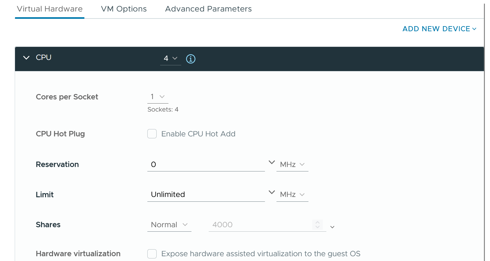

# CPU topology: CPU vs vCPU

## Hyper-Threading inside a VM

- vSphere exposes only virtual sockets and virtual cores to a VM.
- A virtual core has no hyper-threads.
- So Hyper-Threading exists at the physical CPU level only, not at the vCPU level.

## System on a Chip
- A CPU socket is not a simple, linear collection of cores. CPU design moves toward System on a Chip.
- Example: 64-core AMD EPYC 7003 (Zen 3).
  - 8 Core Complex Dies (CCD).
  - Each CCD has its own L3 cache.
  - Each CCD has 8 Zen 3 cores.
  - Each core has its own L2 cache.
- Consequence: locality exists inside one socket. A thread is closer to another thread on the same CCD than to one on another CCD.
- Every core reaches every memory DIMM of its socket through the die fabric, but the paths are not equal. Memory behind a distant controller costs:
  - hop latency: the signal crosses die boundaries;
  - fabric congestion: threads that keep fetching across the central crossbar share its finite bandwidth, which saturates under high utilization.
- So NUMA matters inside one socket too: ESX aligns a VM's threads with the nearest memory controllers through the physical NUMA nodes and the VM's vNUMA layout.
- Placement inside a socket affects application performance.

## NUMA
- NUMA node = a memory domain, not always a socket. One socket (package) holds several NUMA nodes with Sub-NUMA Clustering (SNC, formerly Cluster-on-Die) or AMD NPS2 and NPS4.
- AMD EPYC 9005: NPS4 divides the socket into 4 NUMA domains, each with 3 memory channels and their controllers (6 DIMMs at two DIMMs per channel).
- Intel: SAP recommends enabling Sub-NUMA Clustering (SNC). The workload situation is similar to AMD NPS4.
- Where the domains come from, by processor:

| Processor | Silicon | Memory | Setting whose nodes follow the dies |
|---|---|---|---|
| AMD EPYC 9005 (Zen 5, Turin) | up to 16 CCDs around one central IOD | 12 DDR5 channels | none: one IOD; NPS4 splits it into 4 nodes of 3 channels |
| Intel Xeon 6 6900P (Granite Rapids AP) | up to 3 compute tiles and 2 I/O tiles; the memory controllers sit in the compute tiles | 12 DDR5 channels | SNC3: 3 nodes per socket, one per compute tile, 4 channels each |
| AMD EPYC 9006 (Zen 6, Venice), e.g. EPYC 9996 | 8 CCDs of 32 cores (256 cores); two IODs per socket | 16 DDR5 channels | NPS2: 2 nodes per socket, one per IOD, 128 cores and 8 channels each |

- A node boundary at a die boundary (an IOD, a compute tile with its own memory controllers) keeps the memory of a thread behind its own controllers: a remote access crosses a die-to-die link.
- A node boundary inside one IOD (NPS4 on EPYC 9005) removes no die-to-die hop: every CCD reaches every memory controller through the same IOD, so a local access saves only part of the path across that die.
- The BIOS setting for a general-purpose cluster, NPS-1 for AMD EPYC, and when to depart from it: [`vsphere/technology/cpu/configuration/numa-settings`](../configuration/numa-settings.md), section AMD EPYC.
- Broadcom KB 314059 shows a NUMA effect: NUMA nodes heavily load-imbalanced.

## Cache latency
- Intel Xeon 6 test: local L3 cache latency 33 ns.
- Remote L3 cache (further away on the die): 80 ns.

## Misconceptions
- "A vCPU can use Hyper-Threading" → a virtual core has no hyper-threads. Hyper-Threading is a property of the physical core.
- "All cores in a socket are equal distance from each other" → CCD and L3 boundaries create locality inside a socket.
- "NUMA node = socket" → NUMA node = package or a sub-socket domain (Cluster-on-Die, NPS4, SNC).

## Metadata
```yaml
id: vsphere/technology/cpu/concepts/cpu-topology
retriever_guide: how-it-works
scope: vsphere
technology:
- cpu
- memory
pillar:
- performance
product:
- vsphere
object:
- HostSystem
- VirtualMachine
internal_derive: []
related:
- vsphere/technology/cpu/concepts/numa
- vsphere/technology/cpu/concepts/virtual-numa
- vsphere/technology/cpu/concepts/hyper-threading
- vsphere/technology/cpu/configuration/numa-settings
- vsphere/technology/cpu/concepts/vcpu-states
images:
  - path: ../images/physical-cpu-threads-vs-vcpu-virtual-sockets-and-cores.png
    product: [vsphere]
    object: [HostSystem, VirtualMachine]
    topic: 'CPU topology'
    image_type: diagram
source:
  document: Knowledge base
  path: 'CPU > Architecture > CPU vs vCPU > System on a Chip; NUMA'
corrections: []
review_notes:
- 'To check: Section ''NUMA'': the EPYC 9006 row (8 CCDs of 32 cores, two IODs per socket, 16 channels) against an AMD document; read so far in press reports of the launch (ServeTheHome, 2026-09-25: two IODs on the high-end parts; StorageReview, 2026-09-26: EPYC 9996, 256 cores, 16 channels). AMD Documentation Hub: https://docs.amd.com'
- 'To check: Section ''NUMA'': Broadcom KB not read (https://knowledge.broadcom.com/external/article/314059/numa-nodes-are-heavily-load-imbalanced-c.html).'
- 'To check: Section ''NUMA'': SAP source not read (https://help.sap.com/docs/SUPPORT_CONTENT/virtualization/4181102237.html).'
status: draft
```
