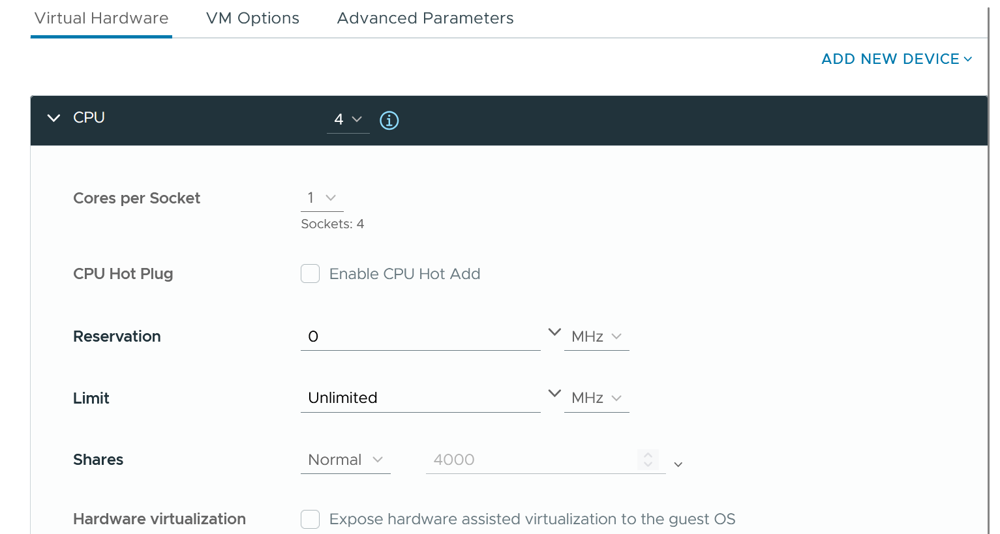

# CPU topology: CPU vs vCPU

## No Hyper-Threading inside a VM

- vSphere exposes only virtual sockets and virtual cores to a VM.
- A virtual core has no hyper-threads.
- So Hyper-Threading exists at the physical CPU level only, not at the vCPU level.

## System on a Chip
- A CPU socket is not a simple, linear collection of cores. CPU design moves toward System on a Chip.
- Example: 64-core AMD EPYC 7003 (Zen 3).
  - 8 Core Complex Dies (CCD).
  - Each CCD has its own L3 cache.
  - Each CCD has 8 Zen 3 cores.
  - Each core has its own L2 cache.
- Consequence: locality exists inside one socket. A thread is closer to another thread on the same CCD than to one on another CCD.
- Placement inside a socket affects application performance.

## NUMA
- NUMA node = package, not always socket. One socket can hold more than one package, for example with Intel Xeon Cluster-on-Die enabled.
- AMD EPYC 9005: AMD states the socket is best divided into 4 NUMA domains. The setting is called NPS4.
- In NPS4, each domain has 6 memory DIMMs and 3 memory controllers.
- Intel: SAP recommends enabling Sub-NUMA Clustering (SNC). The workload situation is similar to AMD NPS4.
- Broadcom KB 314059 shows a NUMA effect: NUMA nodes heavily load-imbalanced.

## Cache latency
- Intel Xeon 6 test: local L3 cache latency 33 ns.
- Remote L3 cache (further away on the die): 80 ns.

## Misconceptions
- "A vCPU can use Hyper-Threading" → a virtual core has no hyper-threads. Hyper-Threading is a property of the physical core.
- "All cores in a socket are equal distance from each other" → CCD and L3 boundaries create locality inside a socket.
- "NUMA node = socket" → NUMA node = package or a sub-socket domain (Cluster-on-Die, NPS4, SNC).

## Metadata
```yaml
id: vsphere/technology/cpu/concepts/cpu-topology
retriever_guide: how-it-works
scope: vsphere
technology:
- cpu
- memory
pillar:
- performance
product:
- vsphere
object:
- HostSystem
- VirtualMachine
internal_derive: []
related:
- vsphere/technology/cpu/concepts/numa
- vsphere/technology/cpu/concepts/virtual-numa
- vsphere/technology/cpu/concepts/hyper-threading
- vsphere/technology/cpu/configuration/numa-settings
- vsphere/technology/cpu/concepts/vcpu-states
images:
  - path: ../images/physical-cpu-threads-vs-vcpu-virtual-sockets-and-cores.png
    product: [vsphere]
    object: [HostSystem, VirtualMachine]
    topic: 'CPU topology'
    image_type: diagram
source:
  document: Private Cloud Management by Iwan Rahabok (https://isvara.io/download)
  path: CPU > Architecture > CPU vs vCPU > System on a Chip; NUMA
corrections: []
review_notes:
- "Section 'System on a Chip': AMD source from the book: https://www.amd.com/system/files/documents/overview-amd-epyc7003-series-processors-microarchitecture.pdf (p. 5)."
- "Section 'System on a Chip': performance example from the book: https://blogs.vmware.com/performance/2020/04/amd-epyc-rome-application-performance-on-vsphere-series-part-1-sql-server-2019.html"
- "Section 'NUMA': AMD EPYC 9005 white paper from the book: https://www.amd.com/content/dam/amd/en/documents/epyc-business-docs/white-papers/5th-gen-amd-epyc-processor-architecture-white-paper.pdf"
- 'To check: Section ''NUMA'': Broadcom KB cited by the book, not read (https://knowledge.broadcom.com/external/article/314059/numa-nodes-are-heavily-load-imbalanced-c.html).'
- 'To check: Section ''NUMA'': SAP source cited by the book, not read (https://help.sap.com/docs/SUPPORT_CONTENT/virtualization/4181102237.html).'
- "Section 'Cache latency': test source from the book: https://chipsandcheese.com/p/a-look-into-intel-xeon-6s-memory"
status: draft
```
