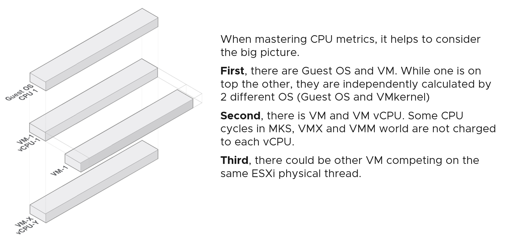
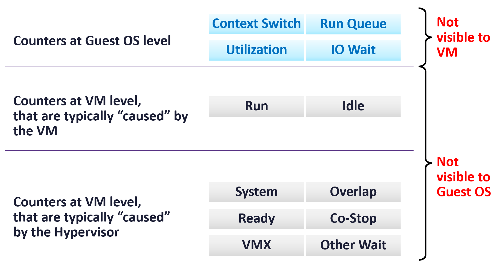
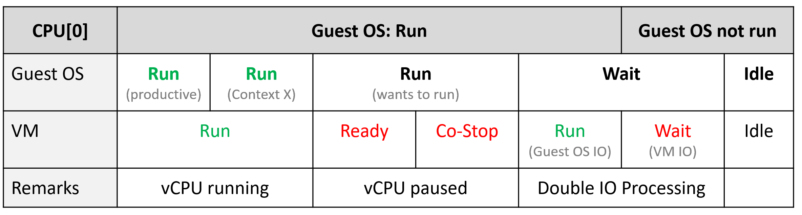

# Guest OS CPU vs VM CPU

## Layers

- CPU has 3 layers: Guest OS, VM, ESXi.
- Memory has 4 layers: a process inside the Guest OS is the extra layer.
- Guest OS CPU and VM CPU are calculated independently, by 2 different kernels: the Guest OS kernel and the VMkernel.
- VM CPU and VM vCPU also differ. Some cycles in the MKS, VMX and VMM worlds are not charged to any vCPU.
- Other VMs can compete for the same ESXi physical thread. The Guest OS cannot see them.
- vCenter has 5 metrics for VM CPU utilization. None maps directly to Windows or Linux CPU utilization.

## Dynamic metrics
- Some CPU metrics are dynamic: their value moves with the CPU clock speed and the Hyper-Threading effect.
- Neither fluctuation is observable from the metric itself.
- The range is not negligible. Example: Hyper-Threading changes CPU Latency by 0% to 37.5%.

## Frozen time
- The kernel can de-schedule a vCPU to run something else on the same physical thread or core: another VM, a kernel interrupt.
- The Guest OS is not told why. For that vCPU, time freezes.
- When the vCPU is scheduled again, guest time jumps.
- The cause of the pause does not matter to the guest. Ready and Co-stop have the same effect on Windows or Linux: a freeze.

## Windows vs Linux accounting of the freeze
| Guest OS | How the frozen time is accounted | Effect |
|---|---|---|
| Windows | Not accounted. | Windows reports a higher utilization than vSphere. |
| Linux | Steal Time only with the VM's steal clock: `stealclock.enable = TRUE`, hardware version 13 or later, a kernel with the VMware steal clock (mainline 5.7 or later, or a distribution backport). Photon OS tracks it by default. Without it: not accounted, as in Windows. | With the steal clock, `st` follows VM CPU Ready; without it, `st` stays 0 however high Ready is. |

- Windows example:
  - second 0-1: the vCPU runs 100%.
  - second 1-2: the hypervisor halts the vCPU. Windows is unaware.
  - Windows sampling every 2 seconds reports 100%. vSphere reports 50%.

## Blind spots per layer
| Layer | Blind spot |
|---|---|
| Guest OS | Hyper-Threading. The ESXi VMM does not pass this information to the guest. |
| Guest OS | CPU frequency scaling, in some Guest OS versions. The real-time frequency comes from the BIOS or the VMM layer. It varies per core and over time. |
| ESXi | How the Guest OS schedules its processes. ESXi sees only what the guest sends out. |

## VM-only components
- When the vCPU shares a physical core with a running sibling thread, VM CPU Usage drops by 37.5%.
- VM CPU Usage includes IO processing done by the hypervisor on behalf of the VM. Significant for heavy databases and NSX Edge.

## Counter visibility


| Counter group | Counters | Not visible to |
|---|---|---|
| Guest OS level | Context Switch, Run Queue, Utilization, IO Wait | VM (ESXi) |
| VM level, typically caused by the VM | Run, Idle | Guest OS |
| VM level, typically caused by the hypervisor | System, Overlap, Ready, Co-stop, VMX, Other Wait | Guest OS |

## No 1:1 mapping (Windows vs VM)
| Type | Windows metric | VM metric |
|---|---|---|
| Contention | Run Queue, DPC Time, Context Switch | None. Internal operations of the Guest OS. |
| Contention | C1 Time, C2 Time, C3 Time | None. ESXi tracks C-states per physical core, not per VM. |
| Contention | None | Ready, Co-stop, System |
| Utilization | Usage | Run - Overlap - VMX - System (formula) |

- Linux `top`, `htop` and `vmstat` usage counters measure time spent. They exclude the speed during the run.

## Linux metrics
| Metric | Meaning |
|---|---|
| User | Non-kernel. Applications typically run here. |
| System | The kernel or privileged ring, where core OS functions run. |
| Idle | Not running. Expect a low run queue during idle time. |
| Wait | Time waiting for IO (disk or network). |
| Steal | Time the vCPU is frozen because the hypervisor has no physical thread to run it. Exists only in a VM. On dedicated physical hardware there is no Steal Time. On vSphere it needs the VM's steal clock; without it, 0. |

## State mapping for one vCPU


| Guest OS state | VM state | Note |
|---|---|---|
| Run (productive) | Run | vCPU running. |
| Run (context switch) | Run | vCPU running. |
| Run (process runnable, vCPU paused) | Ready or Co-stop | The guest counts this as running. The vCPU is frozen. |
| Wait (IO) | Run (Guest OS IO processing) or Wait (VM IO) | IO is processed twice: by the guest and by the hypervisor. |
| Idle | Idle | - |

## Monitoring both layers
- Each layer exposes different performance problems. Monitor both.
- VMware Tools reports Guest OS statistics to ESXi every 20 seconds by default.

## Misconceptions
- "Windows shows 100%, so the VM is at 100%" → Windows does not account frozen time. vSphere can report 50% for the same period.
- "Map Guest OS CPU utilization to one VM counter" → no 1:1 mapping exists. Use each counter at its own layer.
- "The guest sees Hyper-Threading contention" → the guest is unaware of Hyper-Threading.
- "A table of Guest OS-visible metrics marks Demand as not HT-aware, so Demand ignores HT" → that table is the Guest OS realm view. In the VM realm Demand is affected by Hyper-Threading. See [`vsphere/architecture/vm-vs-guest-os`](../../../architecture/vm-vs-guest-os.md).
- "Guest run queue is visible in vSphere" → it is internal to the Guest OS.

## Metadata
```yaml
id: vsphere/technology/cpu/concepts/guest-os-vs-vm-cpu
retriever_guide: how-it-works
scope: vsphere
technology:
- cpu
pillar:
- performance
- capacity
product:
- vsphere
- windows
- linux
object:
- VirtualMachine
internal_derive:
- vsphere/architecture/vm-vs-guest-os
- vsphere/architecture/kernel-worlds
related:
- vsphere/technology/cpu/concepts/vcpu-states
- vsphere/technology/cpu/concepts/cpu-measurement-levels
- vsphere/technology/cpu/concepts/hyper-threading
- vsphere/technology/cpu/metrics/virtual-motherboard/run
- vsphere/technology/cpu/metrics/virtual-motherboard/wait
- vsphere/technology/cpu/metrics/virtual-motherboard/usage
- vsphere/technology/cpu/metrics/virtual-motherboard/latency
images:
  - path: ../images/guest-os-cpu-vs-vm-vcpu-vs-vm-layers.png
    product: [vsphere]
    object: [VirtualMachine]
    topic: 'Guest OS vs VM'
    image_type: diagram
  - path: ../images/guest-os-vs-vm-cpu-counter-visibility.png
    product: [vsphere]
    object: [VirtualMachine]
    topic: 'Guest OS vs VM'
    image_type: diagram
  - path: ../images/guest-os-cpu-states-mapped-to-vm-vcpu-states.png
    product: [vsphere]
    object: [VirtualMachine]
    topic: 'vCPU states'
    image_type: diagram
source:
  document: Knowledge base; Broadcom KB 434983 and KB 376609 (steal time on vSphere); Broadcom TechDocs, Tanzu GemFire 10.1, High CPU Steal (section VMware ESXi)
  path: CPU > Architecture > Guest OS vs VM
corrections: []
review_notes:
- 'To check: Section ''Blind spots per layer'': how often ESXi updates the guest on per-core frequency; unconfirmed.'
status: draft
```
