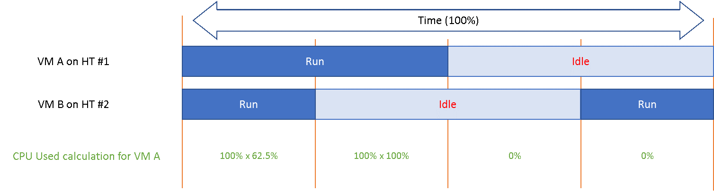
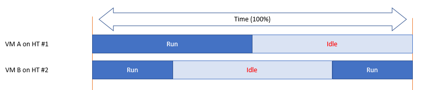
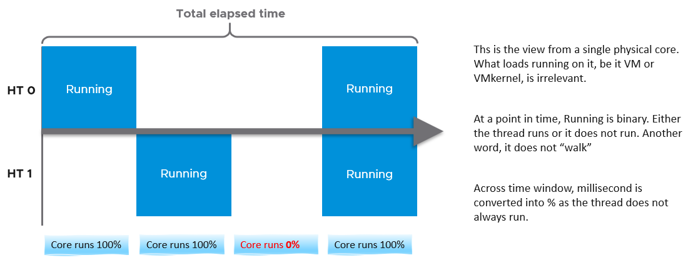
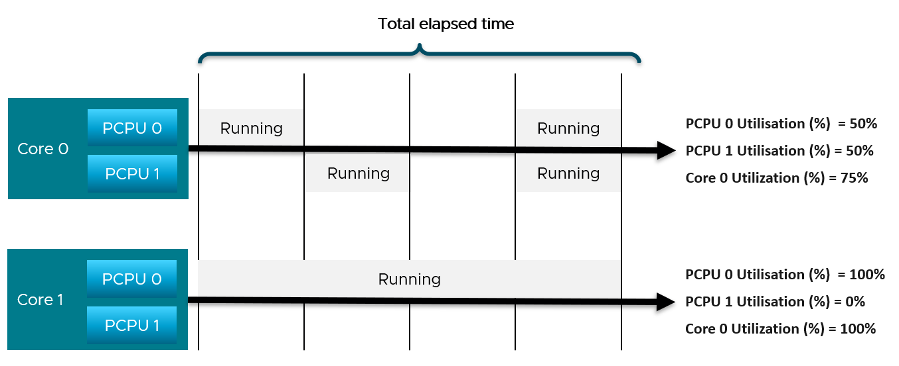
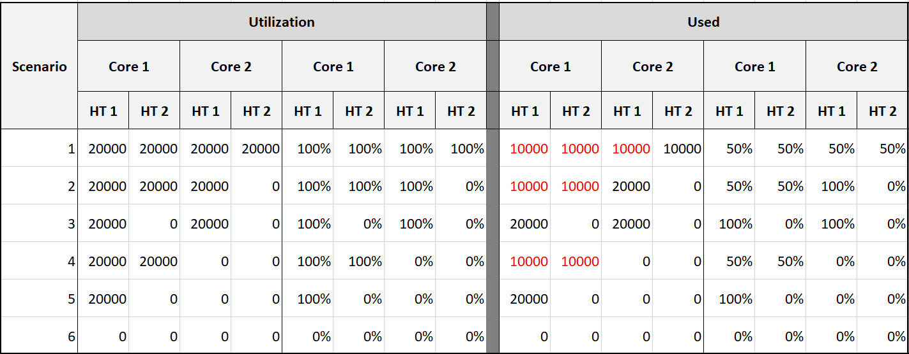
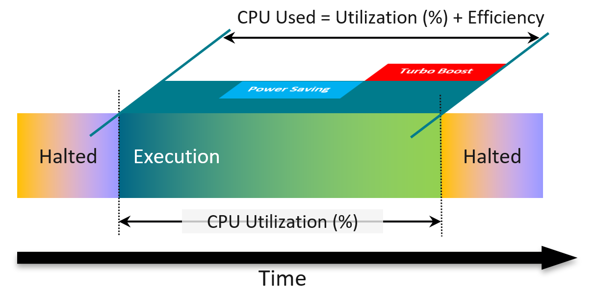
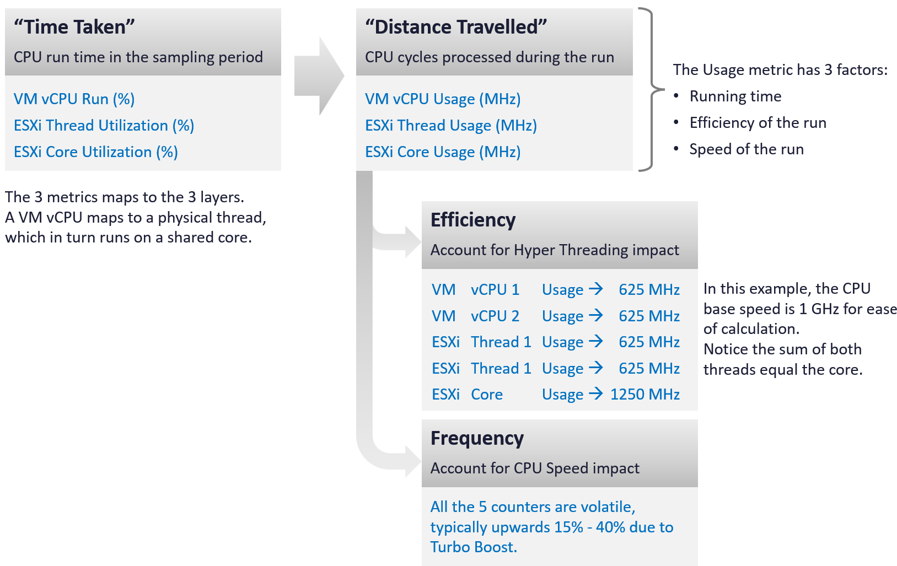

# Hyper-Threading

## Definition
- Hyper-Threading (also called simultaneous multithreading, SMT) lets one physical core behave like two logical processors.
- The two logical processors run threads at the same time.
- Gain: a slight to significant increase in system performance, by keeping the processor pipeline busy.
- Hyper-Threading does not double performance. Twice as many physical cores can roughly double performance. Hyper-Threading can provide anywhere from a slight to a significant increase.

## Enablement
- ESX uses Hyper-Threading automatically when the hardware and BIOS support it.
- The BIOS must support it. Check the system documentation.
- Enable it in the system BIOS.
- BIOS labels vary: "Logical Processor" or "Enable Hyper-Threading".
- The source recommends activating it for best performance.

## Logical processor numbering
- ESX assigns adjacent CPU numbers to the logical processors of one core.
- Example:
  - CPU 0 and CPU 1 share the first core,
  - CPU 2 and CPU 3 share the second core.

## Scheduling behaviour
- ESX spreads load across all physical cores.
- A logical processor with no work is halted.
- Its execution resources become available to the other logical processor on the same core.
- The scheduler places a VM's vCPUs on two different cores before using both logical processors of one core.
- A vCPU running on one logical processor of a busy core gets slightly more than half the throughput it gets alone on the core.
- The scheduler accounts for this: a VM running with a whole core (sibling halted) is charged more than a VM running on half a core.
- The gain is application dependent. Some applications slow down, because the two logical processors share caches and execution units.

## Affinity caution
- The two logical processors share most processor resources.
- Pinning vCPUs to both logical processors of one core can cause poor performance.
- The source gives this example: CPU 0 and CPU 1 on the same core.
- The caution applies whether the vCPUs come from different VMs or from one SMP VM.

- CPU admission control ignores affinity: a pinned VM can be admitted and still not get its reservation.
- A VM's affinity covers its vCPUs and its helper worlds (devices, display). Pinning a 1-vCPU VM to one CPU, or a 2-vCPU VM to two CPUs, stops the helpers from running alongside the vCPUs. Include at least one extra CPU.
- Affinity may no longer fit after vMotion to a host with a different CPU count.

## vCPU count and hyper-threads
- Hyper-threads count as logical threads.
- A VM with more vCPUs than physical cores is sometimes permissible.
- The same configuration can create contention when the vCPUs are used.

## NUMA and hyper-threads
- A VM with more vCPUs than cores per NUMA node, but fewer than logical processors per NUMA node, can use logical processors with local memory.
- Setting: `numa.vcpu.preferHT`, per VM.
- Details: see [`vsphere/technology/cpu/concepts/numa`](numa.md).

## Hyper-Threading accounting: Mechanism
- SMT (Intel: Hyper-Threading) raises the total throughput of a core.
- It lowers the throughput of each thread.
- The real gain varies with the load.
- The gain is hard to measure: the core frequency does not change.

## Hyper-Threading accounting: Accounting
- ESXi records the core gain as 1.25x, regardless of the real gain.
- The real gain for an application can be lower or higher. The counter still reports 1.25x.
- Both threads running: the core records 1.25x. Each thread gets 62.5% of the core.
- From each VM's vantage point, an idle sibling thread is better: 100% instead of 62.5%.
- The drop can be significant. So the latency sensitivity setting gives the vCPU a full core reservation. The scheduler runs nothing on the sibling thread.

## Run vs Used
- Run is unaware of Hyper-Threading. It counts time only.
- Used accounts for the shared core.

## Hyper-Threading accounting: Worked example


- 2 VMs share one physical core. Each runs on one thread.
- 4 combinations are possible: both run, only A runs, only B runs, both idle.
- Each VM runs half the time. Half of VM A's runtime overlaps with VM B.

```text
VM A Run  = 50%
VM A Used = 25% × 0.625  (B also running)
          + 25% × 1.0    (B idle)
          = 15.625% + 25%
          = 40.625%
```

| Scenario | Run | Used |
|---|---|---|
| Each VM runs half the time, half of it overlapping | 50% | 40.625% |
| Both threads run all the time | 100% | 62.5% |

## Provider contention
- ESXi is the provider. A physical thread runs or is halted. It does not wait to be served.
- The consumer (VM) faces contention. So ESXi consumption metrics come first; ESXi contention metrics are sums of VM metrics.

## Time base
- Basic unit: 20,000 ms per sample (vCenter real-time).
- 20,000 ms = 100% at core level. The core keeps 20,000 ms whether Hyper-Threading is on or off.
- With Hyper-Threading, each thread is allocated 10,000 ms of Idle. A fully idle thread shows at most 10,000 ms Idle.
- A thread running alone can show Used up to 20,000 ms.
- At thread level: 100% Used = 20,000 ms, but 100% Idle = 10,000 ms. Thread-level values are confusing for this reason.
- Hyper-Threading and power management act at core level, not thread level. Rolling thread counters up to cores is complex.

## Thread Utilization
- The vCenter counter is named Utilization (%). Read it as Thread Utilization (%).
- The ESXi equivalent of VM CPU Run.
- Binary per moment: a thread is running (unhalted) or not (halted).
- Averaged over the sample. 50% means running half the time, not running at half speed.
- Ignores frequency and Hyper-Threading.
- Relevant only when Hyper-Threading is enabled. Without it, Thread Utilization equals Core Utilization.

## Core Utilization
- 100% when one thread runs. 100% when both run.

## Example: one core
- In 20 s, thread 0 runs 10 s, thread 1 runs 10 s, overlapping 5 s.


```text
Thread Utilization (HT 0) = 10 s / 20 s = 50%
Thread Utilization (HT 1) = 10 s / 20 s = 50%
Core Utilization          = 15 s / 20 s = 75%
```

- vSphere Client cannot select a core when Hyper-Threading is on. It lists PCPUs (threads).
- Core Utilization shown per thread is duplicated, not split. Both threads show the core value.
- Do not sum the 2 threads' Thread Utilization. Each is in the context of one thread.

## Example: ESXi with 2 cores
- Core 1: threads at 50% and 50% (core 75%). Core 2: threads at 100% and 0% (core 100%).


```text
Thread Utilization (ESXi) = (50% + 50% + 100% + 0%) / 4 = 50%
Core Utilization (ESXi)   = (75% + 100%) / 2          = 87.5%
```

- Thread Utilization counts each thread independently. It ignores that Hyper-Threading does not deliver 2x.
- So Core Utilization tends to be consistently higher than Thread Utilization.

## Imbalance signal
- Core Utilization below 2 × Thread Utilization: some cores run 2 threads while other cores are idle.
- The scheduler spreads vCPUs across cores before pairing threads on one core (vSphere 9.1 documentation: VMs are "preferentially scheduled on two different cores"). Uneven core load comes from the workload and NUMA placement.

## Used per thread
- Used splits a core's time when both threads run: 10,000 ms each, not 20,000.
- ESXi considers Hyper-Threading to deliver 1.25x. 12,500 ms per thread is easier to read.
- At ESXi level the split is normalized back.


| Scenario | Utilization (ms) C1-HT1, C1-HT2, C2-HT1, C2-HT2 | Used (ms) |
|---|---|---|
| 1 | 20000, 20000, 20000, 20000 | 10000, 10000, 10000, 10000 |
| 2 | 20000, 20000, 20000, 0 | 10000, 10000, 20000, 0 |
| 3 | 20000, 0, 20000, 0 | 20000, 0, 20000, 0 |
| 4 | 20000, 20000, 0, 0 | 10000, 10000, 0, 0 |
| 5 | 20000, 0, 0, 0 | 20000, 0, 0, 0 |
| 6 | 0, 0, 0, 0 | 0, 0, 0, 0 |

## Used and Usage vs Utilization
- Used is calculated from a hardware counter: Non-Halted Core Cycles (NHCC). Higher clock speed completes more cycles, so Used rises with Turbo.
- Used and Usage add 2 factors that Utilization ignores:
  - efficiency: a thread executes less efficiently when its sibling runs.
  - speed: power management lowers or raises the clock while running.
- A physical thread has no Overlap. System does not apply: it runs in the kernel.


## Time taken vs distance travelled
| Time taken (run time) | Distance travelled (cycles) |
|---|---|
| VM vCPU Run (%) | VM vCPU Usage (MHz) |
| ESXi Thread Utilization (%) | ESXi Thread Usage (MHz) |
| ESXi Core Utilization (%) | ESXi Core Usage (MHz) |

- A VM vCPU maps to a physical thread, which runs on a shared core.
- Example, 1 GHz base, both threads busy: each vCPU and each thread 625 MHz; the core 1,250 MHz. The 2 threads sum to the core.
- Usage has 3 factors: running time, efficiency of the run, speed of the run.
- The cycle-based counters are volatile: typically 15%-40% upward from Turbo Boost.


## Misconceptions
- "Hyper-Threading doubles CPU capacity" → the source gives a slight to significant gain, not a doubling.
- "Pin each vCPU to a logical processor for isolation" → pinning both threads of one core can cause poor performance.
- "Run 50% means the VM got 50% of a core" → Run ignores the shared core. Used shows 40.625%.
- "Hyper-Threading gain is 25% for every workload" → 1.25x is a hardcoded accounting value.
- "Ready shows Hyper-Threading contention" → Ready does not change when the sibling thread is busy. Use CPU Latency.
- "Sum thread utilization to get core utilization" → each thread has its own 100%. Read Core Utilization.
- "Core Utilization shown on a PCPU is half the core" → it is duplicated on both threads.
- "Thread Idle 10,000 ms means half idle" → 10,000 ms is a fully idle thread with Hyper-Threading on.

## Metadata
```yaml
id: vsphere/technology/cpu/concepts/hyper-threading
retriever_guide: how-it-works
scope: vsphere
technology:
- cpu
pillar:
- performance
- capacity
product:
- vsphere
object:
- HostSystem
- VirtualMachine
internal_derive:
- vsphere/technology/cpu/concepts/run-time-vs-run-quality
- vsphere/technology/cpu/concepts/cpu-measurement-levels
related:
- vsphere/technology/cpu/concepts/numa
- vsphere/technology/cpu/configuration/latency-sensitivity
- vsphere/technology/cpu/configuration/side-channel-scheduling
- vsphere/technology/cpu/metrics/comparisons/consumption-metrics
- vsphere/technology/cpu/concepts/idle-and-unused-vcpus
- vsphere/technology/cpu/concepts/cpu-topology
- vsphere/technology/cpu/concepts/cpu-frequency
- vsphere/technology/cpu/metrics/virtual-motherboard/run
- vsphere/technology/cpu/metrics/virtual-motherboard/used
- vsphere/technology/cpu/metrics/virtual-motherboard/usage
- vsphere/technology/cpu/metrics/virtual-motherboard/latency
- vsphere/technology/cpu/metrics/host/utilization
- vsphere/technology/cpu/metrics/host/core-utilization
- vsphere/technology/cpu/metrics/host/used
- vsphere/technology/cpu/metrics/host/usage
- vsphere/technology/cpu/metrics/host/idle
- vsphere/technology/cpu/metrics/comparisons/host-consumption-metrics
images:
- path: ../images/hyper-threading-vm-cpu-used-62-5-percent-when-sibling-runs.png
  product:
  - vsphere
  object:
  - VirtualMachine
  - HostSystem
  metric:
  - VM CPU Used
  topic: Hyper-Threading accounting
  image_type: diagram
- path: ../images/hyper-threading-two-vms-on-sibling-threads-run-idle-combinations.png
  product:
  - vsphere
  object:
  - VirtualMachine
  - HostSystem
  metric:
  - VM CPU Run
  - VM CPU Idle
  topic: Hyper-Threading accounting
  image_type: diagram
- path: ../images/esxi-cpu-one-core-two-threads-thread-vs-core-utilization.png
  product:
  - vsphere
  object:
  - HostSystem
  metric:
  - ESXi CPU Utilization
  - ESXi CPU Core Utilization
  image_type: diagram
- path: ../images/esxi-cpu-two-core-host-thread-and-core-utilization-rollup.png
  product:
  - vsphere
  object:
  - HostSystem
  metric:
  - ESXi CPU Utilization
  - ESXi CPU Core Utilization
  image_type: table
- path: ../images/esxi-cpu-utilization-vs-used-per-thread-6-scenarios-2-core-host.png
  product:
  - vsphere
  object:
  - HostSystem
  metric:
  - ESXi CPU Utilization
  - ESXi CPU Used
  image_type: table
- path: ../images/esxi-cpu-used-vs-utilization-power-saving-and-turbo.png
  product:
  - vsphere
  object:
  - HostSystem
  metric:
  - ESXi CPU Used
  - ESXi CPU Utilization
  image_type: diagram
- path: ../images/cpu-metrics-time-taken-vs-work-done-vm-and-esxi.png
  product:
  - vsphere
  object:
  - VirtualMachine
  - HostSystem
  topic: CPU time-based vs work-based metrics
  image_type: table
source:
  document: Knowledge base; Performance Best Practices for VMware vSphere 9.1 (revision 20260624)
  path: ESX CPU Considerations > Hyper-Threading (p. 28); Guest Operating System CPU Considerations (p. 57); Hardware BIOS Settings (p. 21); CPU > Architecture (pp. 75-77) > CPU Efficiency (from former vsphere/technology/cpu/concepts/hyper-threading); CPU > ESXi > Consumption Metrics > Core vs Thread; Thread Utilization; Used | Usage; Summary (from former vsphere/technology/cpu/concepts/hyper-threading)
corrections: []
review_notes:
- 'Sections ''Scheduling behaviour'', ''Affinity caution'': throughput, charging, scheduler preference and affinity side effects from the vSphere 9.1 documentation, vSphere Resource Management > Hyperthreading and ESX Hosts, Using CPU Affinity, Potential Issues with CPU Affinity (pp. 1829-1831).'
- Checked against 9.1 (revision 20260624). Page 28 unchanged. Page references updated.
- 'Source URL: https://www.vmware.com/docs/vsphere-esxi-vcenter-server-9-1-performance-best-practices'
- 'To check: Hyper-Threading penalty figures, 37.5% (VM Usage) and 50% (ESXi Used); Performance Best Practices for VMware vSphere 9.1 gives no penalty percentages.'
- 'To check: Section ''Worked example'': the formula line, reconstructed from description (VM A runs 50% of the time, half of it with VM B running); gives only the result (40.625%).'
- 'Hyper-Threading figures (1.25x, 62.5%) are not in Performance Best Practices for vSphere 9.1. Open item in project/plan.md.'
- 'To check: Section ''Time base'': what the sibling thread shows when a thread running alone reaches 20,000 ms Used; not tested.'
status: draft
```
