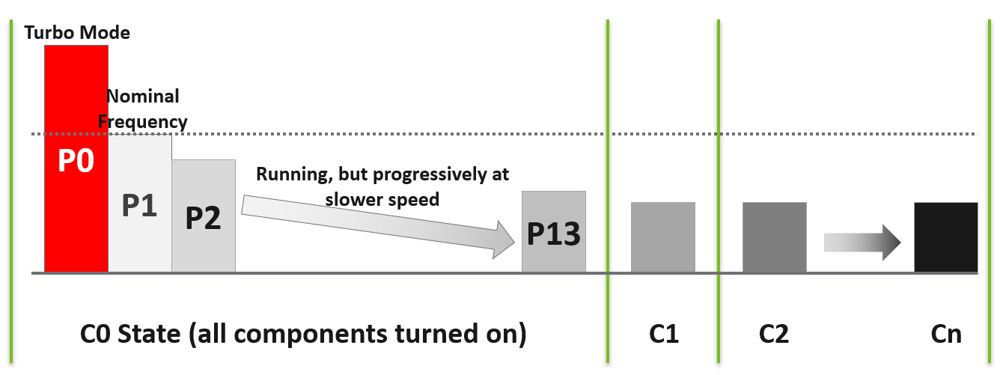

# CPU power states (ACPI)

## Two types

- ACPI defines 2 types of power state: C-states (C = CPU) and P-states (P = performance).
- P-states exist only inside C0.

## C-states
- When a core is idle, ESXi puts it into a halt state: a C-state.
- Deeper C-state: less power, longer time to start running again.
- ESXi predicts the idle duration and picks the C-state to enter.

| State | Effect |
|---|---|
| C0 | Fully running. P-states apply here. An idle CPU can be in C0. |
| C1 | Shallow. Clock gated: the main internal clock stops. All modules stay active. Return to C0 is instantaneous. |
| C2 | Stops the external bus clock. Saves more power than C1. |
| C3 | Flushes the L1 and L2 caches. Stops all internal clocks. |
| C4-Cn | More sections of the CPU turned off. Higher number, deeper sleep. |

- Power policies that do not use deep C-states stop at C1.

## P-states
- P-states grade CPU performance by frequency.
- The number of P-states varies by processor. Not an industry standard.
- P0: Turbo Boost.
- P1: nominal frequency.
- Highest P number: lowest frequency. Example with 14 grades: P13.
- esxtop shows the P-state frequencies when the hardware supports it.

## Two control levels
- Power management must be enabled in both the BIOS and the OS (ESXi).

### BIOS level
- The BIOS is the lower layer. It can override ESXi.
- BIOS-controlled power management: ESXi has no say.
- Check the platform features with vsish:

```text
/power/> cat /power/platformFeatures
Platform Power Management Features
{
   Deep C-states Available:1
   Deep P-states Available:1
   CPPC Capability Available:1
   CPPC Enabled by BIOS:0
   Turbo Boost Enabled:1
}
```

### ESXi level

- BIOS handing control to ESXi does not enable the feature. 2 ESXi Advanced Settings control it.

| Setting | Effect |
|---|---|
| Use C States | Use deep ACPI C-states (C2 or deeper) when the processor is idle. |
| Use C States | An idle core lowers its frequency below base clock speed. It does not have to run fast, so power is saved. |
| Use C States | Disabling it does not disable Turbo. Firmware thermal management sets the frequency of each core. |
| Use P States | Use ACPI P-states or CPPC to save power when the processor is busy. |
| Use P States | Disabled: ESXi uses the highest available frequency. |

## CPPC
- Collaborative Processor Performance Control. Part of ACPI 5.0 and later.
- The OS and the CPU hardware collaborate.
- Replaces legacy, rigid frequency and voltage scaling such as ACPI P-states.
- The OS passes abstract performance capabilities and targets, not frequencies, to the on-die microcontroller.

## C-state × P-state combinations
| Use C States | Use P States | Frequency behaviour |
|---|---|---|
| 1 | 1 | Full dynamic range. Cores drop below base to save power, sleep (0 Hz) when idle, and scale up to All-Core or Single-Core Turbo under heavy load. |
| 1 | 0 | Rigid base, sleep only. Busy cores are pinned at base: no Turbo, no down-throttling. Power drops only in C-state sleep. |
| 0 | 1 | Throttled range. Cores scale below base to save power. No Turbo: without core sleep states there is no thermal budget. |
| 0 | 0 | Flatline. All cores at base frequency, always. No power saving, no sleep, no Turbo. |

## High Performance vs Balanced
- Do not always set power management to maximum.
- ESXi power management saves power without reducing performance.
- A VM at a lower clock speed does not necessarily complete less work.
- Use High Performance only for latency-sensitive applications, where sub-second performance matters. Examples: VDI, VoIP, video calling, Telco NFV.
- Mission-critical clusters often have low overcommit, over-provisioned VMs, or extra hosts for HA. Their actual core utilization is low.
- Low core utilization leaves idle cores. Under Balanced, idle cores let busy cores Turbo higher.

## Oversized VM and C-states
- An oversized VM has a higher chance of idle vCPUs.
- Whitepaper chart (Host Power Management in VMware vSphere 7.0, p. 24):
  - vertical axis: CPU frequency. 100 = nominal frequency.
  - horizontal axis: how busy the core is, from 100% down to 0%. Not time. The VM stays powered on.
  - High Performance: flat at about 130% of nominal until the VM is idle. The whole socket is kept high, so all cores are equal and boost stays at about 130%.
  - Balanced: starts at about 151% of nominal. Busy cores boost higher because other cores are idle.
  - Balanced: frequency falls as load falls, but stays above 100% until the VM is idle.
  - At idle, High Performance: the core enters C1, not C2. The VM can spike quickly.
  - At idle, Balanced: the core enters C2. No spike. The frequency drops further.
- Balanced delivers higher performance than High Performance on low-to-medium load hosts.

## Misconceptions
- "High Performance always gives the highest frequency" → Balanced reached about 151% vs 130% when other cores were idle.
- "Disabling deep C-states disables Turbo" → firmware thermal management still sets per-core frequency.
- "ESXi controls power states" → only when the BIOS hands control to the OS.
- "Lower clock speed means the VM completes less work" → not necessarily. Check contention counters.

## Metadata
```yaml
id: vsphere/technology/cpu/concepts/power-states
retriever_guide: how-it-works
scope: vsphere
technology:
- cpu
- system
pillar:
- performance
- value
product:
- vsphere
object:
- HostSystem
internal_derive: []
related:
- vsphere/technology/cpu/configuration/host-power-management
- vsphere/technology/cpu/concepts/cpu-frequency
- vsphere/technology/cpu/configuration/latency-sensitivity
- vsphere/technology/cpu/concepts/idle-and-unused-vcpus
images:
  - path: ../images/acpi-c-states-and-p-states-diagram.png
    product: [vsphere]
    object: [HostSystem]
    topic: 'CPU power states'
    image_type: diagram
  - path: ../images/esxi-advanced-settings-use-c-states-and-p-states.png
    product: [vsphere]
    object: [HostSystem]
    topic: 'CPU power states'
    image_type: screenshot
source:
  document: Knowledge base
  path: CPU > Architecture > Power States; BIOS Level; ESXi Level; High Performance vs Balance; Impact on Oversized VM
corrections: []
review_notes:
- 'To check: Section ''ESXi level'': advanced option names Power.UseCStates and Power.UsePStates; shows them as ''Use C States'' and ''Use P States'' in the UI.'
- 'To check: Section ''C-state × P-state combinations'': conflicts with the Use P States text and the Turbo observation.'
- 'To check: Section ''C-state × P-state combinations'': the row Use C States = 1, Use P States = 0 says no Turbo; the ESXi level text says P-states off means ''highest available frequency''; the Turbo section reports Turbo (129%) under BIOS static high performance.'
- "Section 'Oversized VM': chart from 'Host Power Management in VMware vSphere 7.0' (2021), p. 24: https://www.vmware.com/docs/hpm-vsphere7-perf. No newer standalone version found on 2026-11-02."
- 'To check: the 9.0 TechDocs page on host power management policies and a VMworld 2017 session (Extreme Performance Series); not read.'
status: draft
```
