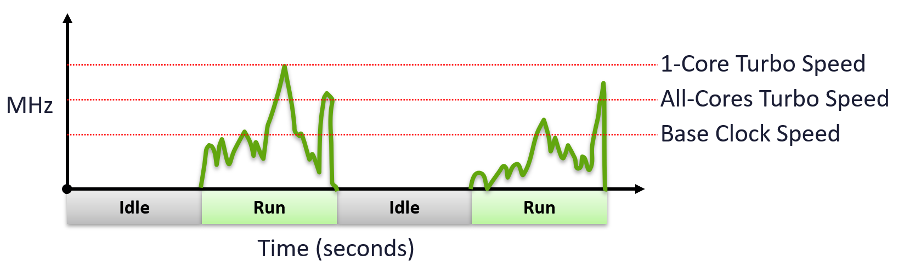
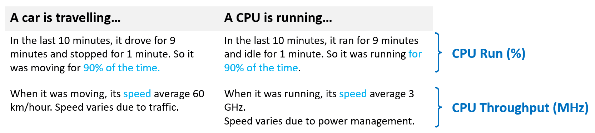

# Run Time vs Run Quality

## Two metrics, not one



| Metric | Nature | Measures | Unit | Use for |
|---|---|---|---|---|
| Run Time | Binary: the CPU runs or does not. | Duration. | ms, or % of the period | Capacity management |
| Run Quality | Complex: cycles completed per unit of runtime vary. | Intensity of work. Only non-zero when Run Time is non-zero. | MHz | Performance management |

- Run Time example: running 60% of the last 100 seconds = 60 seconds of runtime in that period.
- Many CPU metrics are in ms because they track consumption over time.
- Analogy mapping: time a car is moving → CPU Run (%). Speed while moving → CPU Throughput (MHz).
- Speed varies with traffic for a car. CPU speed varies with power management.
- No relative "progress %" exists for speed. The 100% is not deterministic.

## Three factors in one counter
- The counter of work completed mixes 3 technically different factors.

| Factor | Driver | Effect | In the accounting |
|---|---|---|---|
| Frequency | Clock speed | All else equal, 2 GHz completes 2x the cycles of 1 GHz. | Yes. Hence metrics in MHz. |
| Efficiency | Hyper-Threading | A core running 2 threads completes 1.25x the cycles. Each thread gets 0.625x. Translated into MHz. | Yes. The 1.25x and 0.625x values are hardcoded. |
| Efficacy | Core architecture | More work per cycle at the same frequency. | No. |

- Higher throughput lowers utilization: the faster a task completes, the shorter the runtime it occupies.

## Efficacy
- Unique to CPU. Memory, storage and network have no equivalent.
- 1 GHz on a new Intel Xeon is about 30% faster than 1 GHz on a 5-year-old Intel Xeon. Same vendor, same family, same clock speed.
- Causes:
  - more L2 and L3 cache per core. Even a single-threaded process completes more work.
  - superscalar execution, better branch prediction, better pipelines, more execution pipes.
- This is why a new CPU generation with a lower clock speed can run faster.
- No metric accounts for efficacy.

## Fair Share Scheduler
- ESXi schedules many VMs, each with several vCPUs.
- Fairness problem: the quality of a time slice varies.
  - cores in one socket run at different speeds.
  - Hyper-Threading: a shared core gives less per thread.
  - hypervisor IO done for a VM consumes CPU on its behalf.
- The scheduler gives each vCPU a slice of time. It extends the time of a vCPU to keep relative fairness.
- It charges with Used (ms). Used adjusts Run:
  - shared physical core: Used goes down. Used is lower than Run (62.5% vs 100% when both threads run all the time). Usage also goes down.
  - CPU frequency: Used is adjusted for the actual frequency.
  - hypervisor work that interrupts the vCPU for other VMs or the system (Overlap): Used is decreased. Kernel work done for this VM (System) is added to VM-level Used.

## CPU Throughput
- Frequency and efficiency have the same final effect: they change the productive cycles attributed to a vCPU thread.
- A clearer name for this metric: CPU Throughput.
- Reason: "usage" and "used" are general English words. They do not say what is counted.
- A CPU is always running something. Cycles spent waiting for memory or disk are wasted from the task's point of view.
- Throughput means useful cycles, not the idle loop.

## Misconceptions
- "Run 100% means the vCPU got full performance" → Run is time. Throughput depends on frequency and Hyper-Threading.
- "Same MHz, same work done across CPU generations" → efficacy differs. No counter shows it.
- "Used equals Run" → Used is adjusted for shared cores, frequency and hypervisor IO.
- "Use MHz metrics for capacity" → they mix frequency into the value. Use Run Time for capacity.

## Metadata
```yaml
id: vsphere/technology/cpu/concepts/run-time-vs-run-quality
retriever_guide: how-it-works
scope: vsphere
technology:
- cpu
pillar:
- performance
- capacity
product:
- vsphere
object:
- VirtualMachine
- HostSystem
internal_derive:
- vsphere/technology/cpu/concepts/vcpu-states
related:
- vsphere/technology/cpu/concepts/hyper-threading
- vsphere/technology/cpu/concepts/cpu-frequency
- vsphere/technology/cpu/concepts/cpu-measurement-levels
- vsphere/technology/cpu/metrics/virtual-motherboard/run
- vsphere/technology/cpu/metrics/virtual-motherboard/used
- vsphere/technology/cpu/metrics/virtual-motherboard/usage
- vsphere/technology/cpu/metrics/comparisons/consumption-metrics
images:
  - path: ../images/cpu-frequency-base-vs-all-core-turbo-vs-single-core-turbo-while-running.png
    product: [vsphere]
    object: [VirtualMachine, HostSystem]
    topic: 'Turbo Boost'
    image_type: timeline
  - path: ../images/cpu-run-time-vs-throughput-car-analogy.png
    product: [vsphere]
    object: [VirtualMachine, HostSystem]
    metric: ['VM CPU Run']
    topic: 'CPU throughput'
    image_type: diagram
source:
  document: Private Cloud Management by Iwan Rahabok (https://isvara.io/download)
  path: CPU > Architecture > Fair Share Scheduler; 2 Metrics Not 1; Frequency | Efficiency | Efficacy; CPU Throughput
corrections: []
review_notes:
- 'Section ''Efficacy'': the 30% figure is an estimate for a new vs a 5-year-old Intel Xeon at the same clock speed, not a published measurement.'
- 'To check: Section ''CPU Throughput'': which counters the name ''CPU Throughput'' covers (Usage (MHz) at minimum); proposed in the glossary.'
status: draft
```
