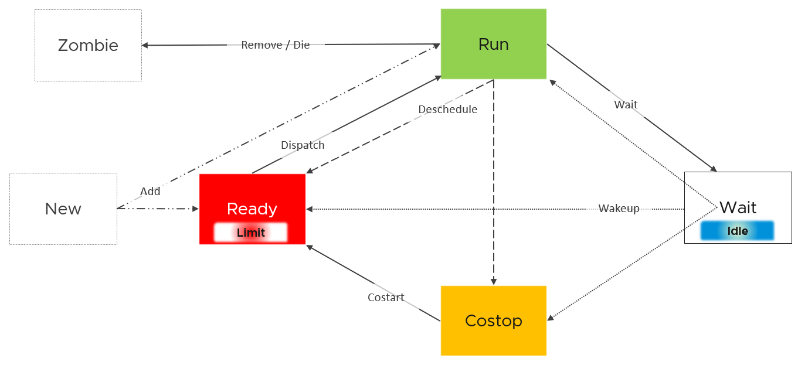
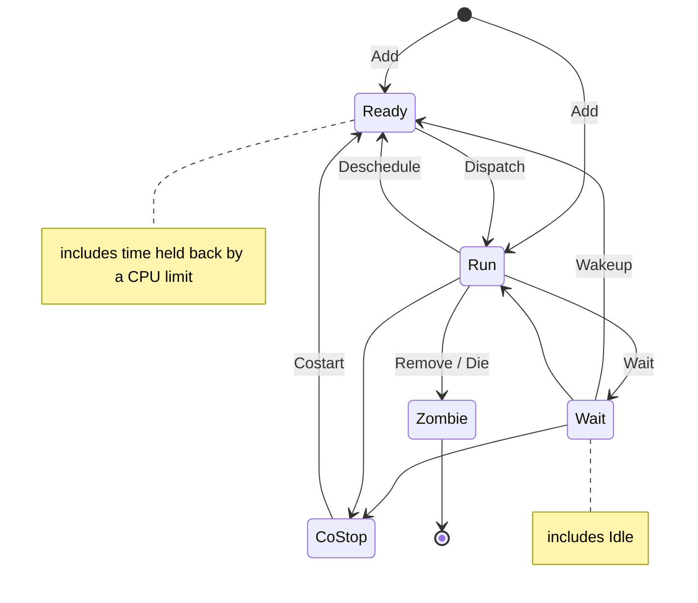
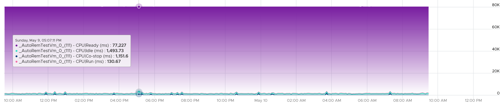
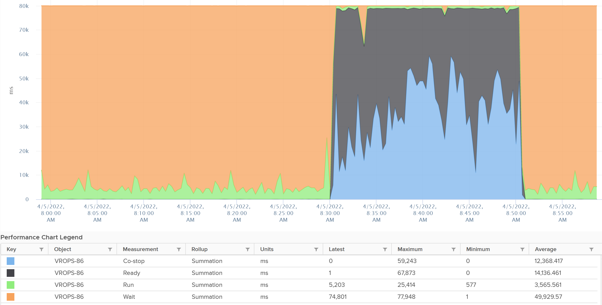
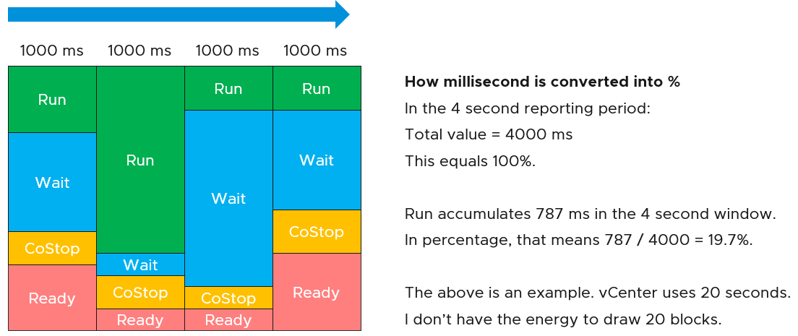
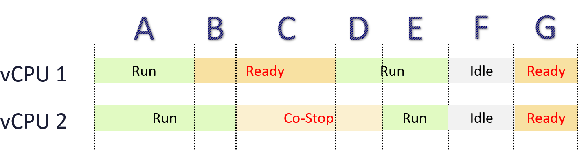

# States of a VM vCPU

## Scheduler goals
- Balance load across physical cores.
- Preserve cache state. Minimize migration cost.
- Avoid contention from hardware (Hyper-Threading, low-level cache) and from sibling vCPUs of the same VM.
- Keep VMs or threads that communicate often close to each other.

## Unit of scheduling
- Each vCPU is scheduled separately. A multi-vCPU VM has one schedule per vCPU.
- At any moment a vCPU either runs or does not. There is no partial state.
- A vCPU is in exactly 1 state at a time. This is the basis of the CPU metric formulas.

## Basic states
| Guest OS activity | Kernel situation | State | Counter |
|---|---|---|---|
| Being used | The kernel has a physical thread to run it. | Run | Run |
| Being used | The kernel has no physical thread to run it. The VM is ready; the hypervisor is not. | Ready | Ready |
| Being used | The kernel has a thread, but another vCPU of the same VM is far behind. | Co-stop | Co-stop |
| Not being used | Truly idle. No work. | Wait (idle) | Idle Wait |
| Not being used | Waiting. 3 sub-cases: IO wait, memory wait, other wait. | Wait | Wait |

## State diagram


- View: one vCPU, from the hypervisor, not from inside the Guest OS.
- New vCPU: enters Ready or Run (Add).
- Ready → Run: the scheduler dispatches the vCPU on a physical thread.
- Run → Ready: the scheduler de-schedules the vCPU.
- Run → Wait: the vCPU has no work, or waits for IO.
- Wait → Ready: wake-up.
- Wait → Run: direct return to Run.
- Run or Wait → Co-stop: a sibling vCPU is too far behind.
- Co-stop → Ready: co-start. The vCPU must still get a thread.
- A CPU limit shows up inside Ready.
- Idle is part of Wait.
- When VM 1's vCPU is in Co-stop, Ready or Wait, the physical thread is free. VM 2 can run on it.

## Formula
```text
Run + Ready + Co-stop + Wait = 100%    (per vCPU, per sample period)
```

## State details
| State | Facts |
|---|---|
| Run | Measures how long the vCPU runs. Unit: ms, not GHz. |
| Run | Does not measure how fast it runs (frequency) or how efficiently (Hyper-Threading). |
| Ready | Caused by ESXi: no physical thread available. |
| Ready | Usually reduced by making the VM smaller: it fits free threads more easily. Fewer shares on a smaller VM can raise it. |
| Co-stop | Caused by the VM: its vCPUs drift apart. |
| Co-stop | Reduced by making the VM smaller, especially relative to the NUMA boundary. |
| Ready, Co-stop | Opposite causes. For the guest the effect is the same: a freeze. |
| Wait | Covers both idle and IO wait. The hypervisor cannot tell whether the guest waits for IO or is idle. Either way, the vCPU does nothing. |
| Wait | Also covers wait caused by hypervisor IO. |
| Wait (idle) | Idle = executing the idle loop. A CPU cannot stop executing instructions without powering down. The kernel runs a lowest-priority system thread: the idle task. |

## Hyper-Threading is invisible to the states
- Ready, Co-stop and Wait do not register slowdown from Hyper-Threading.
- A vCPU is not placed in Ready when its sibling thread is busy. Both threads execute at the same time.
- Contention for shared core resources happens in hardware. The ESXi scheduler does not see it.
- The counter for this throughput loss is CPU Latency.

## OS comparison
| Physical OS process state | ESXi vCPU state |
|---|---|
| Init (being created) | New |
| Ready (in the ready list, waiting to be scheduled) | Ready |
| Running | Run |
| Pending (blocked or suspended; includes idle) | Wait |
| Zombie | Zombie |
| None | Co-stop |

- Co-stop has no OS equivalent. It exists because a multi-vCPU VM is one entity with several schedules.

## State across time



- The diagram is a single moment. Reporting adds a time dimension.
- The scheduler checks state every 2-30 ms.
- Conversion from ms to %: state time / sample period.
- Example: 4-second period = 4,000 ms = 100%. Run accumulates 787 ms. Run = 787 / 4,000 = 19.7%.
- vCenter sample period: 20 seconds. 20,000 ms = 100%.
- The 100% is per vCPU.
- A 24-vCPU VM totals 480,000 ms per sample. Same for 1 socket × 24 cores or 24 sockets × 1 core.
- A 4-vCPU VM: Run + Ready + Co-stop + Wait stacked = exactly 80,000 ms.
- VCF Operations ms metrics are also not normalized by vCPU count. A 4-vCPU VM totals 80,000 ms.
- Use the % versions. They are normalized by the number of vCPUs. Avoid the ms versions.

## Read Ready and Co-stop in the context of Run
- Ready 5% with Run 95%: low.
- Ready 2% with Run 10%: very high. Ready is 20% of Run (2 / 10).
- Reason: Ready is runtime demanded and not given. Compare it with runtime given.

## State across multiple vCPUs

- Ready and Co-stop affect each other.
- Example: a 2-vCPU VM over 7 periods.

| Period | vCPU 1 | vCPU 2 | Reason |
|---|---|---|---|
| A | Run | Run | Both vCPUs run. |
| B | Ready | Run | vCPU 1 hits Ready. vCPU 2 still runs: ESXi has a thread for it. |
| C | Ready | Co-stop | vCPU 1 still has no thread. vCPU 2 is too far ahead, so it is co-stopped. |
| D | Run | Co-stop | vCPU 1 runs. vCPU 2 is still too far ahead. |
| E | Run | Run | The vCPUs are in sync again. Both run. |
| F | Idle | Idle | Both idle or waiting for IO: Wait. |
| G | Ready | Ready | Both demand runtime. No physical thread is free for either. |

- Ready on one vCPU can cause Co-stop on its sibling.

## Misconceptions
- "Ready + Co-stop + Run + Wait is 100% for the VM" → it is 100% per vCPU. Sum over vCPUs for the VM total in ms.
- "Ready 5% is always worse than Ready 2%" → read against Run.
- "A smaller VM reduces only Co-stop" → it usually reduces Ready too. Fewer shares can work the other way.
- "High Wait means IO problems" → Wait includes idle.
- "No Ready, so no Hyper-Threading contention" → states are blind to Hyper-Threading. Check CPU Latency.
- "Compare ms counters across VMs" → ms counters scale with vCPU count. Use %.

## Metadata
```yaml
id: vsphere/technology/cpu/concepts/vcpu-states
retriever_guide: how-it-works
scope: vsphere
technology:
- cpu
pillar:
- performance
- capacity
product:
- vsphere
- vcf-operations
object:
- VirtualMachine
internal_derive:
- vsphere/architecture/provider-consumer
related:
- vsphere/technology/cpu/concepts/guest-os-vs-vm-cpu
- vsphere/technology/cpu/concepts/cpu-measurement-levels
- vsphere/technology/cpu/concepts/run-time-vs-run-quality
- vsphere/technology/cpu/concepts/hyper-threading
- vsphere/technology/cpu/concepts/idle-and-unused-vcpus
- vsphere/technology/cpu/metrics/virtual-motherboard/run
- vsphere/technology/cpu/metrics/virtual-motherboard/ready
- vsphere/technology/cpu/metrics/virtual-motherboard/wait
- vsphere/technology/cpu/metrics/virtual-motherboard/latency
images:
  - path: ../images/vcpu-state-diagram-new-ready-run-costop-wait-zombie.png
    product: [vsphere]
    object: [VirtualMachine]
    topic: 'vCPU states'
    image_type: diagram
  - path: ../images/vm-cpu-states-sum-to-20000-ms-per-vcpu-vcf-operations-chart.png
    product: [vsphere, vcf-operations]
    object: [VirtualMachine]
    metric: ['VM CPU Run', 'VM CPU Ready', 'VM CPU Co-stop', 'VM CPU Wait']
    topic: 'vCPU states'
    image_type: timeline
  - path: ../images/vm-cpu-states-sum-to-20000-ms-per-vcpu-vcenter-chart.png
    product: [vsphere]
    object: [VirtualMachine]
    metric: ['VM CPU Run', 'VM CPU Ready', 'VM CPU Co-stop', 'VM CPU Wait']
    topic: 'vCPU states'
    image_type: timeline
  - path: ../images/vcpu-run-wait-costop-ready-stacked-per-second.png
    product: [vsphere]
    object: [VirtualMachine]
    metric: ['VM CPU Run', 'VM CPU Ready', 'VM CPU Co-stop', 'VM CPU Wait']
    topic: 'vCPU states'
    image_type: diagram
  - path: ../images/multi-vcpu-vm-state-timeline-two-vcpus.png
    product: [vsphere]
    object: [VirtualMachine]
    topic: 'vCPU states'
    image_type: diagram
source:
  document: PART 3 - Counters.docx
  path: CPU > Architecture (pp. 60-67) > State of a VM vCPU; OS Comparison; State Across Time; State Across Multiple vCPU
corrections: []
review_notes:
- 'To check: Section ''State diagram'': the meaning given for the three arrows without a label in the book''s state diagram (Wait to Run, Wait to Co-stop, Run to Co-stop).'
- "Section 'State across time': the book says the % versions are normalized by the number of vCPUs. Applies to vCenter and VCF Operations %. esxtop VM-level % values are sums (see vsphere/technology/cpu/metrics/virtual-motherboard/ready)."
- "Section 'OS comparison': the book uses HarmonyOS as the example OS. The OS name is left out; the state mapping is kept."
status: draft
```
