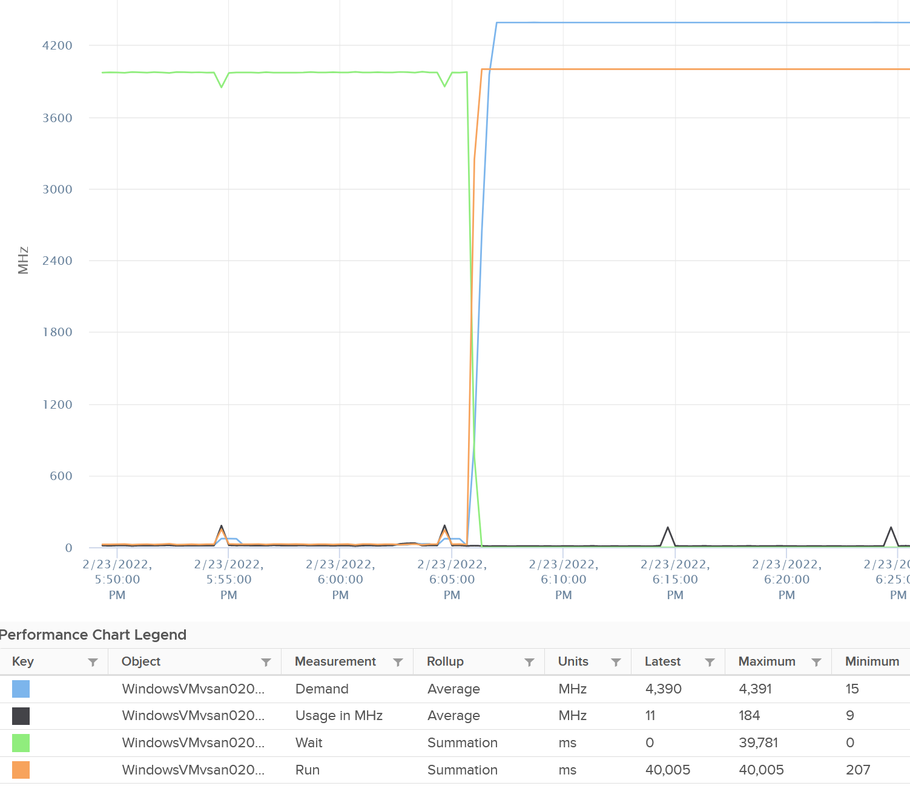

# Latency sensitivity

## Default trade-off
- The default ESX network stack drives high network throughput at low CPU cost.
- Cost: potentially higher network latency.
- Latency-sensitive workloads are impacted by latency on the order of a few tens of microseconds.

## Latency sensitivity setting per VM
- Options: Normal (default), High, High with Hyperthreading.
- High with Hyperthreading requires virtual hardware version 20 or later.

## Normal
- ESX can assign the vCPUs of the VM to any hyper-thread on any physical core of the host.
- The source says this gives the best overall performance for the VMs on the host in most cases.

## High
- The scheduler attempts to grant each vCPU of the VM exclusive access to one physical CPU core.
- The core is used as a whole. This effectively deactivates Hyper-Threading for that core.
- Effect: can increase the performance of that one VM.
- Trade-off: can reduce the performance of other VMs on the same host.

## High with Hyperthreading
- The scheduler grants each vCPU exclusive access to one hyper-thread of a physical core.
- Consecutive vCPU pairs share one core:
  - vCPUs 0 and 1 on one physical core,
  - vCPUs 2 and 3 on another physical core.
- ESX exposes this hyper-threaded topology to the guest OS.
- Benefit: the guest OS and applications can use cache locality. This matters for the few guest workloads that can use awareness of the hyper-threading topology.
- For most workloads: no performance benefit, and possibly reduced performance.
- Locking vCPUs to specific hyper-threads can stop ESX from scheduling vCPUs on otherwise idle physical cores. This can limit performance.
- The source recommends High with Hyperthreading only for workloads known to be aware of, and to benefit from, the underlying topology.

- Documentation name: virtual Hyper-Threading (vHT). Since vSphere 8.0; off by default; at most 2 threads per virtual core.
- Without vHT, each vCPU of a High VM gets a dedicated physical core; the partner hyper-thread is held by an idle world.

```text
CPU reservation, High without vHT = numVcpus x cpuFrequency
CPU reservation, High with vHT    = (numVcpus / numSMT) x cpuFrequency
```
- Example on a 2.0 GHz host, 20 vCPUs: without vHT 20 cores and 40 GHz reserved; with vHT (numSMT 2) 10 cores and 20 GHz.
- vHT also requires a full memory reservation.

## Effect of High or High with Hyperthreading
- Network-related latency and jitter are greatly reduced.
- The assigned physical cores are no longer available to other VMs or to VMkernel worlds.

## Requirements for High or High with Hyperthreading
- Memory for the VM must be reserved at 100%.
- A 100% CPU reservation is set in advance, to get exclusive assignment of the cores the VM uses.
- Even with a 100% CPU reservation, the VM might not get exclusive cores if no NUMA node has enough non-exclusive cores when the VM powers on.
- Virtual hardware version before 14:
  - a 100% CPU reservation is not required to set High,
  - without it, the VM might not get exclusive access to physical CPUs, because of pre-existing CPU overcommitment.
- Virtual hardware version 14 or later with High or High with Hyperthreading:
  - a 100% CPU reservation is a requirement to power on the VM,
  - can be changed with `latency.enforceCpuMin` set to FALSE.
- CPU and memory reservations, and the latency sensitivity setting, persist when the VM is moved with vMotion.

## Full reservations for any latency setting
- Fully reserving memory is required for High and High with Hyperthreading.
- Fully reserving memory can also reduce latency when latency sensitivity is Normal.
- Fully reserving CPUs can also reduce latency when latency sensitivity is Normal.

## Other measures for latency-sensitive traffic
- SR-IOV or DirectPath I/O, to give the VM direct access to the network device. Also tune the interrupt rate for the device in the guest. See `vsphere/technology/network/concepts/passthrough-and-offload`.
- VMXNET3 is the best choice when direct device access is unavailable or undesirable.
- Enhanced Data Path (EDP) is an option without the limitations of SR-IOV. See the 9.1 document, p. 46. Not read.
- NFV workloads that depend on high packet throughput (telco, 5G, IoT) might benefit from Enhanced Network Stack (also called EDP Dedicated mode) in VCF (9.1 p. 54).

## Host power management
- Power management features in newer server hardware can increase network latency.
- Preferred: set the ESX host power policy to Maximum performance. See `vsphere/technology/cpu/configuration/host-power-management`.
- Alternative: deactivate power management in the BIOS.
- BIOS steps:
  - deactivate C1E and other C-states,
  - activate Turbo Boost.
- See `vsphere/object-types/esxi/configuration/bios-settings`.

## Virtual NIC tuning
- For most general-purpose workloads, and moderately latency-sensitive workloads, the default VMXNET3 settings give the best performance.
- Workloads with a low packet rate or few active threads might benefit from deactivating VMXNET3 virtual interrupt coalescing for the NIC.
- Workloads with many outstanding network requests can see reduced performance when interrupt coalescing is deactivated.
- See `vsphere/technology/network/configuration/rss-and-interrupt-coalescing`.

## Effect on metrics (High)
- The vCPU is scheduled 100% of the time: no wake-up or scheduling latency. Exclusive affinity is literal.
- esxtop: each vcpu world shows %RUN about 100% and %WAIT, %IDLE 0. %USED stays low (0.15-0.31%).
- Run and Demand go to 100%. Wait and Idle go to 0%. Usage stays near 0%. Contention stays 0%.
- The usual relationship between Run and Used does not hold: a physical core is carved out for the VM.
- System and Ready are not affected.
- Memory counters do not change: a fully reserved 4 GB idle VM showed no change. Memory is storage; counters rise only when used.


## Misconceptions
- "High latency sensitivity is free" → it removes the physical cores from the pool for other VMs and VMkernel worlds.
- "High with Hyperthreading gives more performance for any VM" → the source says it is not a general-purpose setting, and can reduce performance for most workloads.
- "A 100% CPU reservation guarantees exclusive cores" → not if no NUMA node has enough non-exclusive cores when the VM powers on.
- "Demand 100% with Latency Sensitivity High means CPU shortage" → the vCPU is pinned and always scheduled; Usage stays low.

## Metadata
```yaml
id: vsphere/technology/cpu/configuration/latency-sensitivity
retriever_guide: what-to-set
scope: vsphere
technology:
- cpu
- memory
- network
pillar:
- performance
product:
- vsphere
object:
- VirtualMachine
- HostSystem
internal_derive: []
related:
- vsphere/technology/cpu/concepts/hyper-threading
- vsphere/technology/cpu/configuration/host-power-management
- vsphere/object-types/esxi/configuration/bios-settings
- vsphere/object-types/vm/configuration/resource-settings-guidance
- vsphere/technology/network/concepts/passthrough-and-offload
- vsphere/technology/network/configuration/rss-and-interrupt-coalescing
- vsphere/technology/cpu/concepts/power-states
images:
  - path: ../images/latency-sensitivity-high-vm-cpu-run-demand-100-wait-0.png
    product: [vsphere]
    object: [VirtualMachine]
    metric: ['VM CPU Run', 'VM CPU Demand', 'VM CPU Wait', 'VM CPU Usage']
    topic: 'Latency sensitivity'
    image_type: timeline
source:
  document: Performance Best Practices for VMware vSphere 9.1 (revision 20260624)
  path: 'Network Considerations > Running Network Latency Sensitive Workloads (pp. 52-54); Consumer Objects > Performance: VM & Guest OS > Latency Sensitivity'
corrections: []
review_notes:
- 'Section ''High with Hyperthreading'': vHT name, defaults, reservation formulas and example from the vSphere 9.1 documentation, vSphere Resource Management > Virtual Hyperthreading support for VMs, vHT Full CPU Reservation, Activate vHT (pp. 1946-1947).'
- Checked against 9.1 (revision 20260624). Pages 52-54 read. EDP Dedicated mode named in NFV guidance (p. 54). Power policy wording still inconsistent (p. 53 vs p. 31).
- 'Source URL: https://www.vmware.com/docs/vsphere-esxi-vcenter-server-9-1-performance-best-practices'
- 'To check: inconsistent source naming, still present in 9.1: p. 53 says ''Set the ESX host power policy to Maximum performance''; the power policy list on p. 31 names ''High Performance''. Likely the same policy (Performance Best Practices for VMware vSphere 9.1).'
- 'To check: white paper ''Best Practices for Performance Tuning of Latency-Sensitive Workloads in vSphere VMs'', named by the source and called dated; not read.'
- 'Section ''Effect on metrics (High)'': from Consumer Objects > Latency Sensitivity.'
status: draft
```
