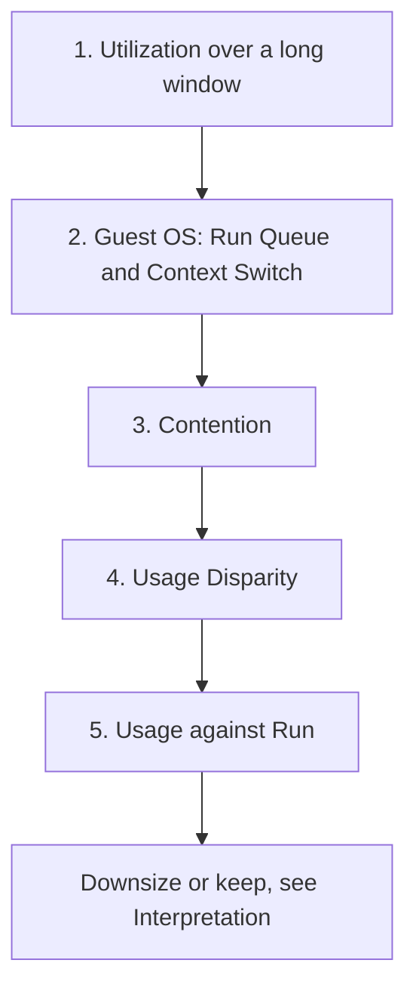

# Downsizing a large, idle VM

## Question
- Should this large VM give back vCPUs, and what evidence convinces its owner?
- The answer is downsize or keep, with the vCPU usage pattern that proves it.
- An operational question, answered by a decision tree; not a health check. The VM health check reads it in its efficiency step ([`vsphere/object-types/vm/vm-health-check`](../../../object-types/vm/vm-health-check.md)).



## Checks, in order
1. Utilization over a long window (example: 90 days): Usage (%), Demand, Idle (%). → step 2.
2. Guest OS: CPU Run Queue and Context Switch. → step 3.
3. Contention: Co-stop, Ready, Other Wait, Swap Wait. → step 4.
4. Usage Disparity: Peak among vCPUs, Max - Min. → step 5.
5. Compare Usage with Run: Usage above 90% with Run below 90% is likely Turbo, not demand.

## Interpretation
- Example: 104-vCPU VM, Usage (%) never above 40% in 90 days, Demand marginally higher, Idle about 20%.
- Guest Run Queue low. A downsize can raise the queue, by an amount the vCPU count alone does not predict (Ready, Co-stop and NUMA move with it): verify after the change ([`guest-os/cpu/metrics/run-queue`](../../../../guest-os/cpu/metrics/run-queue.md), section After a change of the vCPU count).
- Context Switch high at times.
- Co-stop max 0.006%, Ready max 0.14%. Downsizing may not lower them, and they are irrelevant here.
- Refund and performance arguments do not work. The remaining argument: how the vCPUs are used (Usage Disparity).
- All vCPUs balanced and low: the application cannot use even one vCPU. Questions the vendor's sizing and license cost.
- Imbalanced: some vCPUs saturated. Shows real demand on few vCPUs.

## Misconceptions
- "Low utilization alone convinces the owner" → owners who paid do not care. Show vCPU usage disparity.
- "Usage above 90%, so upsize" → Turbo inflates Usage. Check Run.

## Metadata
```yaml
id: vsphere/technology/cpu/decision-tree/oversized-vm-downsizing
retriever_guide: decision-tree
scope: vsphere
technology:
- cpu
pillar:
- capacity
- value
- performance
product:
- vsphere
- vcf-operations
object:
- VirtualMachine
internal_derive:
- vsphere/technology/cpu/metrics/virtual-motherboard/usage-disparity
- vsphere/technology/cpu/metrics/virtual-motherboard/usage
related:
- vsphere/technology/cpu/metrics/virtual-motherboard/run
- vsphere/technology/cpu/concepts/idle-and-unused-vcpus
source:
  document: Knowledge base
  path: CPU > VM > Consumption Metrics > CPU Usage Disparity; Usage vs Net Run > Overall
corrections: []
review_notes: []
status: draft
```
