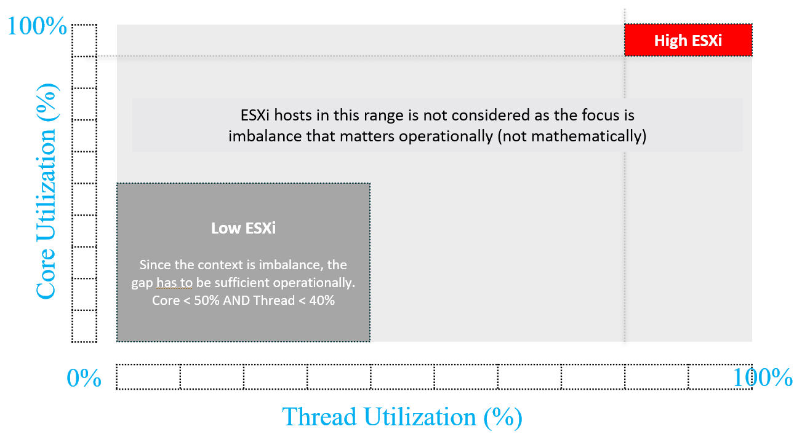
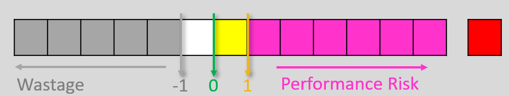
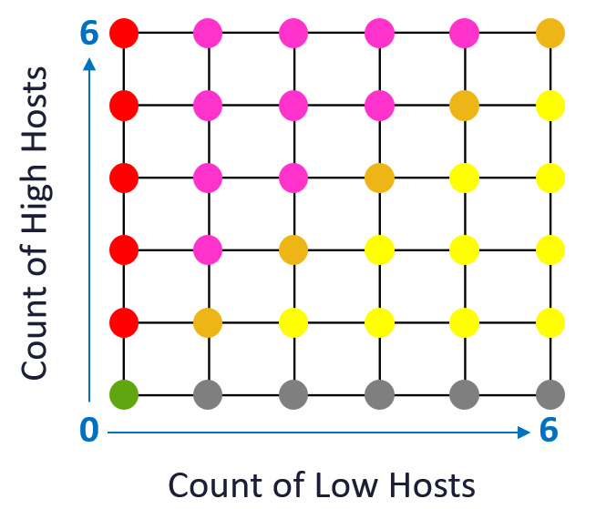
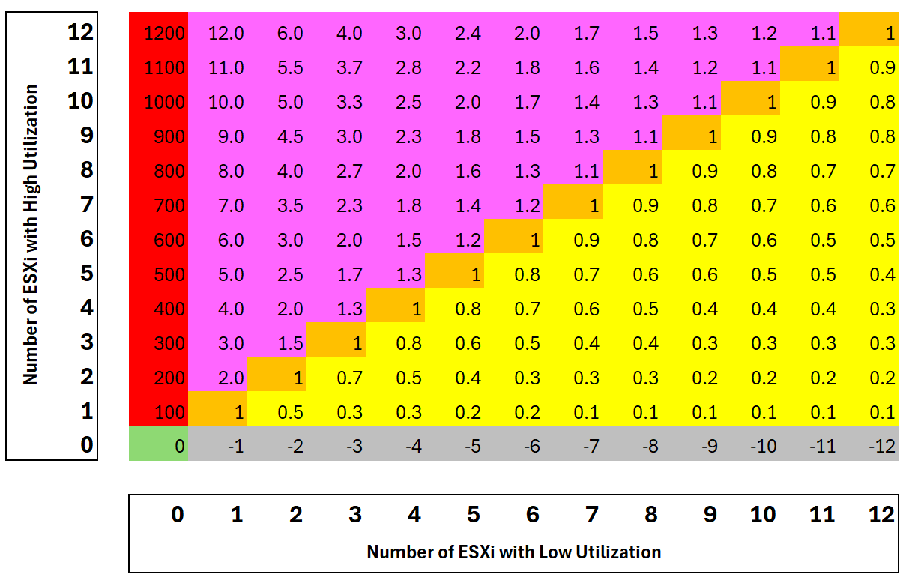

# Cluster Inter-Host Imbalance

## Definitions
- High host: Core Utilization > 90% AND Thread Utilization > 80%.
- Low host: Core Utilization < 50% AND Thread Utilization < 40%.
- 90% for core, not 100%: sustained 100% for 300 s is too late, and NUMA keeps some cores busy while others idle.
- 80% for thread, not lower: lower would include hosts that still have many idle threads.
- Focus is imbalance at high utilization. Imbalance at low utilization is not operationally important.


## Formula
```text
Imbalance = High hosts / Low hosts
```
- Relative, so clusters of different sizes compare.

## Values
| Colour | Meaning | Value |
|---|---|---|
| Red (worst) | 1 or more high hosts, no low host to move VMs to. Moving VMs to another cluster may be required. | 100, 200, 300, ... (raised to avoid overlap with pink) |
| Pink (bad) | More high hosts than low hosts. Maybe not enough capacity to balance. | Between 1 and 63 (decimal) |
| Orange (bad) | High hosts = low hosts. | 1 |
| Yellow (warning) | Fewer high hosts than low hosts. | Between 0 and 1 |
| Green (good) | Utilized and balanced. | 0 |
| Grey (waste) | Low hosts, no high host. Underutilized. | -1, -2, ... (whole numbers) |

- Pink can reach 95: maximum 96 hosts per cluster minus 1 low host.
- The colour ranges do not overlap, so a value maps to one colour. Below 0 is wastage; above 1 is performance risk.



## Limitation
- Summarizing loses detail: 1 high over 2 low and 4 high over 8 low both give 0.5.
- Concatenation (1.2, 4.8) keeps the detail but makes sorting less meaningful.
- A 12-host cluster has 169 possible values.


## Misconceptions
- "Imbalance 0 means every host is idle" → 0 also means no high hosts while some hosts are well used.

## Metadata
```yaml
id: vsphere/technology/cpu/metrics/cluster/inter-host-imbalance
retriever_guide: metric-meaning
scope: vsphere
technology:
- cpu
pillar:
- performance
- capacity
product:
- vcf-operations
object:
- ClusterComputeResource
metric_class: context
internal_derive:
- vsphere/technology/cpu/metrics/host/core-utilization
- vsphere/technology/cpu/metrics/host/utilization
same_name: []
same_meaning: []
related:
- vsphere/technology/cpu/metrics/host/imbalance
- vsphere/object-types/cluster/concepts/cluster-operations
images:
  - path: ../../images/cluster-cpu-imbalance-count-of-high-vs-low-utilization-hosts.png
    product: [vcf-operations]
    object: [ClusterComputeResource]
    metric: ['Cluster CPU Inter-Host Imbalance']
    image_type: diagram
  - path: ../../images/cluster-cpu-imbalance-score-ranges-wastage-vs-performance-risk.png
    product: [vcf-operations]
    object: [ClusterComputeResource]
    metric: ['Cluster CPU Inter-Host Imbalance']
    image_type: diagram
  - path: ../../images/cluster-cpu-imbalance-score-colors-for-6-host-cluster.png
    product: [vcf-operations]
    object: [ClusterComputeResource]
    metric: ['Cluster CPU Inter-Host Imbalance']
    image_type: table
    sample: '6 hosts'
  - path: ../../images/cluster-cpu-imbalance-score-table-by-count-of-high-and-low-hosts.png
    product: [vcf-operations]
    object: [ClusterComputeResource]
    metric: ['Cluster CPU Inter-Host Imbalance']
    image_type: table
    sample: '12 hosts'
source:
  document: Private Cloud Management by Iwan Rahabok (https://isvara.io/download)
  path: Provider Objects > Overview > Inter-Host Imbalance
corrections: []
review_notes:
- 'To check: Section ''Definitions'': whether Inter-Host Imbalance is a built-in VCF Operations metric or a super metric; the source document does not say.'
status: draft
```
